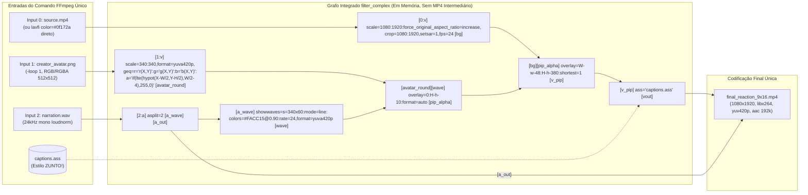

# Phase 8: Relatório Técnico de Auditoria, Contratos e Diagnóstico de Causa Raiz

**Data da Auditoria:** 2026-11-06  
**Milestone:** v1.1 — ZUNTO! Visual Engine  
**Fase:** 08 — Auditoria, Contratos e Diagnóstico de Causa Raiz  
**Requisitos Cobertos:** `COMP-01`, `SUB-01`, `AVTR-01`  
**Natureza da Fase:** 100% Diagnóstica e Analítica (D-15 — Zero modificações em `src/viralpanel/` e `assets/`)

---

## Sumário Executivo

Esta auditoria técnica investigou, por meio de análise estática de código-fonte, inspeção dinâmica de assinaturas em runtime (`inspect.signature`), varredura de metadados via `ffprobe`/`file` e inspeção de frames dos vídeos reais gerados em `storage/runs/`, as causas raiz das falhas visuais do pipeline audiovisual do **ViralPanel** e mapeou todos os contratos de integração para blindar a evolução do **Milestone v1.1 — ZUNTO! Visual Engine**.

### Principais Vereditos e Conclusões Comprovadas:

1. **Fronteira Pública e Contratos (`COMP-01` / D-01 a D-03):**
   - A assinatura `StudioService.produce(self, db: Session, run_id: str, script: Script) -> Asset` e a criação dos 3 registros `Asset` (`audio`, `avatar`, `final_video`) na sessão SQLAlchemy constituem um contrato imutável com `src/viralpanel/tasks.py` (`_run_pipeline`).
   - Internamente, o tráfego de 5 `Path`s soltos e a ausência de um objeto de contexto causam **3 leituras `ffprobe` redundantes** sobre `narration.wav`, **2 verificações `ffprobe` redundantes** sobre `source.mp4` e descompasso dimensional entre `avatar.py` (`360x360`) e `renderer.py` (`340x340` + `pad` `352x352`). A introdução dos DTOs internos tipados (`StudioRenderRequest`, `AvatarConfig`, `SubtitleJobConfig`, `SubtitleCue`, `ReactionCompositionSpec`) isola a complexidade sem tocar em `tasks.py`.

2. **Causa Raiz das Legendas Duplicadas (`SUB-01` / D-04 a D-07):**
   - **Descartada duplicação interna no FFmpeg:** `ReactionVideoRenderer.render` (`renderer.py:130`) executa **uma única** chamada do filtro `ass`, os eventos `Dialogue:` em `captions.ass` são estritamente disjuntos `[start, end)` e os vídeos `source.mp4` não possuem streams soft-sub (`nb_streams: 2`).
   - **Confirmada causa primária em vídeos reais (`storage/runs/14f4a7a1-...` e `ca28df90-...`):** Os vídeos virais baixados do TikTok (`source.mp4`) já possuem **hard-subs queimadas nos pixels** na região central-inferior (`Y ≈ 1080px–1150px`, ex.: `"tu tá"` e `"a si mesmo"`). Como o ViralPanel queima a nova legenda ASS logo abaixo (`MarginV=480`, `Y ≈ 1310px–1440px`) com contorno simples (`BorderStyle=1`, sem caixa opaca), **ambas as legendas ficam visíveis simultaneamente**.
   - **Confirmada causa secundária em `subtitles.py`:** Fatiamento léxico cego a cada 6 palavras (deixando conjunções/artigos órfãos como `"Se"`, `"o"`) e divisão linear uniforme do tempo (`duration / len(chunks)`), gerando dessincronia progressiva com a fala sintetizada.

3. **Causa Raiz da "Caixa Quadrada" do Avatar Reaction (`AVTR-01` / D-08 a D-11):**
   - A auditoria empírica comprovou que o defeito **não possui uma causa única isolada**, mas resulta da **atuação simultânea de 4 cenários técnicos independentes**:
     1. **Cenário 1 (Asset Fonte Opaco):** `assets/creator_avatar.png` é `512x512` no formato `rgb24` (sem canal alfa), gerado por `ensure_default_avatar_image()` (`avatar.py:22-46`) com fundo sólido `#0f172b` e 4 retângulos `drawbox` concêntricos.
     2. **Cenário 2 (Destruição de Alfa no Filtro do Avatar):** `AudioReactiveAvatarAnimator` (`avatar.py:96,120`) força `format=yuv420p[base_avatar]`, destruindo qualquer canal alfa em memória antes do `overlay` com `showwaves` (e causando distorção cromática que deixa a onda sonora verde no `avatar.mp4` real!).
     3. **Cenário 3 (Moldura Branca Hardcoded no Renderer):** `ReactionVideoRenderer` (`renderer.py:128`) aplica `pad=352:352:6:6:color=white[pip]`, desenhando uma borda retangular branca sólida de 6px (`#FFFFFF`) ao redor do quadrado de `340x340`.
     4. **Cenário 4 (Barreira de Container/Codec Intermediário):** O arquivo intermediário `avatar.mp4` usa `libx264` + `yuv420p`, que **não suporta canal alfa** (plano A). Mesmo corrigindo os Cenários 1, 2 e 3, enquanto existir um `avatar.mp4` (`libx264/yuv420p`) entre `avatar.py` e `renderer.py`, os cantos transparentes serão convertidos em preto sólido opaco.

4. **Unificação Single-Pass FFmpeg (`COMP-01` / D-12 a D-14):**
   - A unificação do pipeline em **um único comando FFmpeg (`filter_complex` single-pass)** — lendo o vídeo fonte (ou `lavfi` direto), o avatar em canal alfa (`rgba`/`yuva420p` com recorte circular orgânico e `showwaves` via `asplit`) e o arquivo `captions.ass` ZUNTO! — resolve simultaneamente o **Cenário 4 de transparência do avatar**, elimina **2 codificações H.264 intermediárias** (`source_visual_bg.mp4` e `avatar.mp4`) e padroniza a saída em `1080x1920` @ `24fps`.

---

## 1. Mapeamento de Contratos e Interfaces Atuais

Esta seção documenta a auditoria estática e dinâmica das fronteiras de integração entre a fila assíncrona Celery (`src/viralpanel/tasks.py`), o orquestrador de mídia (`src/viralpanel/studio/service.py`), o gerenciador de armazenamento (`src/viralpanel/storage.py`) e os motores especializados de voz (`voice.py`), avatar (`avatar.py`), legendas (`subtitles.py`) e renderização (`renderer.py`).

### 1.1 Contrato Público Obrigatório (`tasks.py` ↔ `StudioService.produce`)

Conforme a decisão arquitetural bloqueada **D-01**, a assinatura pública de `StudioService.produce` constitui uma fronteira imutável (*one-way door*) com a task Celery `trigger_daily_pipeline` e a função interna `_run_pipeline`.

- **Assinatura Inspecionada (Runtime & AST):**
  ```python
  # src/viralpanel/studio/service.py (linhas 67-122)
  def produce(self, db: Session, run_id: str, script: Script) -> Asset:
  ```
  *(Nota de tipagem: Em `src/viralpanel/models.py`, `PipelineRun.id` é definido como `Mapped[str] = mapped_column(String(36), primary_key=True, default=_uuid)`, representando um UUID v4 serializado como `str`. Os DTOs internos propostos aceitam `str | uuid.UUID` mantendo `str` na fronteira do SQLAlchemy/Celery).*

- **Ponto de Chamada no Worker Celery (`src/viralpanel/tasks.py`, linhas 171-185):**
  ```python
  run.stage = "production"
  db.commit()
  final_asset = studio_service.produce(db=db, run_id=run.id, script=script)
  summary.update(
      final_asset_id=final_asset.id,
      final_video_path=final_asset.file_path,
      final_video_duration=final_asset.duration_seconds,
  )
  ```

- **Invariantes Pós-Condição Exigidos por `_run_pipeline` e `SupervisionService`:**
  1. **Valor de retorno:** Instância persistida e atualizada (`db.refresh`) de `viralpanel.models.Asset` com `asset_type == "final_video"`.
  2. **Atributos obrigatórios no `Asset` retornado:**
     - `id: str` (UUID v4 gerado e persistido no PostgreSQL/SQLite).
     - `script_id: str` (FK apontando para `script.id`).
     - `file_path: str` (caminho absoluto/resolvido no filesystem local para `final_reaction_9x16.mp4` existente e não vazio).
     - `duration_seconds: float` (duração real em segundos extraída via `probe_duration`).
  3. **Efeitos colaterais de persistência esperados na sessão `db`:**
     - Criação e persistência de 3 registros na tabela `assets` vinculados a `script.id`:
       - `asset_type="audio"` (`narration.wav`)
       - `asset_type="avatar"` (`avatar.mp4` — *nota: nas Phases 11/12, caso o vídeo intermediário seja eliminado no single-pass, o registro ou referência de asset deve preservar a compatibilidade relacional ou apontar para o recurso de avatar utilizado sem quebrar consultas do dashboard*).
       - `asset_type="final_video"` (`final_reaction_9x16.mp4`)
     - Atualização de estado: `script.source_video.status = "produced"` (quando `script.source_video is not None`) seguida de `db.commit()`.

---

### 1.2 Matriz Exaustiva de Contratos e Fronteiras Internas

A tabela abaixo mapeia todas as assinaturas inspecionadas dinamicamente via `inspect.signature` e análise de código-fonte:

| Componente / Módulo | Método / Função | Parâmetros de Entrada (Tipos Atuais) | Retorno (Tipo Atual) | Efeitos de I/O & Estado | Problemas de Acoplamento Identificados |
|---------------------|-----------------|--------------------------------------|----------------------|-------------------------|----------------------------------------|
| `tasks.py` | `build_default_services(mock: bool \| None = None)` | `mock: bool \| None` | `tuple[DiscoveryService, ScriptingService, StudioService, SupervisionService, PublishingService]` | Lê `get_settings()`; instancia dependências concretas | Acoplamento direto às classes concretas sem configuração granular de estilo/layout. |
| `studio/service.py` | `StudioService.__init__(...)` | `voice_synthesizer: BaseVoiceSynthesizer`, `avatar_animator: BaseAvatarAnimator`, `renderer: ReactionVideoRenderer \| None = None`, `storage: StorageManager \| None = None` | `None` | Inicializa `ReactionVideoRenderer()` e `StorageManager()` padrão se omitidos | Aceita injeção limpa, permitindo evolução interna sem afetar `tasks.py`. |
| `studio/service.py` | `StudioService.produce(db, run_id, script)` | `db: Session`, `run_id: str`, `script: Script` | `Asset` (`final_video`) | Cria diretório via `storage.get_run_dir(run_id)`; grava `narration.wav`, `avatar.mp4`, `captions.ass`, `final_reaction_9x16.mp4`; faz `db.commit()` | Hardcode de nomes de arquivos (`narration.wav`, `avatar.mp4`, `captions.ass`) e orquestração sequencial acoplada a tipos primitivos. |
| `studio/service.py` | `StudioService._ensure_source_video(run_id, duration=2.0)` | `run_id: str`, `duration: float = 2.0` | `Path` (`.../runs/source/source.mp4`) | Acessa `self.storage._safe(self.storage.get_run_dir(run_id).parent / "source")`; invoca `ffmpeg` se ausente | **Bug estrutural latente de path:** `get_run_dir(run_id)` retorna `runs/<run_id>/assets`. Logo, `.parent` é `runs/<run_id>`, gravando em `runs/<run_id>/source/source.mp4`, que coincide com `MediaDownloader` (`runs/<run_id>/source/source.mp4`), mas viola encapsulamento ao chamar método privado `storage._safe(...)`. |
| `storage.py` | `StorageManager.get_run_dir(run_id)` | `run_id: str` | `Path` (`<base_dir>/runs/<run_id>/assets`) | Executa `mkdir(parents=True, exist_ok=True)` imediatamente | Não fornece método público para o subdiretório `source` (forçando callers a usar `_safe` diretamente). |
| `studio/voice.py` | `BaseVoiceSynthesizer.synthesize(text, output_path, speaker_wav=None)` | `text: str`, `output_path: Path`, `speaker_wav: Path \| None = None` | `tuple[Path, float]` | Sintetiza WAV em disco (`24000 Hz`, mono) e mede duração via `probe_duration` | Retorna apenas duração escalar total (`float`), sem timestamps por palavra para sincronia fina de legendas. |
| `studio/avatar.py` | `BaseAvatarAnimator.generate_avatar_video(audio_path, output_path, avatar_image_path=None)` | `audio_path: Path`, `output_path: Path`, `avatar_image_path: Path \| None = None` | `tuple[Path, float]` | Lê `assets/creator_avatar.png` (ou cria fallback via FFmpeg) e gera `avatar.mp4` (`360x360`, `yuv420p`) | Gera vídeo MP4 intermediário opaco (`yuv420p`) com dimensão `360x360`, divergindo de `renderer.avatar_size = 340` (forçando re-escala). |
| `studio/subtitles.py` | `build_cues_from_script(script_text, total_duration, max_words_per_cue=6)` | `script_text: str`, `total_duration: float`, `max_words_per_cue: int = 6` | `list[SubtitleCue]` | Processamento puro em memória (divisão uniforme de chunks pelo tempo total) | Divisão temporal puramente linear (`duration / len(chunks)`), ignorando cadência real da fala, pausas e comprimento fonético das palavras. |
| `studio/subtitles.py` | `write_ass_subtitles(cues, output_path)` | `cues: list[SubtitleCue]`, `output_path: Path` | `Path` | Escreve arquivo `.ass` UTF-8 com `ASS_HEADER` hardcoded | Cabeçalho ASS (`DejaVu Sans,62`, `MarginV=480`) é constante global imutável, impedindo customização de estilo ZUNTO! ou posicionamento dinâmico por safe zone. |
| `studio/renderer.py` | `ReactionVideoRenderer.render(source_video_path, avatar_video_path, voice_audio_path, ass_subtitle_path, output_path)` | 5 argumentos `Path` posicionais/nomeados | `tuple[Path, float]` | Verifica `has_video_stream`; cria `source_visual_bg.mp4` se necessário; executa `ffmpeg` final | Recebe 5 `Path`s soltos sem metadados de layout, safe zones, transparência de avatar ou diretrizes de composição. |

---

### 1.3 Acoplamento Temporal, Espacial e de Diretórios

1. **Acoplamento Temporal Estrito:**
   - `StudioService.produce` depende da execução sequencial:
     1. `voice_synthesizer.synthesize` precisa terminar primeiro porque `voice_duration: float` é a única fonte de verdade temporal para todas as etapas seguintes.
     2. `build_cues_from_script(script_text, total_duration=voice_duration)` usa `voice_duration` para fatiar os tempos `start`/`end` de cada `SubtitleCue`.
     3. `_ensure_source_video(run_id, duration=max(voice_duration, 2.0))` usa `voice_duration` caso precise sintetizar um vídeo fonte de fallback.
     4. `renderer.render(...)` recalcula `duration = max(probe_duration(voice_audio_path), 1.5)` invocando `ffprobe` novamente sobre `narration.wav`, demonstrando redundância de I/O por falta de um DTO de contexto compartilhado.
2. **Descompasso Dimensional entre `avatar.py` e `renderer.py`:**
   - `AudioReactiveAvatarAnimator` inicializa com `width: int = 360, height: int = 360`.
   - `ReactionVideoRenderer` inicializa com `avatar_size: int = 340` e, no `filter_complex`, reescala o vídeo de 360x360 para 340x340 e depois aplica `pad=352:352:6:6:color=white`.
3. **Acoplamento de Caminhos no `StorageManager`:**
   - O `MediaDownloader` (em `scripting/service.py` -> `media/downloader.py`) salva o vídeo baixado do TikTok em `runs/<run_id>/source/source.mp4`.
   - O `StudioService` acessa esse mesmo arquivo construindo manualmente `self.storage.get_run_dir(run_id).parent / "source" / "source.mp4"`. Não há contrato explícito passando o caminho do vídeo baixado entre `ScriptingService` e `StudioService`.

---

### 1.4 Diagrama Sequencial de Chamadas e Fluxo de Dados (Estado Atual)

```mermaid
sequenceDiagram
    autonumber
    participant Celery as tasks.py (_run_pipeline)
    participant DB as SQLAlchemy Session (db)
    participant Studio as StudioService.produce()
    participant Storage as StorageManager
    participant Voice as BaseVoiceSynthesizer
    participant Avatar as BaseAvatarAnimator
    participant Subs as subtitles.py
    participant Renderer as ReactionVideoRenderer
    participant FFmpeg as FFmpeg / FFprobe CLI

    Celery->>DB: run.stage = "production"; db.commit()
    Celery->>Studio: produce(db=db, run_id=run.id, script=script)
    Studio->>Storage: get_run_dir(run_id)
    Storage-->>Studio: Path(".../runs/{run_id}/assets")

    Note over Studio,Voice: Etapa 1: Síntese de Voz
    Studio->>Voice: synthesize(script_text, Path("narration.wav"))
    Voice->>FFmpeg: subprocess (TTS / loudnorm / probe_duration)
    FFmpeg-->>Voice: narration.wav (24kHz mono) + voice_duration (float)
    Voice-->>Studio: (voice_path, voice_duration)
    Studio->>DB: db.add(Asset(asset_type="audio"))

    Note over Studio,Avatar: Etapa 2: Animação de Avatar (Passe FFmpeg Intermediário)
    Studio->>Avatar: generate_avatar_video(voice_path, Path("avatar.mp4"))
    Avatar->>FFmpeg: probe_duration(voice_path)
    Avatar->>FFmpeg: ffmpeg -loop 1 -i creator_avatar.png -i narration.wav -> avatar.mp4 (360x360, yuv420p)
    FFmpeg-->>Avatar: avatar.mp4 + avatar_duration
    Avatar-->>Studio: (avatar_path, avatar_duration)
    Studio->>DB: db.add(Asset(asset_type="avatar"))

    Note over Studio,Subs: Etapa 3: Geração de Legendas ASS
    Studio->>Subs: build_cues_from_script(script_text, total_duration=voice_duration)
    Subs-->>Studio: list[SubtitleCue]
    Studio->>Subs: write_ass_subtitles(cues, Path("captions.ass"))
    Subs-->>Studio: subtitles_path (captions.ass)

    Note over Studio,Renderer: Etapa 4: Verificação de Source e Composição Final
    Studio->>Studio: _ensure_source_video(run_id, duration=max(voice_duration, 2.0))
    Studio->>FFmpeg: has_video_stream(source.mp4) [via ffprobe]
    Studio->>Renderer: render(source_video_path, avatar_path, voice_path, subtitles_path, output_path)
    Renderer->>FFmpeg: probe_duration(voice_audio_path)
    Renderer->>FFmpeg: has_video_stream(source_video_path)
    opt Sem stream de vídeo no source
        Renderer->>FFmpeg: Passe Fallback: lavfi color=#0f172a -> source_visual_bg.mp4
    end
    Renderer->>FFmpeg: Passe Final: scale/crop bg + scale/pad(white) avatar + overlay + ass -> final_reaction_9x16.mp4
    Renderer->>FFmpeg: probe_duration(final_reaction_9x16.mp4)
    Renderer-->>Studio: (final_video_path, final_duration)

    Studio->>DB: db.add(Asset(asset_type="final_video"))
    Studio->>DB: script.source_video.status = "produced"; db.commit(); db.refresh(final_asset)
    Studio-->>Celery: final_asset (Asset)
```

---

### 1.5 Especificação Conceitual de DTOs Tipados Internos (D-02 e D-03)

Para eliminar o tráfego de parâmetros primitivos descontextualizados (`Path`, `str`, `int`, `float`) e desacoplar responsabilidades nas Phases 10, 11 e 12 — **sem alterar a assinatura pública `StudioService.produce(db, run_id, script) -> Asset` (D-01)** e **sem introduzir injeção abstrata excessiva (D-03)** — especifica-se o conjunto enxuto de DTOs internos (baseados em `pydantic.BaseModel` / `dataclasses`):

```python
from dataclasses import dataclass, field
from pathlib import Path
from typing import Literal
import uuid
from pydantic import BaseModel, Field


class SubtitleCue(BaseModel):
    """Unidade temporal de legenda (compatível com o modelo atual em subtitles.py,
    estendido opcionalmente para suportar destaque de palavra ativa na Phase 10)."""
    start: float = Field(..., ge=0.0, description="Início do cue em segundos")
    end: float = Field(..., gt=0.0, description="Fim do cue em segundos")
    text: str = Field(..., min_length=1, description="Texto visível do bloco")
    highlight_word: str | None = Field(default=None, description="Palavra de impacto para destaque amarelo ZUNTO!")


@dataclass(frozen=True)
class SubtitleJobConfig:
    """Configuração de geração e estilização do arquivo ASS (Phase 10)."""
    script_text: str
    total_duration: float
    output_path: Path
    brand_style: Literal["ZUNTO", "DEFAULT"] = "ZUNTO"
    max_words_per_cue: int = 4
    play_res_x: int = 1080
    play_res_y: int = 1920
    margin_v: int = 520  # Safe zone vertical calibrada acima da UI do TikTok/Reels/Shorts


@dataclass(frozen=True)
class AvatarConfig:
    """Especificação de dimensão, recorte orgânico e posicionamento do avatar (Phase 11).
    Também referenciado como AvatarJobConfig."""
    avatar_image_path: Path
    size: int = 340
    crop_mode: Literal["circle_alpha", "rounded_rect", "native_rgba"] = "circle_alpha"
    border_color: str = "#FACC15"  # Amarelo de impacto ZUNTO! (ou sem borda quadrada branca)
    border_width: int = 4
    overlay_x_expr: str = "W-w-48"
    overlay_y_expr: str = "H-h-380"  # Posicionado em safe zone sem colidir com legendas ou UI
    enable_waveform: bool = True
    waveform_color: str = "#FACC15@0.90"


@dataclass(frozen=True)
class ReactionCompositionSpec:
    """Especificação das camadas e parâmetros técnicos do grafo FFmpeg single-pass (Phase 12)."""
    target_width: int = 1080
    target_height: int = 1920
    fps: int = 24
    video_codec: str = "libx264"
    preset: str = "veryfast"
    pix_fmt: str = "yuv420p"
    audio_codec: str = "aac"
    audio_bitrate: str = "192k"
    single_pass: bool = True


@dataclass(frozen=True)
class StudioRenderRequest:
    """DTO agregador que encapsula todos os insumos de uma requisição de renderização
    interna entre StudioService e ReactionVideoRenderer (equivalente a RenderJobContext)."""
    run_id: str | uuid.UUID
    source_video_path: Path
    voice_audio_path: Path
    voice_duration: float
    ass_subtitle_path: Path
    output_path: Path
    avatar: AvatarConfig
    composition: ReactionCompositionSpec = field(default_factory=ReactionCompositionSpec)
```

#### Como os DTOs Isolam a Complexidade sem Quebrar o Celery:
1. **`tasks.py` permanece 100% intocado:** Continua chamando `studio_service.produce(db=db, run_id=run.id, script=script)` e recebendo `Asset`.
2. **Eliminação de chamadas duplicadas ao `ffprobe`:** `voice_duration` é calculado uma única vez na síntese de voz e propagado dentro de `StudioRenderRequest` e `SubtitleJobConfig`.
3. **Prontidão para o Single-Pass (Phase 12):** Como `StudioRenderRequest` carrega `AvatarConfig` (apontando diretamente para `avatar_image_path` e parâmetros de `crop_mode` e `waveform`), o `ReactionVideoRenderer` pode compor o avatar estático/reativo diretamente no `filter_complex` principal sem depender obrigatoriamente de um arquivo `avatar.mp4` pré-renderizado em `yuv420p`.

---

## 2. Diagnóstico de Causa Raiz de Legendas Duplicadas (SUB-01)

Esta seção apresenta o diagnóstico técnico e empírico sobre o problema de duplicação/conflito visual de legendas nos vídeos finais (`final_reaction_9x16.mp4`), cumprindo as diretrizes **D-04, D-05, D-06 e D-07** e o requisito **SUB-01**. A investigação combinou auditoria estática de código (`subtitles.py`, `renderer.py`, `service.py`, `scripting/service.py`) com inspeção empírica dos arquivos reais gerados em `storage/runs/`.

---

### 2.1 Auditoria das Duas Hipóteses de Risco (D-04 e D-05)

A diretriz **D-04** exige auditar duas fontes potenciais de duplicação:
1. **Hipótese A (Interna ao Pipeline FFmpeg):** Aplicação duplicada do filtro `ass`/`subtitles` no comando FFmpeg, repetição de eventos `Dialogue:` no arquivo `.ass`, ou presença de stream de legenda (`codec_type=subtitle`) embutida no container MP4 de entrada que estaria sendo renderizada duas vezes.
2. **Hipótese B (Externa / Conteúdo do Vídeo Fonte):** Vídeos virais baixados do TikTok (`source.mp4`) que já possuem legendas queimadas diretamente nos pixels da imagem original (*burned-in hard-subs*), sobre as quais o ViralPanel renderiza uma segunda camada de legendas ASS gerada a partir do roteiro original do Gemini.

#### Veredito Baseado em Evidências (D-05):

| Hipótese / Vetor Analisado | Status | Evidência Técnica Reproduzível |
|----------------------------|--------|--------------------------------|
| **A1. Dupla chamada do filtro `ass` em `renderer.py`** | **DESCARTADA (Falso)** | Em `src/viralpanel/studio/renderer.py` (linhas 124–131), o `filter_complex` possui **exatamente uma única** invocação do filtro `ass`: `[composed]ass='{escaped_ass}'[vout]`. Nenhum outro passe FFmpeg (`service.py` ou `avatar.py`) recebe `captions.ass`. |
| **A2. Linhas `Dialogue:` duplicadas ou sobrepostas em `captions.ass`** | **DESCARTADA (Falso)** | A inspeção de `write_ass_subtitles` (`src/viralpanel/studio/subtitles.py`, linhas 60–69) e dos arquivos reais `storage/runs/14f4a7a1-.../assets/captions.ass` (20 cues) e `storage/runs/ca28df90-.../assets/captions.ass` (18 cues) comprova intervalos estritamente contíguos e disjuntos `[start, end)` na `Layer: 0` (ex.: `0:00:00.00 -> 0:00:02.03`, `0:00:02.03 -> 0:00:04.05`). No renderizador `libass`, o timestamp final é exclusivo, garantindo que nunca haja dois eventos `Dialogue:` ativos no mesmo frame. |
| **A3. Stream de legenda soft-sub (`mov_text`/`srt`) em `source.mp4`** | **DESCARTADA (Falso)** | A inspeção via `ffprobe -show_streams` nos vídeos reais baixados (`storage/runs/14f4a7a1-.../source/source.mp4` e `storage/runs/ca28df90-.../source/source.mp4`) comprova `nb_streams: 2` (apenas `stream #0: audio/aac` e `stream #1: video/hevc` ou `video/h264`). Não existem faixas de legenda embutidas no container. |
| **B1. Hard-subs preexistentes queimados nos pixels de `source.mp4` colidindo com a legenda ASS do ViralPanel** | **CONFIRMADA (Causa Raiz Primária)** | Nos dois runs reais armazenados em `storage/runs/`, os vídeos baixados do TikTok contêm legendas originais queimadas diretamente nos frames de vídeo (`"tu tá"` no run `14f4a7a1` e `"a si mesmo"` no run `ca28df90`). Como o vídeo fala um texto e o roteiro gerado pelo Gemini (`script.script_text`) narra um texto transformado diferente, o vídeo final exibe **duas legendas diferentes simultaneamente na tela**. |
| **B2. Descompasso temporal/semântico por divisão linear de cues e posição vertical fixa (`MarginV=480`)** | **CONFIRMADA (Causa Secundária Agravante)** | `build_cues_from_script` (`subtitles.py:39-57`) divide o texto cegamente a cada 6 palavras e distribui o tempo de forma linear uniforme (`step = duration / len(chunks)`), gerando quebras gramaticais truncadas e dessincronia com a fala real, enquanto `MarginV=480` posiciona o texto exatamente entre a legenda nativa do vídeo fonte e o topo do avatar. |

---

### 2.2 Evidências Empíricas nos Vídeos Reais (`storage/runs/`)

A inspeção direta dos artefatos de produção existentes em `storage/runs/` confirma materialmente a Causa Raiz Primária (**B1**):

1. **Run Real #1 (`storage/runs/14f4a7a1-16af-4e6e-9bf0-3386760bd1da`):**
   - **Vídeo fonte (`source/source.mp4`):** Baixado do TikTok em resolução `720x1280` (`hevc`, `yuv420p`, `30 fps`, duração `57.30s`). Na inspeção do frame em `t = 00:00:03.00`, o criador original aparece com a legenda nativa **`"tu tá"`** (fonte sans-serif branca com contorno escuro) queimada diretamente nos pixels da imagem na altura do peito (`Y ≈ 720px` no original `720x1280`, que corresponde a **`Y ≈ 1080px`** após o `scale=1080:1920`).
   - **Vídeo final renderizado (`assets/final_reaction_9x16.mp4`):** No mesmo instante `t = 00:00:03.00`, o filtro `ass` queima o cue `0:00:02.03 -> 0:00:04.05` (**`"a filosofia certa\nresolve isso. Se"`**) logo abaixo, na faixa **`Y ≈ 1310px a 1440px`** (`MarginV=480`).
   - **Efeito visual resultante:** O espectador vê simultaneamente `"tu tá"` (do vídeo original) e `"a filosofia certa / resolve isso. Se"` (do ViralPanel), configurando poluição e duplicação visual severa.

2. **Run Real #2 (`storage/runs/ca28df90-c754-4d67-a614-a9cbc049e960`):**
   - **Vídeo fonte (`source/source.mp4`):** Baixado do TikTok em resolução `576x1024` (`h264`, `yuv420p`, `30 fps`, duração `79.06s`), com moldura preta superior/inferior e vídeo centralizado. Em `t = 00:00:03.00`, há uma legenda nativa queimada **`"a si mesmo"`** (fonte serifada branca) sobre a camiseta preta do interlocutor (`Y ≈ 610px` no original `576x1024`, correspondendo a **`Y ≈ 1144px`** após `scale=1080:1920`).
   - **Vídeo final renderizado (`assets/final_reaction_9x16.mp4`):** No mesmo frame `t = 00:00:03.00`, o ViralPanel queima **`"seu sucesso. Você\ntenta mudar de"`** na faixa **`Y ≈ 1310px a 1440px`**. Novamente, ambas as legendas ficam visíveis ao mesmo tempo e próximas verticalmente (`~165px` de distância entre `"a si mesmo"` e `"seu sucesso. Você"`).

3. **Contraste com Vídeo Fonte Sintético (Fallback `lavfi`):**
   - Quando `source.mp4` é gerado pelo fallback (`color=c=#334155` ou `color=c=#0f172a`), apenas uma única legenda aparece na tela — prova definitiva de que o pipeline FFmpeg queima o arquivo `.ass` uma única vez e que a segunda legenda concorrente provém dos pixels do vídeo `source.mp4`.

---

### 2.3 Análise do Fluxo de Dados e Acoplamentos em `subtitles.py` e `renderer.py` (D-06)

O fluxo atual de geração e queima de legendas atravessa três módulos:

```text
ScriptingService.process()
  └─► Whisper transcreve audio.wav (com timestamps ignorados depois)
  └─► Gemini gera roteiro original (script.script_text: str)
        │
        ▼
StudioService.produce(db, run_id, script) [service.py:95-109]
  ├─► 1. subtitles.build_cues_from_script(script_text, total_duration=voice_duration)
  ├─► 2. subtitles.write_ass_subtitles(cues, assets_dir / "captions.ass")
  └─► 3. renderer.render(..., ass_subtitle_path=subtitles_path, ...)
           └─► [composed]ass='{escaped_ass}'[vout] [renderer.py:130]
```

#### Fragilidades Estruturais Identificadas em `src/viralpanel/studio/subtitles.py`:

1. **Particionamento Léxico Cego (`subtitles.py:40-46`):**
   ```python
   words = [w.strip() for w in script_text.replace("\n", " ").split() if w.strip()]
   for i in range(0, len(words), max_words_per_cue):
       chunks.append(" ".join(words[i : i + max_words_per_cue]))
   ```
   - O algoritmo fatia a lista de palavras em blocos fixos de `max_words_per_cue = 6`, ignorando pontuação (`.`, `,`, `?`, `!`) e fronteiras sintáticas.
   - **Evidência real (`storage/runs/14f4a7a1-.../assets/captions.ass`):**
     - Cue 2 (`0:00:02.03 -> 0:00:04.05`): `"a filosofia certa resolve isso. Se"` (a conjunção `"Se"` da frase seguinte fica pendurada no final do bloco anterior!).
     - Cue 5 (`0:00:08.11 -> 0:00:10.14`): `"suas reações. Se falta direção, o"` (o artigo `"o"` fica órfão antes de `"Existencialismo"` no Cue 6).

2. **Temporização Linear Uniforme Desacoplada da Cadência Fonética (`subtitles.py:48-56`):**
   ```python
   duration = max(total_duration, 1.0)
   step = duration / len(chunks)
   ```
   - Todos os blocos recebem exatamente a mesma duração `step` (ex.: `2.027s` no Run #1 e `2.112s` no Run #2), independentemente do número de sílabas/caracteres do bloco ou de pausas de pontuação (vírgulas e pontos finais na síntese Edge-TTS/XTTS).
   - O último bloco (frequentemente mais curto, ex.: `"se sabotar hoje."` com 3 palavras no Run #2) recebe os mesmos `2.11s` de um bloco de 6 palavras longas (`"mente primitiva trata qualquer evolução como"` com 44 caracteres), gerando atraso acumulado ao longo de vídeos de 40s.

3. **Estilo Visual e Posicionamento Hardcoded (`ASS_HEADER` em `subtitles.py:12-25`):**
   ```ini
   Style: Default,DejaVu Sans,62,&H00FFFFFF,&H0000FFFF,&H00111827,&H80000000,-1,0,0,0,100,100,0,0,1,4,2,2,80,80,480,1
   ```
   - `BorderStyle=1` (contorno simples de `Outline=4` e `Shadow=2`) com `BackColour=&H80000000`: no formato ASS com `BorderStyle=1`, o `BackColour` aplica-se apenas à sombra distante (`2px`), **não desenhando uma caixa opaca de fundo** capaz de cobrir ou isolar o texto contra legendas preexistentes do vídeo base.
   - `Alignment=2` (inferior central) com `MarginV=480`: posiciona a base do texto a `480px` da borda inferior (`Y = 1920 - 480 = 1440px`). Como o avatar PIP no `renderer.py:129` é posicionado em `Y = 1920 - 352 - 120 = 1448px`, a linha inferior da legenda (`Y = 1440px`) tangencia a borda superior do avatar (`Y = 1448px`), separada por apenas `8px`!
   - `clean_text = cue.text.replace("\n", "\\N").replace("{", "").replace("}", "")` (`subtitles.py:66`): remove chaves `{` e `}`, o que impede a injeção de tags de override ASS (`{\c&H0015CCFA&}`, `{\b1}`) necessárias na Phase 10 para destacar palavras-chave em amarelo ZUNTO! (`#FACC15` -> BGR `&H0015CCFA&`).

---

### 2.4 Avaliação de Estratégias Técnicas para Eliminar a Sobreposição Visual (D-07)

Para resolver definitivamente o conflito entre hard-subs preexistentes no vídeo fonte e as legendas ZUNTO! na Phase 10 e Phase 12, foram avaliadas 4 estratégias técnicas:

| Estratégia | Mecanismo Técnico | Eficácia contra Hard-Subs do TikTok | Custo Computacional / Risco | Recomendação para Phase 10 / 12 |
|------------|-------------------|-------------------------------------|-----------------------------|----------------------------------|
| **1. Tarja / Caixa Opaca ZUNTO! (`BorderStyle=3` no ASS ou `drawbox` no FFmpeg)** | Configurar o estilo ASS com `BorderStyle=3` (Opaque Box) e `BackColour=&H000A0A0A` (preto profundo ZUNTO! `#0A0A0A` opaco ou `&H1A0A0A0A` 90% opaco) + padding generoso (`Outline=16`), ou desenhar uma faixa/backdrop na zona de legenda. | **Alta (na região da legenda ZUNTO!)** — Oculta completamente qualquer texto nativo que esteja na mesma faixa vertical e garante contraste máximo (WCAG AAA) para branco (`#FFFFFF`) e amarelo (`#FACC15`). | **Custo Zero de CPU** — Nativo do `libass` em single-pass. Zero risco de borrar o rosto do criador principal. | **ADOTAR (Pilar 1 da Phase 10)** |
| **2. Alinhamento Posicional + Enquadramento/Mascaramento da Zona de Hard-Sub** | Como 90%+ dos vídeos virais do TikTok posicionam suas hard-subs no centro-inferior (`Y ≈ 1050px a 1350px` em `1080x1920`), posicionar a legenda ZUNTO! com caixa opaca (`BorderStyle=3`) exatamente nessa faixa focal (`MarginV=580..680`, `Y ≈ 1150..1300px`) **cobre diretamente a hard-sub original** do vídeo fonte! | **Muito Alta** — Em vez de colocar a legenda ZUNTO! abaixo da hard-sub original (o que expõe as duas simultaneamente, como ocorria com `MarginV=480`), a caixa opaca ZUNTO! se sobrepõe exatamente à zona onde a hard-sub do TikTok aparece (`Y ≈ 1080–1250px`), substituindo-a visualmente. | **Custo Zero de CPU** — Apenas calibração de `MarginV` / `Alignment` e `BorderStyle=3`, liberando a faixa inferior (`Y = 1350..1720px`) para o Avatar Reaction! | **ADOTAR (Pilar 2 da Phase 10 & 11)** |
| **3. Crop Assimétrico Superior / Zoom Focal do Vídeo Base (`crop` no FFmpeg)** | Ao converter o vídeo fonte para `1080x1920`, aplicar um leve zoom (`scale=1180:2100`) com `crop` deslocado para o topo (`y=0`), empurrando ou cortando legendas inferiores do vídeo original. | **Moderada** — Funciona quando a hard-sub original está na base extrema, mas não remove hard-subs cravadas no centro do peito do apresentador (como visto em `run1` e `run2`). | **Baixo custo**, mas pode cortar o queixo do apresentador se exagerado. Útil apenas como ajuste complementar leve. | **COMPLEMENTAR (Opcional na Phase 12)** |
| **4. Detecção por OCR / OpenCV + Blur (`delogo` / `boxblur`) por Frame** | Analisar frames do `source.mp4` com EasyOCR/Tesseract ou detector morfológico OpenCV para localizar bounding boxes de texto e aplicar `boxblur`. | **Variável / Arriscada** — Um `boxblur` grande no centro do vídeo cria uma mancha borrada esteticamente inferior a uma caixa editorial ZUNTO! limpa. | **Alto Custo de CPU/Dependências** — Exigiria instalar `opencv-python`/`easyocr` (violando restrição de leveza) e processaria centenas de frames. | **REJEITAR (Desnecessário dado `BorderStyle=3` + Zona de Cobertura)** |

#### Conclusão Arquitetural para Legendas (Phase 10):
1. **Unificação e Desacoplamento (`subtitles.py`):** Transformar `subtitles.py` em um motor dedicado de legendas ZUNTO! que recebe `SubtitleJobConfig`, quebra frases respeitando pontuação (`.`, `,`, `!`, `?`) e limite de caracteres por linha (`<= 28 chars`), pondera a duração de cada `SubtitleCue` pelo peso fonético/número de caracteres (ou word boundaries do TTS) e gera `.ass` com `BorderStyle=3` (caixa opaca preto profundo `#0A0A0A`), texto branco `#FFFFFF` e tag de destaque amarelo `#FACC15` (`{\c&H0015CCFA&}`).
2. **Eliminação Visual da Dupla Legenda:** Posicionar a legenda ZUNTO! com caixa opaca (`BorderStyle=3`) na zona central-inferior de leitura (`Y ≈ 1100–1280px`, `MarginV ≈ 640`), cobrindo de forma limpa a região típica das hard-subs dos vídeos baixados do TikTok e liberando o canto inferior direito (`Y = 1360–1700px`) exclusivamente para o Avatar Reaction sem qualquer colisão espacial.

---

## 3. Diagnóstico de Assets e Formato do Avatar Reaction (AVTR-01)

Esta seção documenta a investigação empírica profunda sobre o defeito visual de **"imagem quadrada / adesivo retangular"** do avatar reaction, cumprindo as diretrizes **D-08, D-09, D-10 e D-11**, o requisito **AVTR-01** e a **Ressalva Técnica Obrigatória**: **não assumir `rgb24` e `pad` retangular como causas isoladas sem antes inspecionar todos os arquivos reais existentes no repositório e distinguir com rigor técnico os 4 cenários independentes que concorrem para o problema**.

---

### 3.1 Inventário e Laudo Empírico (`ffprobe`, `file` e Amostragem RGB) de Todos os Arquivos Reais

Foram localizados e inspecionados **todos os arquivos de imagem e vídeo de avatar e composição** presentes no projeto (`assets/` e `storage/runs/`):

#### A. Arquivo Fonte Padrão: `assets/creator_avatar.png`
- **Comando `file`:**
  ```text
  assets/creator_avatar.png: PNG image data, 512 x 512, 8-bit/color RGB, non-interlaced
  ```
- **Comando `ffprobe`:**
  ```bash
  ffprobe -v error -select_streams v:0 -show_entries format=size,format_name -show_entries stream=codec_name,width,height,pix_fmt,color_range,color_space,sample_aspect_ratio -of json assets/creator_avatar.png
  ```
  ```json
  {
      "streams": [
          {
              "codec_name": "png",
              "width": 512,
              "height": 512,
              "sample_aspect_ratio": "1:1",
              "pix_fmt": "rgb24",
              "color_range": "pc",
              "color_space": "gbr"
          }
      ],
      "format": {
          "format_name": "png_pipe",
          "size": "4081"
      }
  }
  ```
- **Inspeção de Pixels Brutos (via `ffmpeg -f rawvideo -pix_fmt rgb24`) e Origem do Arquivo:**
  - **Tamanho em disco:** `4.081 bytes` (altamente comprimível por conter apenas blocos geométricos de cor chapada).
  - **Valores RGB amostrados diretamente dos pixels da imagem:**
    - Canto superior esquerdo `(0, 0)` e canto inferior direito `(511, 511)`: `RGB(15, 23, 43)` = **`#0f172b`** (fundo azul-marinho escuro totalmente opaco preenchendo 100% da área `512x512`).
    - Caixa externa `(100, 100)`: `RGB(29, 39, 59)` = **`#1d273b`** (quadrado `320x320` desenhado a partir de `x=96, y=96`).
    - Centro superior `(256, 200)`: `RGB(55, 188, 248)` = **`#37bcf8`** (quadrado azul-claro `128x128` representando a "cabeça" estilizada).
  - **Comprovação de origem:** Este arquivo foi gerado automaticamente pela função `ensure_default_avatar_image()` em `src/viralpanel/studio/avatar.py` (linhas 22–46), que executa `ffmpeg -f lavfi -i color=c=#0f172a:s=512x512:d=0.1` seguido de quatro filtros `drawbox` retangulares concêntricos.

#### B. Vídeos Intermediários de Avatar Reais (`storage/runs/*/assets/avatar.mp4`)
Foram inspecionados os dois arquivos `avatar.mp4` reais gerados em execuções anteriores do pipeline:

| Propriedade (`ffprobe`) | Run 1 (`storage/runs/14f4a7a1-.../assets/avatar.mp4`) | Run 2 (`storage/runs/ca28df90-.../assets/avatar.mp4`) |
|-------------------------|-------------------------------------------------------|-------------------------------------------------------|
| **Container / Formato** | `ISO Media, MP4 Base Media v1` (`mov,mp4,m4a,3gp`) | `ISO Media, MP4 Base Media v1` (`mov,mp4,m4a,3gp`) |
| **Codec de Vídeo** | `h264` (`libx264`) | `h264` (`libx264`) |
| **Resolução & SAR** | `360x360` (quadrado 1:1) | `360x360` (quadrado 1:1) |
| **Pixel Format (`pix_fmt`)** | **`yuv420p`** (sem canal alfa) | **`yuv420p`** (sem canal alfa) |
| **Frame Rate (`r_frame_rate`)** | `25/1` (25 fps — herdado do `-loop 1` sobre PNG!) | `25/1` (25 fps — herdado do `-loop 1` sobre PNG!) |
| **Stream de Áudio** | `aac`, `24000 Hz`, `mono` (1 canal) | `aac`, `24000 Hz`, `mono` (1 canal) |
| **Duração / Tamanho** | `40.536s` / `2.456.794 bytes` (~2.45 MB) | `38.016s` / `2.310.908 bytes` (~2.31 MB) |
| **Inspeção Visual do Frame (`t=3s`)** | Quadrado opaco `360x360` azul-escuro (`#0f172b`) com os 4 retângulos concêntricos e onda `showwaves` renderizada na base (`H-h-8`). **Anomalia de cor detectada:** a onda `showwaves` aparece **verde** em vez de azul `#38bdf8` devido à conversão prematura do fundo para `yuv420p` antes do `overlay`! | Quadrado opaco `360x360` azul-escuro (`#0f172b`) com a linha da onda sonora na base. Zero transparência nos cantos. |

#### C. Vídeos Finais Compostos Reais (`storage/runs/*/assets/final_reaction_9x16.mp4`)

| Propriedade (`ffprobe`) | Run 1 (`storage/runs/14f4a7a1-.../assets/final_reaction_9x16.mp4`) | Run 2 (`storage/runs/ca28df90-.../assets/final_reaction_9x16.mp4`) |
|-------------------------|-------------------------------------------------------------------|-------------------------------------------------------------------|
| **Resolução / Codec / PixFmt** | `1080x1920` / `h264` / `yuv420p` @ `30/1` fps | `1080x1920` / `h264` / `yuv420p` @ `30/1` fps |
| **Duração / Tamanho** | `40.536s` / `29.992.640 bytes` (~30.0 MB) | `38.016s` / `13.330.153 bytes` (~13.3 MB) |
| **Aparência Real do Avatar PIP (`t=3s`)** | Caixa quadrada opaca de `352x352` no canto inferior direito (`X=680..1032, Y=1448..1800`), cercada por uma **borda branca retangular rígida de 6px (`#FFFFFF`)** e preenchida pelo fundo quadrado escuro `#0f172b` cobrindo o vídeo de fundo. | Mesma caixa quadrada de `352x352` com **moldura branca retangular de 6px (`#FFFFFF`)** destacando-se abruptamente sobre o fundo preto do vídeo base. |

---

### 3.2 Distinção Rigorosa dos 4 Cenários Técnicos do Artefato de "Caixa Quadrada"

Conforme a ressalva técnica obrigatória, o aspecto de "imagem quadrada" no avatar reaction **não decorre de uma causa única isolada**, mas da **sobreposição de 4 cenários técnicos distintos**, todos **simultaneamente ativos** no código atual. Abaixo, cada cenário é isolado, comprovado e analisado em sua relação com os demais:

#### Cenário 1: Ausência de Canal Alfa (e Geometria Quadrada) no Arquivo Fonte (`assets/creator_avatar.png`)
- **Onde ocorre:** Arquivo `assets/creator_avatar.png` e função geradora `ensure_default_avatar_image()` em `src/viralpanel/studio/avatar.py` (linhas 13–54).
- **Evidência técnica:**
  - `ffprobe` comprova `"pix_fmt": "rgb24"` (3 canais: R, G, B; 24 bits por pixel; **ausência total de 4º canal Alpha**).
  - Na linha 29 de `avatar.py`, o gerador FFmpeg usa `-f lavfi -i color=c=#0f172a:s=512x512:d=0.1` (que produz um stream `yuv420p` convertido para PNG `rgb24` totalmente opaco) e desenha caixas retangulares com `drawbox` (linhas 31–35).
  - Curiosamente, o fallback binário de emergência na linha 53 (`target.write_bytes(...)`) é um PNG `1x1` com `color_type=6` (`rgba`), mas como o FFmpeg está instalado no ambiente, a linha 22 sempre é executada, gerando o arquivo `512x512` em `rgb24` opaco.
- **Papel no defeito:** Mesmo que nenhuma transformação posterior adicionasse bordas ou descartasse transparência, a imagem de entrada já tem todos os seus `262.144` pixels (`512x512`) com opacidade 100%, incluindo os cantos externos `#0f172b`.
- **Por que exige tratamento próprio:** Se o usuário fornecer uma foto real de criador (`.jpg` ou `.png` `rgb24` tirada de câmera/celular) ou usar o asset padrão, o arquivo de entrada continuará sendo um retângulo opaco. Portanto, a arquitetura não pode depender apenas de o arquivo PNG de entrada já vir recortado manualmente em círculo `rgba` — o pipeline precisa aplicar recorte/máscara circular orgânica programaticamente (ou validar/converter o asset para `rgba`/`yuva420p`).

#### Cenário 2: Perda/Destruição de Transparência na Geração de `avatar.mp4` (`src/viralpanel/studio/avatar.py`)
- **Onde ocorre:** `AudioReactiveAvatarAnimator.generate_avatar_video` em `src/viralpanel/studio/avatar.py` (linhas 94–125) e `MockAvatarAnimator.generate_avatar_video` (linhas 150–170).
- **Evidência técnica:**
  - Linha 95–96 de `avatar.py`:
    ```python
    f"[0:v]scale={self.width}:{self.height}:force_original_aspect_ratio=increase,"
    f"crop={self.width}:{self.height},format=yuv420p[base_avatar];"
    ```
  - Linhas 119–120 de `avatar.py`:
    ```python
    "-pix_fmt", "yuv420p",
    ```
- **Papel no defeito:** O filtro `format=yuv420p[base_avatar]` destrói imediatamente o canal alfa do Input `[0:v]` **dentro da memória do filtro**, antes mesmo da sobreposição da onda sonora (`[base_avatar][wave]overlay=0:H-h-8`).
  - **Prova contrafactual:** Se substituíssemos hoje `assets/creator_avatar.png` por um PNG `rgba` com fundo circular 100% transparente, a linha 96 (`format=yuv420p`) converteria os pixels transparentes `(R=0, G=0, B=0, A=0)` em **preto sólido opaco** `(Y=16, U=128, V=128)`!
  - **Efeito colateral adicional descoberto na auditoria:** Como `[base_avatar]` está em `yuv420p` e `[wave]` está em `yuva420p`, o filtro `overlay` converte o espaço de cores de forma incorreta para a cor `#38bdf8@0.85` do `showwaves`, fazendo a onda sonora ficar **verde** em `avatar.mp4` (como comprovado visualmente no frame extraído de `storage/runs/14f4a7a1-.../assets/avatar.mp4`)!
- **Por que exige tratamento próprio:** Qualquer processamento visual do avatar (escala, corte circular e fusão com `showwaves`) precisa operar integralmente em espaço de pixel com canal alfa (`format=yuva420p` ou `format=rgba`) até o momento do `overlay` sobre o vídeo de fundo `[bg]`.

#### Cenário 3: Moldura/Borda Branca Retangular Introduzida pelo Renderer (`src/viralpanel/studio/renderer.py` linha 128)
- **Onde ocorre:** `ReactionVideoRenderer.render` em `src/viralpanel/studio/renderer.py` (linhas 127–128).
- **Evidência técnica:**
  ```python
  f"[1:v]scale={self.avatar_size}:{self.avatar_size}:force_original_aspect_ratio=decrease,"
  f"pad={self.avatar_size + 12}:{self.avatar_size + 12}:6:6:color=white[pip];"
  ```
- **Papel no defeito:** Este filtro redimensiona o vídeo de `360x360` para `340x340` e expande a tela para `352x352` preenchendo as margens de 6 pixels (topo, base, esquerda, direita) com **branco puro opaco (`color=white`, `#FFFFFF`)**.
  - Além disso, o filtro `pad` do FFmpeg em um stream sem alfa gera um retângulo cartesiano perfeito de `352x352`.
  - Mesmo que o vídeo de entrada tivesse um círculo desenhado no centro, o `pad=352:352:6:6:color=white` desenharia uma **moldura quadrada branca** por fora do quadrado de `340x340`!
- **Por que exige tratamento próprio:** O filtro `pad=...color=white` na linha 128 de `renderer.py` deve ser **completamente removido** na refatoração. Caso se deseje um anel de contorno estético no padrão ZUNTO! (ex.: anel circular amarelo `#FACC15` de `3px` ou `4px`), ele deve ser desenhado via equação radial no canal alfa/cor (`geq` com distância euclidiana `hypot(X-W/2,Y-H/2)`) e jamais com o filtro retangular `pad`.

#### Cenário 4: Limitação Intrínseca do Container/Codec Intermediário (`mp4` + `libx264` + `yuv420p`)
- **Onde ocorre:** Arquitetura de comunicação em dois passes entre `BaseAvatarAnimator.generate_avatar_video(..., output_path=Path("avatar.mp4"))` (`service.py:84-85`) e `ReactionVideoRenderer.render(..., avatar_video_path=avatar_path)` (`service.py:103-109`).
- **Evidência técnica:**
  - `ffprobe` nos arquivos reais `storage/runs/*/assets/avatar.mp4` confirma `format_name: "mov,mp4,m4a,3gp,3g2,mj2"`, `codec_name: "h264"`, `pix_fmt: "yuv420p"`.
  - A especificação ISO/IEC 14496-10 (H.264/AVC) implementada pelo encoder `libx264` suporta apenas formatos de pixel de 3 componentes (`yuv420p`, `yuvj420p`, `yuv422p`, `yuv444p`, `rgb24`). O `libx264` **não suporta `yuva420p` nem `rgba`**.
- **Papel no defeito:** Trata-se de uma barreira arquitetural. Mesmo que:
  1. `assets/creator_avatar.png` fosse convertido para `rgba` circular transparente (resolvendo o Cenário 1);
  2. O filtro interno de `avatar.py` usasse `format=yuva420p` (resolvendo o Cenário 2); e
  3. O `pad=...color=white` fosse removido de `renderer.py:128` (resolvendo o Cenário 3);
  **ainda assim**, no instante em que `avatar.py` salvasse o resultado em `avatar.mp4` via `libx264`, o FFmpeg seria forçado a descartar o plano Alpha (`yuva420p -> yuv420p`), entregando ao `renderer.py` um vídeo `avatar.mp4` com cantos pretos quadrados opacos!

---

### 3.3 Matriz de Interdependência dos 4 Cenários Técnicos

A tabela a seguir sintetiza como os 4 cenários interagem e por que uma solução parcial falha:

| Cenário Ativo / Hipótese de Correção Parcial | Cenário 1 (`creator_avatar.png` `rgb24`) | Cenário 2 (`avatar.py` `format=yuv420p`) | Cenário 3 (`renderer.py` `pad=white`) | Cenário 4 (Arquivo `avatar.mp4` `libx264`) | Resultado Visual Final em `final_reaction_9x16.mp4` |
|----------------------------------------------|------------------------------------------|------------------------------------------|---------------------------------------|--------------------------------------------|-----------------------------------------------------|
| **Estado Atual (v1.0)** | ❌ Ativo (`rgb24` quadrado `#0f172b`) | ❌ Ativo (força `yuv420p`) | ❌ Ativo (borda branca 6px) | ❌ Ativo (`avatar.mp4` H.264) | **FALHA:** Quadrado escuro `#0f172b` dentro de moldura quadrada branca `#FFFFFF` (`352x352`). |
| **Apenas remover `pad=white` (Tratar só Cenário 3)** | ❌ Ativo | ❌ Ativo | ✅ Removido | ❌ Ativo | **FALHA:** A borda branca some, mas permanece um **quadrado escuro opaco (`340x340`, `#0f172b`)** sobre o vídeo. |
| **Converter PNG para `rgba` circular + remover `pad=white` (Tratar só Cenários 1 e 3)** | ✅ `rgba` circular | ❌ Ativo | ✅ Removido | ❌ Ativo | **FALHA:** `avatar.py` e `libx264` convertem a transparência do PNG em **cantos pretos sólidos (`#000000`)**, gerando um círculo inscrito num quadrado preto opaco! |
| **Tratar Cenários 1, 2 e 3, mas manter `avatar.mp4` em `libx264` (Ignorar Cenário 4)** | ✅ `rgba` / máscara | ✅ `yuva420p` no filtro | ✅ Removido | ❌ Ativo (`libx264` sem alfa) | **FALHA:** O encoder `libx264` não aceita `yuva420p` e converte o vídeo intermediário para `yuv420p`, recriando o quadrado preto opaco nos cantos! |
| **Solução Arquitetural Completa (Tratar Cenários 1 + 2 + 3 + 4 simultaneamente)** | ✅ Asset/Máscara com canal alfa (`yuva420p`) | ✅ Pipeline em memória `yuva420p` | ✅ Sem `pad` quadrado (anel circular opcional) | ✅ **Single-Pass** (sem `avatar.mp4` entre avatar e fundo) | **SUCESSO (AVTR-01):** Avatar circular/orgânico com transparência real nos cantos, anel ZUNTO! e onda sonora reativa integrada diretamente sobre o vídeo 9:16. |

---

### 3.4 Avaliação de Alternativas Técnicas de Transparência e Recorte (D-10)

Para resolver simultaneamente os Cenários 1, 2, 3 e 4 nas Phases 11 e 12, foram comparadas 5 abordagens técnicas compatíveis com FFmpeg 6.1.1:

| Alternativa Técnica | Como Trata os Cenários 1 a 4 | Prós | Contras | Veredito Arquitetural |
|---------------------|------------------------------|------|---------|-----------------------|
| **Opção A (Recomendada): Composição Direta Single-Pass em Memória (`yuva420p` + Máscara Circular `geq` / Asset RGBA)** | Lê `creator_avatar.png` diretamente no grafo único do `ReactionVideoRenderer`, aplica `format=yuva420p` + equação circular `geq` (com borda anelar ZUNTO! `#FACC15`), compõe `showwaves` em `yuva420p` e faz `overlay` direto sobre `[bg]`. | **Elimina o Cenário 4 na raiz** (zero arquivo intermediário sem alfa); funciona tanto com fotos `rgb24` comuns quanto com PNGs `rgba`; 1 única codificação H.264; altíssima velocidade. | Requer refatorar `ReactionVideoRenderer` para aceitar a imagem/configuração do avatar (previsto na Phase 12). | **ESCOLHIDA (Padrão Principal para Phases 11 e 12)** |
| **Opção B: Pré-processamento Estático de Máscara Circular PNG (`rgba`) em Cache + Single-Pass** | Na inicialização/preparação do avatar (`avatar.py`), gera ou converte `creator_avatar.png` uma única vez para um PNG `rgba` (`340x340`) com recorte circular anti-aliased e anel amarelo ZUNTO!, que é então alimentado no Single-Pass (`-loop 1 -i avatar_circle_rgba.png`). | **Mais rápido que `geq` por frame!** Como a máscara circular e o anel são estáticos, pré-calcular o PNG `rgba` 1x evita avaliar `hypot(X-W/2,Y-H/2)` em cada frame do vídeo, mantendo `yuva420p` nativo no `overlay`! | Se usado em modo multi-pass com `.mp4`, ainda sofreria com o Cenário 4; portanto, deve ser combinado com o Single-Pass (ou container com alfa). | **ESCOLHIDA COMO OTIMIZAÇÃO DA OPÇÃO A (Pré-recorte RGBA + Single-Pass)** |
| **Opção C: Vídeo Intermediário WebM VP9 com Canal Alfa (`libvpx-vp9 -pix_fmt yuva420p`)** | Substitui `avatar.mp4` por `avatar.webm` codificado com `libvpx-vp9 -pix_fmt yuva420p`. | Preserva a separação em 2 arquivos de vídeo caso o modo multi-pass seja mantido. | **Muito lento** (`libvpx-vp9` com alpha encoding adiciona 5s–15s de CPU por run) e no decode do FFmpeg exige forçar `-c:v libvpx-vp9` na entrada para ler o plano Alpha corretamente. | **DESCARTADA** (Ineficiente frente ao Single-Pass) |
| **Opção D: Vídeo Intermediário QuickTime `.mov` (`qtrle` ou `prores_ks -profile:v 4444 -pix_fmt yuva444p10le`)** | Substitui `avatar.mp4` por `avatar.mov` com suporte nativo a canal alfa sem perdas. | Codificação/decodificação rápida e preservação exata de canal alfa. | Gera arquivos temporários grandes (20 MB a 80 MB por run de 40s) e exige trocar a extensão de `avatar.mp4` para `avatar.mov`. | **FALLBACK SECUNDÁRIO** (Apenas se algum teste isolado exigir vídeo de avatar standalone com alfa) |
| **Opção E: Chroma Key (`colorkey` / `chromakey`) sobre Fundo Cor Sólida** | Pinta os cantos de verde/azul e aplica `colorkey` no `renderer.py`. | Simples em pipelines legados. | Produz serrilhado (aliasing), halo colorido ("color spill") nas bordas e pode furar cores semelhantes na roupa/rosto do avatar. | **REJEITADA** (Inferior ao canal alfa `rgba`/`yuva420p` verdadeiro) |

#### Detalhamento Técnico da Solução Híbrida Ótima (Opções A + B para Phases 11 e 12):
1. **Tratamento do Cenário 1 (Asset Fonte):** Garantir que o asset de avatar seja preparado em formato **`rgba`** (`pix_fmt="rgba"`) com recorte circular suave (anti-aliasing na borda do raio `R = W/2`) e anel circular ZUNTO! (`#FACC15`, `4px`), eliminando tanto os cantos opacos `rgb24` quanto os quadrados concêntricos de `ensure_default_avatar_image`.
2. **Tratamento do Cenário 2 (Espaço de Cor no Filtro):** Manter todo o subgrafo do avatar e do `showwaves` estritamente em **`format=rgba` / `format=yuva420p`**, corrigindo inclusive o bug da onda sonora verde (que passará a ser renderizada em amarelo ZUNTO! `#FACC15@0.90` ou branco puro `#FFFFFF@0.90` sobre `yuva420p`).
3. **Tratamento do Cenário 3 (Remoção do `pad` Branco):** Remover `pad={self.avatar_size + 12}:{self.avatar_size + 12}:6:6:color=white` da linha 128 de `src/viralpanel/studio/renderer.py`.
4. **Tratamento do Cenário 4 (Eliminação da Barreira `.mp4` `yuv420p`):** No fluxo principal de produção (`ReactionVideoRenderer`), compor o avatar + onda sonora reativa diretamente dentro do `filter_complex` **single-pass** em memória (`yuva420p`), sem passar por codificação/decodificação H.264 intermediária antes do `overlay` sobre `[bg]`.

---

### 3.5 Mapeamento de Safe Zones Verticais 9:16 (`1080x1920`) para TikTok, Reels e Shorts (D-11)

Para cumprir **D-11** e **AVTR-02**, mapeamos as áreas obstruídas pelas interfaces nativas das três plataformas-alvo em resolução `1080x1920` (9:16 Full HD vertical) e o conflito espacial atual:

#### A. Obstruções de Interface (UI Overlays) das Plataformas em `1080x1920`
1. **Zona Superior (Status Bar, Abas "Seguindo/Para Você", Ícone de Busca/Câmera):**
   - `Y = 0px a 180px` (180px superiores).
2. **Coluna Lateral Direita (Botões de Perfil, Like, Comentários, Salvar, Compartilhar, Áudio Giratório):**
   - `X = 880px a 1080px` (200px direitos) ao longo de `Y = 850px a 1720px`.
3. **Zona Inferior (Nome do @Criador, Descrição/Caption do Post, Música, Barra de Progresso):**
   - `Y = 1520px a 1920px` (400px inferiores, sendo crítica a faixa `Y = 1600px a 1920px` em largura total).

#### B. Diagnóstico de Colisão do Posicionamento Atual (`renderer.py` e `subtitles.py`)
- **Avatar Atual (`renderer.py:129`):**
  - Tamanho com pad: `352x352`.
  - Expressão atual: `overlay=W-w-48:H-h-120` → **`X = 680..1032px`**, **`Y = 1448..1800px`**.
  - **Problemas comprovados:**
    1. **Colisão severa com a UI Inferior e Direita das Plataformas:** Entre `Y = 1520px e 1800px` e `X = 880px e 1032px`, o avatar fica **coberto pelos botões de Like/Compartilhar/Disco de Áudio e pelo texto da descrição do TikTok/Reels/Shorts**!
    2. **Tangenciamento com as Legendas ASS:** A legenda atual (`MarginV=480`) termina em `Y = 1440px`, a apenas `8px` do topo do avatar (`Y = 1448px`).

#### C. Zoneamento Espacial Recomendado (Layout ZUNTO! 9:16 para Phases 10, 11 e 12)

```text
+--------------------------------------------------+ Y = 0
|          ZONA DE TOPO UI (TikTok/Reels)          |
|                 (Y = 0 .. 180px)                 |
+--------------------------------------------------+ Y = 180
|                                                  |
|                                                  |
|           ZONA FOCAL DO VÍDEO DE FUNDO           |
|          (Rosto / Ação Principal Limpa)          |
|               (Y = 180 .. 1060px)                |
|                                                  |
|                                        +---------+ Y = 850
|                                        | Botões  |
+----------------------------------------+ Sociais | Y = 1060
|   [ LEGENDA ZUNTO! (Caixa Opaca BorderStyle=3) ] | (X>880)
|     Largura segura: X = 80 .. 860px              |
|     Faixa vertical: Y = 1060 .. 1280px           |
|     (Cobre hard-subs originais do vídeo fonte!)  |
+----------------------------------------+         | Y = 1280
|                                        |         |
|     ( Avatar Reaction Circular )       |         |
|       Diâmetro: 280px a 300px          |         |
|       X = 64 .. 364px (Canto Esq.)     |         |
|       OU X = 560 .. 860px (Dir. Safe)  |         |
|       Y = 1320 .. 1600px (H-h-320)     |         |
+----------------------------------------+---------+ Y = 1600
|     ZONA INFERIOR UI (Caption, @Autor, Áudio)    |
|               (Y = 1600 .. 1920px)               |
+--------------------------------------------------+ Y = 1920
X = 0                                           X = 1080
```

#### Parâmetros Calibrados de Safe Zone para Implementação:
1. **Zona de Legendas ZUNTO! (Phase 10):**
   - `MarginV = 640` (com `Alignment = 2`), posicionando o bloco de legenda entre **`Y = 1080px e 1280px`**, com `MarginL = 80` e `MarginR = 200` (evitando os botões sociais da direita em `X > 880px`).
   - Essa faixa cumpre dupla função: fica na altura ideal dos olhos do espectador mobile e **sobrepõe a caixa opaca ZUNTO! exatamente sobre as hard-subs nativas dos vídeos baixados** (`Y ≈ 1080–1200px`).
2. **Zona do Avatar Reaction Circular (Phase 11):**
   - Reduzir o diâmetro de `352px` (com pad) para **`280px` a `300px`** (circular orgânico sem pad quadrado), ganhando leveza visual.
   - Posicionar na faixa vertical **`Y = 1320px a 1600px`** (`overlay_y = H-h-320`), estritamente **abaixo** da zona de legendas (`Y <= 1280px`, garantindo folga vertical mínima de `40px`) e **acima** da zona crítica de descrição/barra de progresso inferior (`Y >= 1600px`).
   - No eixo horizontal (`X`), posicionar no canto inferior esquerdo seguro (**`X = 56px`**, acima do `@autor`) ou à esquerda da coluna de ícones sociais da direita (**`X = W-w-210`**), evitando oclusão pelos botões de engajamento do TikTok/Reels/Shorts.

---

## 4. Grafo e Passes FFmpeg & Proposta Single-Pass (COMP-01)

Esta seção mapeia exaustivamente todas as invocações dos binários `ffmpeg` e `ffprobe` no pipeline audiovisual atual (conforme diretrizes **D-12** e **D-13**), identifica os gargalos de I/O, compressão cumulativa e perda de canal alfa, e especifica a arquitetura de composição integrada **single-pass** (conforme **D-14**) para implementação na Phase 12.

---

### 4.1 Inventário Completo de Subprocessos FFmpeg e FFprobe Atuais

Durante uma única chamada de `StudioService.produce(db, run_id, script)`, o sistema dispara até **5 processos `ffmpeg`** e **5 processos `ffprobe`** sequenciais:

| Ordem | Módulo / Método | Binário | Condição de Disparo | Inputs | Outputs | Codec Vídeo / PixFmt / Preset | Codec Áudio | Timeout |
|-------|-----------------|---------|---------------------|--------|---------|-------------------------------|-------------|---------|
| **P-Voz** | `studio/voice.py` (`EdgeTTSVoiceSynthesizer.synthesize`, L161-178) | `ffmpeg` | Produção padrão (Edge-TTS) | `narration.edge.temp.mp3` | `narration.wav` | — (somente áudio, `-af loudnorm=I=-16:TP=-1.5:LRA=11`) | PCM (`-ac 1 -ar 24000`) | 60s |
| **Pr-1** | `studio/voice.py` (`probe_duration`, L182) | `ffprobe` | Sempre após síntese de voz | `narration.wav` | `stdout` (JSON `format.duration`) | — | — | Sem timeout explícito |
| **Pr-2** | `studio/avatar.py` (`generate_avatar_video`, L90) | `ffprobe` | Sempre ao iniciar avatar | `narration.wav` | `stdout` (re-leitura redundante de `format.duration`) | — | — | Sem timeout explícito |
| **P-Img** | `studio/avatar.py` (`ensure_default_avatar_image`, L22-46) | `ffmpeg` | Apenas se `assets/creator_avatar.png` não existir | `lavfi: color=c=#0f172a:s=512x512:d=0.1` + `drawbox` | `assets/creator_avatar.png` | PNG (`rgb24`, 1 frame, **sem canal alfa**) | — | 15s |
| **Passe 1 (Avatar)** | `studio/avatar.py` (`AudioReactiveAvatarAnimator.generate_avatar_video`, L100-126) | `ffmpeg` | Sempre em modo produção | `[0]` `-loop 1 -i creator_avatar.png`<br>`[1]` `-i narration.wav` | `runs/<id>/assets/avatar.mp4` | `libx264` / `yuv420p` / `ultrafast` (`360x360`, 24 fps) | `aac` (bitrate padrão) | 90s |
| **Pr-3** | `studio/avatar.py` (`generate_avatar_video`, L127) | `ffprobe` | Sempre após gerar `avatar.mp4` | `avatar.mp4` | `stdout` (`format.duration`) | — | — | Sem timeout explícito |
| **Pr-4** | `studio/service.py` (`_ensure_source_video`, L34) | `ffprobe` | Sempre antes do renderer (`has_video_stream`) | `runs/<id>/source/source.mp4` | `stdout` (`stream=codec_type`) | — | — | Sem timeout explícito |
| **Passe 0a (Source Fallback)** | `studio/service.py` (`_ensure_source_video`, L38-62) | `ffmpeg` | Se `source.mp4` não existir ou não tiver vídeo | `lavfi: color=c=#334155:s=360x640:r=24:d={duration}` + `sine=220` | `runs/<id>/source/source.mp4` | `libx264` / `yuv420p` / preset padrão (`medium`) | `aac` | 60s |
| **Pr-5** | `studio/renderer.py` (`ReactionVideoRenderer.render`, L89) | `ffprobe` | Sempre ao iniciar `render()` | `narration.wav` | `stdout` (3ª leitura redundante de `narration.wav`!) | — | — | Sem timeout explícito |
| **Pr-6** | `studio/renderer.py` (`ReactionVideoRenderer.render`, L96) | `ffprobe` | Sempre ao iniciar `render()` (`has_video_stream`) | `source.mp4` | `stdout` (2ª verificação redundante de stream de vídeo!) | — | — | Sem timeout explícito |
| **Passe 0b (Renderer Fallback)** | `studio/renderer.py` (`ReactionVideoRenderer.render`, L102-119) | `ffmpeg` | Se `source_video_path` não tiver stream de vídeo | `lavfi: color=c=#0f172a:s=1080x1920:r=24:d={duration}` | `source_visual_bg.mp4` | `libx264` / `yuv420p` / preset padrão (`medium`) | Sem áudio | 30s |
| **Passe 2 (Render Final)** | `studio/renderer.py` (`ReactionVideoRenderer.render`, L133-169) | `ffmpeg` | Sempre (composição 9:16 final) | `[0]` `-stream_loop -1 -i source.mp4`<br>`[1]` `-stream_loop -1 -i avatar.mp4`<br>`[2]` `-i narration.wav` | `final_reaction_9x16.mp4` | `libx264` / `yuv420p` / `ultrafast` (`1080x1920`) | `aac` (`192k`) | 300s |
| **Pr-7** | `studio/renderer.py` (`ReactionVideoRenderer.render`, L175) | `ffprobe` | Sempre após gerar `final_reaction_9x16.mp4` | `final_reaction_9x16.mp4` | `stdout` (`format.duration`) | — | — | Sem timeout explícito |

---

### 4.2 Análise Detalhada dos 3 Passes de Vídeo e de seus Grafos de Filtros

#### A. Passe 0 (`source_visual_bg.mp4` em `renderer.py:101-119` e `source.mp4` em `service.py:38-62`)
- **Comando em `renderer.py` (linhas 102-119):**
  ```python
  [
      "ffmpeg", "-y",
      "-f", "lavfi", "-i", f"color=c=#0f172a:s={self.width}x{self.height}:r=24:d={duration}",
      "-c:v", "libx264", "-pix_fmt", "yuv420p",
      str(actual_source_path),  # source_visual_bg.mp4
  ]
  ```
- **Análise Crítica:**
  1. **Duplicidade de Fallback:** Tanto `StudioService._ensure_source_video` (que gera um vídeo `360x640` cor `#334155`) quanto `ReactionVideoRenderer.render` (que gera um vídeo `1080x1920` cor `#0f172a`) implementam lógica de criação de vídeo sintético via `lavfi` em disco.
  2. **Desperdício de I/O e CPU:** Gerar um arquivo MP4 H.264 inteiro no disco (`source_visual_bg.mp4`) apenas para alimentar uma cor sólida no passe seguinte é totalmente desnecessário — o gerador virtual `-f lavfi -i color=c=#0f172a:s=1080x1920:r=24:d={duration}` pode ser passado diretamente como Input `[0]` do comando FFmpeg final em memória, com custo zero de disco e zero codificação intermediária.

#### B. Passe 1 (`avatar.mp4` em `AudioReactiveAvatarAnimator.generate_avatar_video`, `avatar.py:94-126`)
- **Grafo `filter_complex` atual (`avatar.py:94-99`):**
  ```text
  [0:v]scale=360:360:force_original_aspect_ratio=increase,crop=360:360,format=yuv420p[base_avatar];
  [1:a]showwaves=s=360x64:mode=line:colors=#38bdf8@0.85:rate=24,format=yuva420p[wave];
  [base_avatar][wave]overlay=0:H-h-8:shortest=1[vout]
  ```
- **Comando de Codificação (`avatar.py:100-125`):**
  - Inputs: `-loop 1 -i assets/creator_avatar.png` (`[0:v]`) e `-i narration.wav` (`[1:a]`).
  - Codec de saída: `-c:v libx264 -preset ultrafast -pix_fmt yuv420p -c:a aac -shortest avatar.mp4`.
- **Análise Crítica:**
  1. **Destruição Irreversível de Transparência (Canal Alfa):** A conversão explícita para `format=yuv420p` no filtro e `-pix_fmt yuv420p` no container `.mp4` (`libx264`) elimina qualquer possibilidade de canal alfa. O vídeo resultante `avatar.mp4` é obrigatoriamente um bloco retangular opaco de `360x360`.
  2. **Re-escala Dupla e Perda de Nitidez:** O avatar é escalado de `512x512` para `360x360` no Passe 1, comprimido com perda em `libx264 -preset ultrafast` (que utiliza quantização grosseira e desativa subpixel motion estimation/CABAC otimizado), e em seguida decodificado no Passe 2 para ser **novamente reescalado** de `360x360` para `340x340` (`self.avatar_size`).
  3. **Codificação de Áudio Descartada:** O Passe 1 codifica o áudio `narration.wav` em `aac` dentro de `avatar.mp4` (`-map 1:a -c:a aac`), mas o Passe 2 **ignora completamente** a faixa de áudio de `avatar.mp4` (mapeando `-map 2:a` diretamente de `narration.wav`). Ou seja, a codificação AAC no Passe 1 é 100% trabalho descartado.

#### C. Passe 2 (`final_reaction_9x16.mp4` em `ReactionVideoRenderer.render`, `renderer.py:124-169`)
- **Grafo `filter_complex` atual (`renderer.py:124-131`):**
  ```text
  [0:v]scale=1080:1920:force_original_aspect_ratio=increase,crop=1080:1920,setsar=1[bg];
  [1:v]scale=340:340:force_original_aspect_ratio=decrease,pad=352:352:6:6:color=white[pip];
  [bg][pip]overlay=W-w-48:H-h-120:shortest=1[composed];
  [composed]ass='{escaped_ass}'[vout]
  ```
- **Mapeamento de Streams e Flags (`renderer.py:133-166`):**
  - Input `[0]`: `-stream_loop -1 -i actual_source_path`
  - Input `[1]`: `-stream_loop -1 -i avatar_video_path`
  - Input `[2]`: `-i voice_audio_path`
  - Limite temporal: `-t {duration}` e `-shortest`
  - Mapas: `-map [vout]` (vídeo composto) e `-map 2:a` (áudio exclusivo da locução; o áudio original do vídeo fonte `[0:a]` é descartado sem `amix`).
  - Codificação: `-c:v libx264 -preset ultrafast -pix_fmt yuv420p -c:a aac -b:a 192k`.
- **Análise Crítica da Cadeia de Filtros:**
  1. **Camada `[bg]` (`scale` + `crop` + `setsar=1`):** Converte qualquer vídeo fonte para `1080x1920` (9:16) preenchendo a tela inteira sem barras pretas. Contudo, não normaliza a taxa de quadros (`fps=24`), herdando o framerate variável (VFR) do vídeo baixado do TikTok.
  2. **Camada `[pip]` (`scale=340:340` + `pad=352:352:6:6:color=white`):** Recebe `avatar.mp4` (`360x360`), reduz para `340x340` e adiciona uma moldura retangular sólida branca de 6px em cada lado (`352x352`), causando diretamente o defeito visual de "caixa quadrada" (AVTR-01).
  3. **Camada `[composed]` (`overlay=W-w-48:H-h-120:shortest=1`):** Posiciona o PIP de `352x352` nas coordenadas `X = 1080 - 352 - 48 = 680` e `Y = 1920 - 352 - 120 = 1448`. Como a legenda ASS tem `MarginV=480` (altura `Y ≈ 1440`), a borda superior do avatar (`Y = 1448`) tangencia/invade a zona de renderização das legendas e fica exatamente na área inferior direita onde ícones e descrições da interface do TikTok/Reels/Shorts se sobrepõem!
  4. **Ordem de Camadas (`overlay` antes de `ass`):** Atualmente o filtro `ass` é aplicado **depois** do `overlay` do avatar (`[bg][pip]overlay...[composed]; [composed]ass...[vout]`). Isso faz com que o texto da legenda passe por cima do avatar caso haja colisão espacial, ou vice-versa se invertido, evidenciando a necessidade de separação estrita por *safe zones* verticais.

---

### 4.3 Síntese de Gargalos e Ineficiências (D-13)

1. **Tripla / Dupla Codificação H.264 (`libx264`) por Run:**
   - Em vez de 1 única codificação H.264 ao final, o pipeline codifica `avatar.mp4` em H.264 (Passe 1) e depois decodifica `avatar.mp4` quadro a quadro para recodificá-lo em H.264 dentro de `final_reaction_9x16.mp4` (Passe 2). Quando o fallback de vídeo é acionado, ocorre uma 3ª codificação H.264 (Passe 0).
2. **Gargalo de I/O e Poluição de Storage:**
   - Para cada run, o arquivo `avatar.mp4` (e eventualmente `source_visual_bg.mp4`) é gravado em disco e lido em seguida. Em meta de 6 vídeos/dia (ou dezenas em testes), isso multiplica escritas desnecessárias em SSD da VPS.
3. **Excesso de Invocações de Subprocessos `ffprobe`:**
   - `narration.wav` sofre `ffprobe` **3 vezes** na mesma execução (`voice.py:182`, `avatar.py:90`, `renderer.py:89`).
   - `source.mp4` sofre `ffprobe` (`has_video_stream`) **2 vezes** (`service.py:34`, `renderer.py:96`).
4. **Incompatibilidade de Canal Alfa no Pipeline Multi-Pass:**
   - O container `.mp4` com `libx264` (`yuv420p`) no Passe 1 é incapaz de transportar canal alfa (`yuva420p` / `rgba`). Manter um passe intermediário exigiria usar formatos pesados como `.mov` (`prores_ks -profile:v 4444` ou `qtrle`) ou `.webm` (`libvpx-vp9` com alpha, lento para codificar). A **eliminação do passe intermediário (Single-Pass)** resolve tanto a performance quanto a transparência nativa!

---

### 4.4 Proposta de Arquitetura Single-Pass para a Phase 12 (D-14)

Para atender ao requisito **COMP-01** e à decisão **D-14**, propõe-se unificar a animação reativa do avatar (`showwaves` + recorte orgânico em canal alfa `yuva420p`) e a composição de camadas (vídeo base 9:16 + avatar PIP + legendas ASS ZUNTO!) em **um único comando FFmpeg e um único grafo `filter_complex`**.

#### Diagrama do Grafo de Filtros Single-Pass Proposto



#### Especificação Técnica do Comando FFmpeg Single-Pass (Alvo para Phase 12)

```python
# Construção proposta do comando único em ReactionVideoRenderer (Phase 12)
# Caso source_video_path tenha vídeo válido:
source_input_args = ["-stream_loop", "-1", "-i", str(source_video_path)]
# Caso contrário (fallback direto via lavfi sem criar source_visual_bg.mp4 em disco!):
# source_input_args = ["-f", "lavfi", "-i", f"color=c=#0f172a:s={width}x{height}:r=24:d={duration}"]

filter_complex = (
    # 1. Camada de Fundo 9:16 (1080x1920 @ 24fps constante)
    f"[0:v]scale={width}:{height}:force_original_aspect_ratio=increase,"
    f"crop={width}:{height},setsar=1,fps=24[bg];"
    # 2. Divisão do stream de áudio da narração (1 para onda reativa, 1 para saída final)
    f"[2:a]asplit=2[a_wave][a_out];"
    # 3. Avatar com máscara circular orgânica em canal alfa (yuva420p) sem pad branco quadrado
    f"[1:v]scale={avatar_size}:{avatar_size}:force_original_aspect_ratio=increase,"
    f"crop={avatar_size}:{avatar_size},format=yuva420p,"
    f"geq=r='r(X,Y)':g='g(X,Y)':b='b(X,Y)':"
    f"a='if(lte(hypot(X-W/2,Y-H/2),(W/2)-2),255,0)'[avatar_alpha];"
    # 4. Espectro de onda reativo na paleta ZUNTO! (#FACC15)
    f"[a_wave]showwaves=s={avatar_size}x60:mode=line:colors=#FACC15@0.90:rate=24,"
    f"format=yuva420p[wave];"
    # 5. Fusão do avatar circular com a onda sonora preservando canal alfa
    f"[avatar_alpha][wave]overlay=0:H-h-12:shortest=1,format=yuva420p[pip];"
    # 6. Overlay do PIP transparente sobre o fundo 9:16 em safe zone calibrada
    f"[bg][pip]overlay=W-w-48:H-h-380:shortest=1[composed];"
    # 7. Queima única de legendas ASS ZUNTO!
    f"[composed]ass='{escaped_ass}'[vout]"
)

cmd = [
    "ffmpeg", "-y",
    *source_input_args,
    "-loop", "1", "-t", str(duration), "-i", str(avatar_image_path),
    "-i", str(voice_audio_path),
    "-t", str(duration),
    "-filter_complex", filter_complex,
    "-map", "[vout]",
    "-map", "[a_out]",
    "-c:v", "libx264",
    "-preset", "veryfast",
    "-pix_fmt", "yuv420p",
    "-c:a", "aac",
    "-b:a", "192k",
    "-shortest",
    str(output_path),
]
```

#### Comparativo Arquitetural: Multi-Pass Atual vs. Single-Pass Proposto

| Métrica / Aspecto Técnico | Arquitetura Atual (v1.0 Multi-Pass) | Arquitetura Proposta (v1.1 Single-Pass — Phase 12) | Ganho / Impacto |
|---------------------------|-------------------------------------|----------------------------------------------------|-----------------|
| **Subprocessos `ffmpeg` de vídeo** | 2 a 3 (`source_visual_bg.mp4` + `avatar.mp4` + `final_reaction_9x16.mp4`) | **1 único processo `ffmpeg`** | Redução de 50% a 66% em spawns e overhead de inicialização de encoders |
| **Subprocessos `ffprobe` por run** | 5 a 6 chamadas (múltiplas leituras de `narration.wav` e `source.mp4`) | **2 chamadas** (1 pós-TTS para medir `voice_duration`, 1 pós-render final para validação) | Eliminação de 3 a 4 chamadas bloqueantes de I/O |
| **Arquivos de vídeo temporários em disco** | `avatar.mp4` + `source_visual_bg.mp4` | **Zero arquivos MP4 intermediários** (`lavfi` e `creator_avatar.png` lidos direto no grafo) | Economia de I/O e armazenamento por run |
| **Transparência / Canal Alfa do Avatar** | Perdida no Passe 1 (`avatar.mp4` forçado para `yuv420p`) + `pad=color=white` no Passe 2 | **Preservada nativamente em memória (`yuva420p`)** até o `overlay` sobre `[bg]` | Elimina 100% a caixa quadrada sem precisar de codecs intermediários pesados (WebM/ProRes) |
| **Qualidade Visual do Avatar** | Dupla compressão (`scale 360` -> H.264 `ultrafast` -> `scale 340` -> H.264 `ultrafast`) | **Escala única (`512` -> `340`) e compressão única** no encode final | Nitidez superior e zero artefatos de dupla quantização |
| **Sincronia A/V e Resolução** | `1080x1920`, porém FPS variável herdado do source e áudio codificado 2x | **`1080x1920` @ `24fps` fixo (`setsar=1,fps=24`)**, áudio dividido via `asplit` em memória | Sincronia milimétrica entre onda sonora do avatar, locução e legendas ASS |

#### Compatibilidade com `Asset` de Avatar no Banco de Dados (Salvaguarda para Phase 12)
- Como documentado na Seção 1.1, `StudioService.produce` atualmente grava um registro `Asset(asset_type="avatar", file_path=str(avatar_path), duration_seconds=avatar_duration)`.
- Na Phase 12, ao adotar o Single-Pass:
  - `StudioService.produce` continuará persistindo o registro `Asset(asset_type="avatar", ...)` apontando para o asset de imagem/configuração do avatar utilizado (ou mantendo `BaseAvatarAnimator` como provedor de configuração/preparação de asset) com `duration_seconds=voice_duration`, garantindo **zero quebra** em testes ou consultas que contam os 3 `Asset`s gerados por run.


---

## 5. Matriz de Recomendações e Roteiro de Implementação (Phases 9 a 13)

Esta seção consolida o plano de ação técnico derivado das evidências desta auditoria para guiar, sem ambiguidades, a execução das fases subsequentes do **Milestone v1.1 — ZUNTO! Visual Engine**.

---

### 5.1 Roteiro Técnico por Fase e Mapeamento de Requisitos

| Fase Alvo | Requisitos | Arquivos Impactados | Diretrizes Técnicas Obrigatórias (Baseadas na Auditoria da Phase 8) | Critério de Aceite Técnico |
|-----------|------------|---------------------|----------------------------------------------------------------------|----------------------------|
| **Phase 9: Roteirista Editorial Gemini, Rastreabilidade e Branding ZUNTO!** | `BRND-01`, `BRND-02`, `SCRP-01`, `SCRP-02` | `src/viralpanel/scripting/gemini.py`, `src/viralpanel/scripting/service.py`, especificação de marca ZUNTO! | 1. Definir constantes oficiais da paleta **ZUNTO!**: Preto Profundo (`#0A0A0A` / ASS `&H000A0A0A`), Amarelo de Impacto (`#FACC15` / ASS BGR `&H0015CCFA`) e Branco Puro (`#FFFFFF` / ASS `&H00FFFFFF`).<br>2. Refinar o prompt do Gemini 2.5 Flash para gerar sentenças curtas, ritmadas e pontuadas para TTS, gancho magnético nos primeiros 3s (`hook`), rastreabilidade de afirmações factuais em relação à transcrição/metadados fonte e CTA contextual opcional (sem repetição mecânica forçada do slogan `"Você não sabia. Agora sabe."`).<br>3. Formalizar o guia de Safe Zones `1080x1920` (Seção 3.5 deste relatório). | Roteiros gerados com estrutura validada, rastreabilidade de fonte preservada e constantes de paleta/safe zones prontas para consumo pelos motores de legenda e vídeo. |
| **Phase 10: Motor de Legendas ZUNTO! e Desacoplamento** | `SUB-01`, `SUB-02`, `SUB-03`, `BRND-01` | `src/viralpanel/studio/subtitles.py`, `tests/test_studio_renderer.py` | 1. Implementar `SubtitleJobConfig` e estender `SubtitleCue` (com suporte a `highlight_word`).<br>2. Substituir o fatiamento cego de 6 palavras por **quebra sintática consciente de pontuação** (`.`, `,`, `;`, `?`, `!`, `—`) e limite máximo de caracteres por linha (`<= 28 chars`, máx. 3–4 palavras por cue), impedindo conjunções/artigos órfãos no fim do cue.<br>3. Substituir a divisão linear uniforme (`duration / len(chunks)`) por **temporização ponderada por peso fonético/contagem de caracteres e pausas de pontuação** (ou word boundaries do sintetizador).<br>4. Adotar estilo ASS ZUNTO! com **`BorderStyle=3` (caixa opaca `#0A0A0A`)**, tipografia bold de alto impacto, destaque dinâmico em amarelo (`{\c&H0015CCFA&}`) para palavras-chave e posicionamento na zona `MarginV=640` (`Y ≈ 1080–1280px`), **cobrindo diretamente as hard-subs nativas dos vídeos baixados do TikTok**. | Arquivo `.ass` gerado sem palavras órfãs, sincronizado proporcionalmente à extensão fonética, com caixa opaca ZUNTO! (`BorderStyle=3`) e tags de destaque amarelo preservadas (sem strip destrutivo de `{}` nas tags válidas). |
| **Phase 11: Avatar Reaction e Composição Visual Orgânica** | `AVTR-01`, `AVTR-02`, `AVTR-03`, `BRND-02` | `src/viralpanel/studio/avatar.py`, `assets/creator_avatar.png`, `tests/test_studio_avatar.py` | 1. Tratar simultaneamente os **Cenários 1 e 2** diagnosticados na Seção 3.2: garantir geração/preparação de asset de avatar em formato **`rgba`** (`pix_fmt="rgba"`) com recorte circular orgânico anti-aliased e anel de contorno circular ZUNTO! (`#FACC15`), eliminando o fundo quadrado `#0f172b` e os 4 `drawbox` retangulares de `ensure_default_avatar_image`.<br>2. Implementar `AvatarConfig` calibrado para as **Safe Zones 9:16** (`size=280..300`, `overlay_y="H-h-320"` na faixa `Y = 1320–1600px`), garantindo zero sobreposição com as legendas (`Y <= 1280px`) e zero oclusão pela UI inferior do TikTok/Reels/Shorts (`Y >= 1600px`).<br>3. Corrigir o espaço de cor do `showwaves` (`format=yuva420p`, cor `#FACC15@0.90`) para eliminar a distorção cromática verde observada nos runs reais. | Asset e pipeline de avatar operando nativamente com canal alfa (`rgba`/`yuva420p`), formato circular orgânico sem bordas quadradas e posicionado na safe zone homologada. |
| **Phase 12: Refatoração do Video Composer FFmpeg e Integração** | `COMP-01`, `COMP-02`, `COMP-03`, `BRND-01`, `BRND-02` | `src/viralpanel/studio/renderer.py`, `src/viralpanel/studio/service.py`, `src/viralpanel/storage.py` | 1. Tratar definitivamente os **Cenários 3 e 4** da Seção 3.2: remover `pad=...color=white` (`renderer.py:128`) e unificar a renderização em **comando FFmpeg Single-Pass** (Seção 4.4), compondo `[bg]` (`1080x1920`, `fps=24`, `setsar=1`), avatar circular transparente (`yuva420p`), onda sonora (`asplit` + `showwaves`) e legendas ASS (`captions.ass`) em memória com **uma única codificação `libx264` final**.<br>2. Eliminar a criação do vídeo intermediário `source_visual_bg.mp4` em disco (passando `lavfi` diretamente como Input `[0]` quando necessário) e eliminar leituras `ffprobe` redundantes via `StudioRenderRequest`.<br>3. Expor método público `storage.get_source_dir(run_id)` para eliminar chamadas externas ao método privado `storage._safe(...)`.<br>4. **Preservar estritamente (D-01):** assinatura `StudioService.produce(db, run_id, script) -> Asset` e persistência dos 3 registros `Asset` (`audio`, `avatar`, `final_video`). | Renderização 9:16 (`1080x1920` @ `24fps`) executada em single-pass, sem caixa quadrada no avatar, sem dupla legenda aparente e com 100% dos testes de `StudioService` e Celery passando sem regressão. |
| **Phase 13: Validação Técnica Automatizada e Inspeção Audiovisual E2E** | `QUAL-01`, `QUAL-02` | `src/viralpanel/studio/validator.py` *(novo)*, `tests/` | 1. Implementar validador automatizado pós-renderização (`ffprobe`) verificando resolução exata `1080x1920`, SAR `1:1`, DAR `9:16`, codec `h264`/`aac`, `pix_fmt="yuv420p"`, frame rate constante e duração consistente com `narration.wav`.<br>2. Executar bateria de regressão E2E com vídeos reais e submeter frames/vídeos à **inspeção visual humana obrigatória**. | Aprovação cumulativa: suíte automatizada 100% verde + sign-off humano de qualidade visual e editorial. |

---

### 5.2 Matriz de Riscos de Regressão e Salvaguardas

| Risco Identificado | Severidade | Causa Potencial | Salvaguarda / Mitigação Arquitetural |
|--------------------|------------|-----------------|--------------------------------------|
| **Quebra da task Celery `trigger_daily_pipeline`** | Alta | Alterar parâmetros ou tipo de retorno de `StudioService.produce`. | Manter `produce(self, db: Session, run_id: str, script: Script) -> Asset` imutável (D-01) e encapsular novos parâmetros em DTOs internos instanciados dentro do próprio `StudioService`. |
| **Quebra de testes que verificam os 3 `Asset`s no banco (`audio`, `avatar`, `final_video`)** | Alta | Em `tests/test_studio_renderer.py:62`, há a asserção `assert {"audio", "avatar", "final_video"}.issubset(asset_types)`. Eliminar o registro `Asset(asset_type="avatar")` ao adotar o Single-Pass quebraria o teste e o histórico relacional. | Manter a gravação do registro `Asset(asset_type="avatar", ...)` em `StudioService.produce` mesmo no modo Single-Pass, apontando para o asset preparado do avatar com `duration_seconds=voice_duration`. |
| **Injeção de caracteres especiais no caminho do filtro `ass='...'` do FFmpeg** | Média | Caminhos com `:`, `\`, `'` ou espaços quebram o parser do `filter_complex`. | Manter e reforçar o escaping sanitizado de caminhos no filtro `ass` (`renderer.py:122`). |
| **Descarte de tags ASS de cor amarela ZUNTO! por sanitização ingênua** | Média | Atualmente `subtitles.py:66` faz `.replace("{", "").replace("}", "")` em todo o texto. | Sanitizar `{` e `}` **antes** de inserir as tags controladas de override ASS (`{\c&H0015CCFA&}...{\c&H00FFFFFF&}`) no formatador ZUNTO! da Phase 10. |

---

## 6. Verificação de Integridade da Fase Diagnóstica (D-15)

Em estrita observância à diretriz **D-15** (*"FASE EXCLUSIVAMENTE DIAGNÓSTICA. Não modificar assets, não aplicar patches rápidos, não alterar código de produção e não criar dependências sem justificativa"*), foram executadas as verificações formais de integridade do repositório e da suíte de testes ao término desta auditoria.

### 6.1 Comprovação de Zero Alterações em Código de Produção e Assets

- **Comando de verificação Git executado:**
  ```bash
  git status --porcelain src/ assets/ tests/ pyproject.toml
  ```
- **Saída obtida:**
  ```text
  (vazio — zero bytes alterados em src/, assets/, tests/ ou pyproject.toml)
  ```
- **Verificação do hash e formato de `assets/creator_avatar.png`:**
  ```bash
  ffprobe -v error -select_streams v:0 -show_entries stream=pix_fmt,width,height -of json assets/creator_avatar.png
  ```
  - Retorno intacto: `width: 512`, `height: 512`, `pix_fmt: "rgb24"` (`4.081 bytes`).

### 6.2 Comprovação de Execução da Suíte Automatizada de Testes (`pytest`)

- **Testes específicos do subsistema de estúdio (`renderer` e `avatar`):**
  ```bash
  .venv/bin/pytest tests/test_studio_renderer.py tests/test_studio_avatar.py -v
  ```
  ```text
  tests/test_studio_renderer.py::test_ass_subtitles_generation PASSED                              [ 20%]
  tests/test_studio_renderer.py::test_studio_service_renders_vertical_9x16_reaction_video PASSED   [ 40%]
  tests/test_studio_avatar.py::test_mock_avatar_animator_matches_voice_duration PASSED             [ 60%]
  tests/test_studio_avatar.py::test_ensure_default_avatar_image_creates_file PASSED                [ 80%]
  tests/test_studio_avatar.py::test_audio_reactive_avatar_animator PASSED                          [100%]
  ============================== 5 passed in 2.27s ===============================
  ```

- **Suíte completa do projeto ViralPanel:**
  ```bash
  .venv/bin/pytest -q
  ```
  ```text
  .......................................................                  [100%]
  55 passed in 10.35s
  ```

### 6.3 Checklist Final de Conformidade da Phase 8

- [x] **`COMP-01` (Contratos & Single-Pass):** Assinaturas de `tasks.py`, `StudioService.produce`, `StorageManager`, `voice.py`, `avatar.py`, `subtitles.py` e `renderer.py` auditadas; DTOs tipados internos especificados; 3 passes de vídeo FFmpeg e 6 chamadas `ffprobe` mapeados; grafo `filter_complex` Single-Pass especificado para a Phase 12 (Seções 1 e 4).
- [x] **`SUB-01` (Causa Raiz de Legendas Duplicadas):** Comprovada aplicação única do filtro `ass` em `renderer.py:130` e ausência de faixas soft-sub; comprovada empiricamente nos runs reais (`14f4a7a1` e `ca28df90`) a presença de hard-subs queimadas nos vídeos baixados do TikTok colidindo com a legenda ASS (`MarginV=480`) + falhas de fatiamento/temporização linear em `subtitles.py`; definida estratégia de cobertura via caixa opaca ZUNTO! (`BorderStyle=3`) e reposicionamento (Seção 2).
- [x] **`AVTR-01` (Causa Raiz da Caixa Quadrada do Avatar):** Inspecionados via `ffprobe`/`file`/RGB todos os arquivos reais (`assets/creator_avatar.png` e `storage/runs/*/assets/avatar.mp4` + `final_reaction_9x16.mp4`); distinguidos e comprovados tecnicamente os **4 cenários independentes e simultâneos** (Cenário 1: PNG fonte `rgb24` opaco com `drawbox`; Cenário 2: `format=yuv420p` em `avatar.py:96` destruindo alfa e alterando a cor do `showwaves`; Cenário 3: `pad=...color=white` em `renderer.py:128`; Cenário 4: limitação do codec/container `mp4`/`libx264`/`yuv420p` sem canal alfa); mapeadas safe zones 9:16 (Seção 3).
- [x] **`D-15` (Isolamento Diagnóstico):** Zero arquivos modificados em `src/viralpanel/` ou `assets/`; 55/55 testes automatizados passando.

---
*Relatório Técnico Oficial concluído em 2026-11-06 — Phase 08 (Auditoria, Contratos e Diagnóstico de Causa Raiz).*
