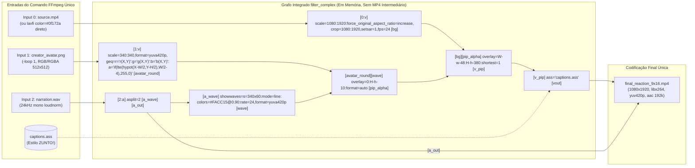

# Phase 8: Relatório Técnico de Auditoria, Contratos e Diagnóstico de Causa Raiz

**Data da Auditoria:** 2026-11-06  
**Milestone:** v1.1 — ZUNTO! Visual Engine  
**Fase:** 08 — Auditoria, Contratos e Diagnóstico de Causa Raiz  
**Requisitos Cobertos:** `COMP-01`, `SUB-01`, `AVTR-01`  
**Natureza da Fase:** 100% Diagnóstica e Analítica (D-15 — Zero modificações em `src/viralpanel/`)

---

## 1. Mapeamento de Contratos e Interfaces Atuais

Esta seção documenta a auditoria estática e dinâmica das fronteiras de integração entre a fila assíncrona Celery (`src/viralpanel/tasks.py`), o orquestrador de mídia (`src/viralpanel/studio/service.py`), o gerenciador de armazenamento (`src/viralpanel/storage.py`) e os motores especializados de voz (`voice.py`), avatar (`avatar.py`), legendas (`subtitles.py`) e renderização (`renderer.py`).

### 1.1 Contrato Público Obrigatório (`tasks.py` ↔ `StudioService.produce`)

Conforme a decisão arquitetural bloqueada **D-01**, a assinatura pública de `StudioService.produce` constitui uma fronteira imutável (*one-way door*) com a task Celery `trigger_daily_pipeline` e a função interna `_run_pipeline`.

- **Assinatura Inspecionada (Runtime & AST):**
  ```python
  # src/viralpanel/studio/service.py (linhas 67-122)
  def produce(self, db: Session, run_id: str, script: Script) -> Asset:
  ```
  *(Nota de tipagem: Em `src/viralpanel/models.py`, `PipelineRun.id` é definido como `Mapped[str] = mapped_column(String(36), primary_key=True, default=_uuid)`, representando um UUID v4 serializado como `str`. Os DTOs internos propostos aceitam `str | uuid.UUID` mantendo `str` na fronteira do SQLAlchemy/Celery).*

- **Ponto de Chamada no Worker Celery (`src/viralpanel/tasks.py`, linhas 171-185):**
  ```python
  run.stage = "production"
  db.commit()
  final_asset = studio_service.produce(db=db, run_id=run.id, script=script)
  summary.update(
      final_asset_id=final_asset.id,
      final_video_path=final_asset.file_path,
      final_video_duration=final_asset.duration_seconds,
  )
  ```

- **Invariantes Pós-Condição Exigidos por `_run_pipeline` e `SupervisionService`:**
  1. **Valor de retorno:** Instância persistida e atualizada (`db.refresh`) de `viralpanel.models.Asset` com `asset_type == "final_video"`.
  2. **Atributos obrigatórios no `Asset` retornado:**
     - `id: str` (UUID v4 gerado e persistido no PostgreSQL/SQLite).
     - `script_id: str` (FK apontando para `script.id`).
     - `file_path: str` (caminho absoluto/resolvido no filesystem local para `final_reaction_9x16.mp4` existente e não vazio).
     - `duration_seconds: float` (duração real em segundos extraída via `probe_duration`).
  3. **Efeitos colaterais de persistência esperados na sessão `db`:**
     - Criação e persistência de 3 registros na tabela `assets` vinculados a `script.id`:
       - `asset_type="audio"` (`narration.wav`)
       - `asset_type="avatar"` (`avatar.mp4` — *nota: nas Phases 11/12, caso o vídeo intermediário seja eliminado no single-pass, o registro ou referência de asset deve preservar a compatibilidade relacional ou apontar para o recurso de avatar utilizado sem quebrar consultas do dashboard*).
       - `asset_type="final_video"` (`final_reaction_9x16.mp4`)
     - Atualização de estado: `script.source_video.status = "produced"` (quando `script.source_video is not None`) seguida de `db.commit()`.

---

### 1.2 Matriz Exaustiva de Contratos e Fronteiras Internas

A tabela abaixo mapeia todas as assinaturas inspecionadas dinamicamente via `inspect.signature` e análise de código-fonte:

| Componente / Módulo | Método / Função | Parâmetros de Entrada (Tipos Atuais) | Retorno (Tipo Atual) | Efeitos de I/O & Estado | Problemas de Acoplamento Identificados |
|---------------------|-----------------|--------------------------------------|----------------------|-------------------------|----------------------------------------|
| `tasks.py` | `build_default_services(mock: bool \| None = None)` | `mock: bool \| None` | `tuple[DiscoveryService, ScriptingService, StudioService, SupervisionService, PublishingService]` | Lê `get_settings()`; instancia dependências concretas | Acoplamento direto às classes concretas sem configuração granular de estilo/layout. |
| `studio/service.py` | `StudioService.__init__(...)` | `voice_synthesizer: BaseVoiceSynthesizer`, `avatar_animator: BaseAvatarAnimator`, `renderer: ReactionVideoRenderer \| None = None`, `storage: StorageManager \| None = None` | `None` | Inicializa `ReactionVideoRenderer()` e `StorageManager()` padrão se omitidos | Aceita injeção limpa, permitindo evolução interna sem afetar `tasks.py`. |
| `studio/service.py` | `StudioService.produce(db, run_id, script)` | `db: Session`, `run_id: str`, `script: Script` | `Asset` (`final_video`) | Cria diretório via `storage.get_run_dir(run_id)`; grava `narration.wav`, `avatar.mp4`, `captions.ass`, `final_reaction_9x16.mp4`; faz `db.commit()` | Hardcode de nomes de arquivos (`narration.wav`, `avatar.mp4`, `captions.ass`) e orquestração sequencial acoplada a tipos primitivos. |
| `studio/service.py` | `StudioService._ensure_source_video(run_id, duration=2.0)` | `run_id: str`, `duration: float = 2.0` | `Path` (`.../runs/source/source.mp4`) | Acessa `self.storage._safe(self.storage.get_run_dir(run_id).parent / "source")`; invoca `ffmpeg` se ausente | **Bug estrutural latente de path:** `get_run_dir(run_id)` retorna `runs/<run_id>/assets`. Logo, `.parent` é `runs/<run_id>`, gravando em `runs/<run_id>/source/source.mp4`, que coincide com `MediaDownloader` (`runs/<run_id>/source/source.mp4`), mas viola encapsulamento ao chamar método privado `storage._safe(...)`. |
| `storage.py` | `StorageManager.get_run_dir(run_id)` | `run_id: str` | `Path` (`<base_dir>/runs/<run_id>/assets`) | Executa `mkdir(parents=True, exist_ok=True)` imediatamente | Não fornece método público para o subdiretório `source` (forçando callers a usar `_safe` diretamente). |
| `studio/voice.py` | `BaseVoiceSynthesizer.synthesize(text, output_path, speaker_wav=None)` | `text: str`, `output_path: Path`, `speaker_wav: Path \| None = None` | `tuple[Path, float]` | Sintetiza WAV em disco (`24000 Hz`, mono) e mede duração via `probe_duration` | Retorna apenas duração escalar total (`float`), sem timestamps por palavra para sincronia fina de legendas. |
| `studio/avatar.py` | `BaseAvatarAnimator.generate_avatar_video(audio_path, output_path, avatar_image_path=None)` | `audio_path: Path`, `output_path: Path`, `avatar_image_path: Path \| None = None` | `tuple[Path, float]` | Lê `assets/creator_avatar.png` (ou cria fallback via FFmpeg) e gera `avatar.mp4` (`360x360`, `yuv420p`) | Gera vídeo MP4 intermediário opaco (`yuv420p`) com dimensão `360x360`, divergindo de `renderer.avatar_size = 340` (forçando re-escala). |
| `studio/subtitles.py` | `build_cues_from_script(script_text, total_duration, max_words_per_cue=6)` | `script_text: str`, `total_duration: float`, `max_words_per_cue: int = 6` | `list[SubtitleCue]` | Processamento puro em memória (divisão uniforme de chunks pelo tempo total) | Divisão temporal puramente linear (`duration / len(chunks)`), ignorando cadência real da fala, pausas e comprimento fonético das palavras. |
| `studio/subtitles.py` | `write_ass_subtitles(cues, output_path)` | `cues: list[SubtitleCue]`, `output_path: Path` | `Path` | Escreve arquivo `.ass` UTF-8 com `ASS_HEADER` hardcoded | Cabeçalho ASS (`DejaVu Sans,62`, `MarginV=480`) é constante global imutável, impedindo customização de estilo ZUNTO! ou posicionamento dinâmico por safe zone. |
| `studio/renderer.py` | `ReactionVideoRenderer.render(source_video_path, avatar_video_path, voice_audio_path, ass_subtitle_path, output_path)` | 5 argumentos `Path` posicionais/nomeados | `tuple[Path, float]` | Verifica `has_video_stream`; cria `source_visual_bg.mp4` se necessário; executa `ffmpeg` final | Recebe 5 `Path`s soltos sem metadados de layout, safe zones, transparência de avatar ou diretrizes de composição. |

---

### 1.3 Acoplamento Temporal, Espacial e de Diretórios

1. **Acoplamento Temporal Estrito:**
   - `StudioService.produce` depende da execução sequencial:
     1. `voice_synthesizer.synthesize` precisa terminar primeiro porque `voice_duration: float` é a única fonte de verdade temporal para todas as etapas seguintes.
     2. `build_cues_from_script(script_text, total_duration=voice_duration)` usa `voice_duration` para fatiar os tempos `start`/`end` de cada `SubtitleCue`.
     3. `_ensure_source_video(run_id, duration=max(voice_duration, 2.0))` usa `voice_duration` caso precise sintetizar um vídeo fonte de fallback.
     4. `renderer.render(...)` recalcula `duration = max(probe_duration(voice_audio_path), 1.5)` invocando `ffprobe` novamente sobre `narration.wav`, demonstrando redundância de I/O por falta de um DTO de contexto compartilhado.
2. **Descompasso Dimensional entre `avatar.py` e `renderer.py`:**
   - `AudioReactiveAvatarAnimator` inicializa com `width: int = 360, height: int = 360`.
   - `ReactionVideoRenderer` inicializa com `avatar_size: int = 340` e, no `filter_complex`, reescala o vídeo de 360x360 para 340x340 e depois aplica `pad=352:352:6:6:color=white`.
3. **Acoplamento de Caminhos no `StorageManager`:**
   - O `MediaDownloader` (em `scripting/service.py` -> `media/downloader.py`) salva o vídeo baixado do TikTok em `runs/<run_id>/source/source.mp4`.
   - O `StudioService` acessa esse mesmo arquivo construindo manualmente `self.storage.get_run_dir(run_id).parent / "source" / "source.mp4"`. Não há contrato explícito passando o caminho do vídeo baixado entre `ScriptingService` e `StudioService`.

---

### 1.4 Diagrama Sequencial de Chamadas e Fluxo de Dados (Estado Atual)

```mermaid
sequenceDiagram
    autonumber
    participant Celery as tasks.py (_run_pipeline)
    participant DB as SQLAlchemy Session (db)
    participant Studio as StudioService.produce()
    participant Storage as StorageManager
    participant Voice as BaseVoiceSynthesizer
    participant Avatar as BaseAvatarAnimator
    participant Subs as subtitles.py
    participant Renderer as ReactionVideoRenderer
    participant FFmpeg as FFmpeg / FFprobe CLI

    Celery->>DB: run.stage = "production"; db.commit()
    Celery->>Studio: produce(db=db, run_id=run.id, script=script)
    Studio->>Storage: get_run_dir(run_id)
    Storage-->>Studio: Path(".../runs/{run_id}/assets")

    Note over Studio,Voice: Etapa 1: Síntese de Voz
    Studio->>Voice: synthesize(script_text, Path("narration.wav"))
    Voice->>FFmpeg: subprocess (TTS / loudnorm / probe_duration)
    FFmpeg-->>Voice: narration.wav (24kHz mono) + voice_duration (float)
    Voice-->>Studio: (voice_path, voice_duration)
    Studio->>DB: db.add(Asset(asset_type="audio"))

    Note over Studio,Avatar: Etapa 2: Animação de Avatar (Passe FFmpeg Intermediário)
    Studio->>Avatar: generate_avatar_video(voice_path, Path("avatar.mp4"))
    Avatar->>FFmpeg: probe_duration(voice_path)
    Avatar->>FFmpeg: ffmpeg -loop 1 -i creator_avatar.png -i narration.wav -> avatar.mp4 (360x360, yuv420p)
    FFmpeg-->>Avatar: avatar.mp4 + avatar_duration
    Avatar-->>Studio: (avatar_path, avatar_duration)
    Studio->>DB: db.add(Asset(asset_type="avatar"))

    Note over Studio,Subs: Etapa 3: Geração de Legendas ASS
    Studio->>Subs: build_cues_from_script(script_text, total_duration=voice_duration)
    Subs-->>Studio: list[SubtitleCue]
    Studio->>Subs: write_ass_subtitles(cues, Path("captions.ass"))
    Subs-->>Studio: subtitles_path (captions.ass)

    Note over Studio,Renderer: Etapa 4: Verificação de Source e Composição Final
    Studio->>Studio: _ensure_source_video(run_id, duration=max(voice_duration, 2.0))
    Studio->>FFmpeg: has_video_stream(source.mp4) [via ffprobe]
    Studio->>Renderer: render(source_video_path, avatar_path, voice_path, subtitles_path, output_path)
    Renderer->>FFmpeg: probe_duration(voice_audio_path)
    Renderer->>FFmpeg: has_video_stream(source_video_path)
    opt Sem stream de vídeo no source
        Renderer->>FFmpeg: Passe Fallback: lavfi color=#0f172a -> source_visual_bg.mp4
    end
    Renderer->>FFmpeg: Passe Final: scale/crop bg + scale/pad(white) avatar + overlay + ass -> final_reaction_9x16.mp4
    Renderer->>FFmpeg: probe_duration(final_reaction_9x16.mp4)
    Renderer-->>Studio: (final_video_path, final_duration)

    Studio->>DB: db.add(Asset(asset_type="final_video"))
    Studio->>DB: script.source_video.status = "produced"; db.commit(); db.refresh(final_asset)
    Studio-->>Celery: final_asset (Asset)
```

---

### 1.5 Especificação Conceitual de DTOs Tipados Internos (D-02 e D-03)

Para eliminar o tráfego de parâmetros primitivos descontextualizados (`Path`, `str`, `int`, `float`) e desacoplar responsabilidades nas Phases 10, 11 e 12 — **sem alterar a assinatura pública `StudioService.produce(db, run_id, script) -> Asset` (D-01)** e **sem introduzir injeção abstrata excessiva (D-03)** — especifica-se o conjunto enxuto de DTOs internos (baseados em `pydantic.BaseModel` / `dataclasses`):

```python
from dataclasses import dataclass, field
from pathlib import Path
from typing import Literal
import uuid
from pydantic import BaseModel, Field


class SubtitleCue(BaseModel):
    """Unidade temporal de legenda (compatível com o modelo atual em subtitles.py,
    estendido opcionalmente para suportar destaque de palavra ativa na Phase 10)."""
    start: float = Field(..., ge=0.0, description="Início do cue em segundos")
    end: float = Field(..., gt=0.0, description="Fim do cue em segundos")
    text: str = Field(..., min_length=1, description="Texto visível do bloco")
    highlight_word: str | None = Field(default=None, description="Palavra de impacto para destaque amarelo ZUNTO!")


@dataclass(frozen=True)
class SubtitleJobConfig:
    """Configuração de geração e estilização do arquivo ASS (Phase 10)."""
    script_text: str
    total_duration: float
    output_path: Path
    brand_style: Literal["ZUNTO", "DEFAULT"] = "ZUNTO"
    max_words_per_cue: int = 4
    play_res_x: int = 1080
    play_res_y: int = 1920
    margin_v: int = 520  # Safe zone vertical calibrada acima da UI do TikTok/Reels/Shorts


@dataclass(frozen=True)
class AvatarConfig:
    """Especificação de dimensão, recorte orgânico e posicionamento do avatar (Phase 11).
    Também referenciado como AvatarJobConfig."""
    avatar_image_path: Path
    size: int = 340
    crop_mode: Literal["circle_alpha", "rounded_rect", "native_rgba"] = "circle_alpha"
    border_color: str = "#FACC15"  # Amarelo de impacto ZUNTO! (ou sem borda quadrada branca)
    border_width: int = 4
    overlay_x_expr: str = "W-w-48"
    overlay_y_expr: str = "H-h-380"  # Posicionado em safe zone sem colidir com legendas ou UI
    enable_waveform: bool = True
    waveform_color: str = "#FACC15@0.90"


@dataclass(frozen=True)
class ReactionCompositionSpec:
    """Especificação das camadas e parâmetros técnicos do grafo FFmpeg single-pass (Phase 12)."""
    target_width: int = 1080
    target_height: int = 1920
    fps: int = 24
    video_codec: str = "libx264"
    preset: str = "veryfast"
    pix_fmt: str = "yuv420p"
    audio_codec: str = "aac"
    audio_bitrate: str = "192k"
    single_pass: bool = True


@dataclass(frozen=True)
class StudioRenderRequest:
    """DTO agregador que encapsula todos os insumos de uma requisição de renderização
    interna entre StudioService e ReactionVideoRenderer (equivalente a RenderJobContext)."""
    run_id: str | uuid.UUID
    source_video_path: Path
    voice_audio_path: Path
    voice_duration: float
    ass_subtitle_path: Path
    output_path: Path
    avatar: AvatarConfig
    composition: ReactionCompositionSpec = field(default_factory=ReactionCompositionSpec)
```

#### Como os DTOs Isolam a Complexidade sem Quebrar o Celery:
1. **`tasks.py` permanece 100% intocado:** Continua chamando `studio_service.produce(db=db, run_id=run.id, script=script)` e recebendo `Asset`.
2. **Eliminação de chamadas duplicadas ao `ffprobe`:** `voice_duration` é calculado uma única vez na síntese de voz e propagado dentro de `StudioRenderRequest` e `SubtitleJobConfig`.
3. **Prontidão para o Single-Pass (Phase 12):** Como `StudioRenderRequest` carrega `AvatarConfig` (apontando diretamente para `avatar_image_path` e parâmetros de `crop_mode` e `waveform`), o `ReactionVideoRenderer` pode compor o avatar estático/reativo diretamente no `filter_complex` principal sem depender obrigatoriamente de um arquivo `avatar.mp4` pré-renderizado em `yuv420p`.

---

## 2. Diagnóstico de Causa Raiz de Legendas Duplicadas (SUB-01)

*(Seção a ser detalhada no Plano 08-02)*

---

## 3. Diagnóstico de Assets e Formato do Avatar Reaction (AVTR-01)

*(Seção a ser detalhada no Plano 08-02)*

---

## 4. Grafo e Passes FFmpeg & Proposta Single-Pass (COMP-01)

Esta seção mapeia exaustivamente todas as invocações dos binários `ffmpeg` e `ffprobe` no pipeline audiovisual atual (conforme diretrizes **D-12** e **D-13**), identifica os gargalos de I/O, compressão cumulativa e perda de canal alfa, e especifica a arquitetura de composição integrada **single-pass** (conforme **D-14**) para implementação na Phase 12.

---

### 4.1 Inventário Completo de Subprocessos FFmpeg e FFprobe Atuais

Durante uma única chamada de `StudioService.produce(db, run_id, script)`, o sistema dispara até **5 processos `ffmpeg`** e **5 processos `ffprobe`** sequenciais:

| Ordem | Módulo / Método | Binário | Condição de Disparo | Inputs | Outputs | Codec Vídeo / PixFmt / Preset | Codec Áudio | Timeout |
|-------|-----------------|---------|---------------------|--------|---------|-------------------------------|-------------|---------|
| **P-Voz** | `studio/voice.py` (`EdgeTTSVoiceSynthesizer.synthesize`, L161-178) | `ffmpeg` | Produção padrão (Edge-TTS) | `narration.edge.temp.mp3` | `narration.wav` | — (somente áudio, `-af loudnorm=I=-16:TP=-1.5:LRA=11`) | PCM (`-ac 1 -ar 24000`) | 60s |
| **Pr-1** | `studio/voice.py` (`probe_duration`, L182) | `ffprobe` | Sempre após síntese de voz | `narration.wav` | `stdout` (JSON `format.duration`) | — | — | Sem timeout explícito |
| **Pr-2** | `studio/avatar.py` (`generate_avatar_video`, L90) | `ffprobe` | Sempre ao iniciar avatar | `narration.wav` | `stdout` (re-leitura redundante de `format.duration`) | — | — | Sem timeout explícito |
| **P-Img** | `studio/avatar.py` (`ensure_default_avatar_image`, L22-46) | `ffmpeg` | Apenas se `assets/creator_avatar.png` não existir | `lavfi: color=c=#0f172a:s=512x512:d=0.1` + `drawbox` | `assets/creator_avatar.png` | PNG (`rgb24`, 1 frame, **sem canal alfa**) | — | 15s |
| **Passe 1 (Avatar)** | `studio/avatar.py` (`AudioReactiveAvatarAnimator.generate_avatar_video`, L100-126) | `ffmpeg` | Sempre em modo produção | `[0]` `-loop 1 -i creator_avatar.png`<br>`[1]` `-i narration.wav` | `runs/<id>/assets/avatar.mp4` | `libx264` / `yuv420p` / `ultrafast` (`360x360`, 24 fps) | `aac` (bitrate padrão) | 90s |
| **Pr-3** | `studio/avatar.py` (`generate_avatar_video`, L127) | `ffprobe` | Sempre após gerar `avatar.mp4` | `avatar.mp4` | `stdout` (`format.duration`) | — | — | Sem timeout explícito |
| **Pr-4** | `studio/service.py` (`_ensure_source_video`, L34) | `ffprobe` | Sempre antes do renderer (`has_video_stream`) | `runs/<id>/source/source.mp4` | `stdout` (`stream=codec_type`) | — | — | Sem timeout explícito |
| **Passe 0a (Source Fallback)** | `studio/service.py` (`_ensure_source_video`, L38-62) | `ffmpeg` | Se `source.mp4` não existir ou não tiver vídeo | `lavfi: color=c=#334155:s=360x640:r=24:d={duration}` + `sine=220` | `runs/<id>/source/source.mp4` | `libx264` / `yuv420p` / preset padrão (`medium`) | `aac` | 60s |
| **Pr-5** | `studio/renderer.py` (`ReactionVideoRenderer.render`, L89) | `ffprobe` | Sempre ao iniciar `render()` | `narration.wav` | `stdout` (3ª leitura redundante de `narration.wav`!) | — | — | Sem timeout explícito |
| **Pr-6** | `studio/renderer.py` (`ReactionVideoRenderer.render`, L96) | `ffprobe` | Sempre ao iniciar `render()` (`has_video_stream`) | `source.mp4` | `stdout` (2ª verificação redundante de stream de vídeo!) | — | — | Sem timeout explícito |
| **Passe 0b (Renderer Fallback)** | `studio/renderer.py` (`ReactionVideoRenderer.render`, L102-119) | `ffmpeg` | Se `source_video_path` não tiver stream de vídeo | `lavfi: color=c=#0f172a:s=1080x1920:r=24:d={duration}` | `source_visual_bg.mp4` | `libx264` / `yuv420p` / preset padrão (`medium`) | Sem áudio | 30s |
| **Passe 2 (Render Final)** | `studio/renderer.py` (`ReactionVideoRenderer.render`, L133-169) | `ffmpeg` | Sempre (composição 9:16 final) | `[0]` `-stream_loop -1 -i source.mp4`<br>`[1]` `-stream_loop -1 -i avatar.mp4`<br>`[2]` `-i narration.wav` | `final_reaction_9x16.mp4` | `libx264` / `yuv420p` / `ultrafast` (`1080x1920`) | `aac` (`192k`) | 300s |
| **Pr-7** | `studio/renderer.py` (`ReactionVideoRenderer.render`, L175) | `ffprobe` | Sempre após gerar `final_reaction_9x16.mp4` | `final_reaction_9x16.mp4` | `stdout` (`format.duration`) | — | — | Sem timeout explícito |

---

### 4.2 Análise Detalhada dos 3 Passes de Vídeo e de seus Grafos de Filtros

#### A. Passe 0 (`source_visual_bg.mp4` em `renderer.py:101-119` e `source.mp4` em `service.py:38-62`)
- **Comando em `renderer.py` (linhas 102-119):**
  ```python
  [
      "ffmpeg", "-y",
      "-f", "lavfi", "-i", f"color=c=#0f172a:s={self.width}x{self.height}:r=24:d={duration}",
      "-c:v", "libx264", "-pix_fmt", "yuv420p",
      str(actual_source_path),  # source_visual_bg.mp4
  ]
  ```
- **Análise Crítica:**
  1. **Duplicidade de Fallback:** Tanto `StudioService._ensure_source_video` (que gera um vídeo `360x640` cor `#334155`) quanto `ReactionVideoRenderer.render` (que gera um vídeo `1080x1920` cor `#0f172a`) implementam lógica de criação de vídeo sintético via `lavfi` em disco.
  2. **Desperdício de I/O e CPU:** Gerar um arquivo MP4 H.264 inteiro no disco (`source_visual_bg.mp4`) apenas para alimentar uma cor sólida no passe seguinte é totalmente desnecessário — o gerador virtual `-f lavfi -i color=c=#0f172a:s=1080x1920:r=24:d={duration}` pode ser passado diretamente como Input `[0]` do comando FFmpeg final em memória, com custo zero de disco e zero codificação intermediária.

#### B. Passe 1 (`avatar.mp4` em `AudioReactiveAvatarAnimator.generate_avatar_video`, `avatar.py:94-126`)
- **Grafo `filter_complex` atual (`avatar.py:94-99`):**
  ```text
  [0:v]scale=360:360:force_original_aspect_ratio=increase,crop=360:360,format=yuv420p[base_avatar];
  [1:a]showwaves=s=360x64:mode=line:colors=#38bdf8@0.85:rate=24,format=yuva420p[wave];
  [base_avatar][wave]overlay=0:H-h-8:shortest=1[vout]
  ```
- **Comando de Codificação (`avatar.py:100-125`):**
  - Inputs: `-loop 1 -i assets/creator_avatar.png` (`[0:v]`) e `-i narration.wav` (`[1:a]`).
  - Codec de saída: `-c:v libx264 -preset ultrafast -pix_fmt yuv420p -c:a aac -shortest avatar.mp4`.
- **Análise Crítica:**
  1. **Destruição Irreversível de Transparência (Canal Alfa):** A conversão explícita para `format=yuv420p` no filtro e `-pix_fmt yuv420p` no container `.mp4` (`libx264`) elimina qualquer possibilidade de canal alfa. O vídeo resultante `avatar.mp4` é obrigatoriamente um bloco retangular opaco de `360x360`.
  2. **Re-escala Dupla e Perda de Nitidez:** O avatar é escalado de `512x512` para `360x360` no Passe 1, comprimido com perda em `libx264 -preset ultrafast` (que utiliza quantização grosseira e desativa subpixel motion estimation/CABAC otimizado), e em seguida decodificado no Passe 2 para ser **novamente reescalado** de `360x360` para `340x340` (`self.avatar_size`).
  3. **Codificação de Áudio Descartada:** O Passe 1 codifica o áudio `narration.wav` em `aac` dentro de `avatar.mp4` (`-map 1:a -c:a aac`), mas o Passe 2 **ignora completamente** a faixa de áudio de `avatar.mp4` (mapeando `-map 2:a` diretamente de `narration.wav`). Ou seja, a codificação AAC no Passe 1 é 100% trabalho descartado.

#### C. Passe 2 (`final_reaction_9x16.mp4` em `ReactionVideoRenderer.render`, `renderer.py:124-169`)
- **Grafo `filter_complex` atual (`renderer.py:124-131`):**
  ```text
  [0:v]scale=1080:1920:force_original_aspect_ratio=increase,crop=1080:1920,setsar=1[bg];
  [1:v]scale=340:340:force_original_aspect_ratio=decrease,pad=352:352:6:6:color=white[pip];
  [bg][pip]overlay=W-w-48:H-h-120:shortest=1[composed];
  [composed]ass='{escaped_ass}'[vout]
  ```
- **Mapeamento de Streams e Flags (`renderer.py:133-166`):**
  - Input `[0]`: `-stream_loop -1 -i actual_source_path`
  - Input `[1]`: `-stream_loop -1 -i avatar_video_path`
  - Input `[2]`: `-i voice_audio_path`
  - Limite temporal: `-t {duration}` e `-shortest`
  - Mapas: `-map [vout]` (vídeo composto) e `-map 2:a` (áudio exclusivo da locução; o áudio original do vídeo fonte `[0:a]` é descartado sem `amix`).
  - Codificação: `-c:v libx264 -preset ultrafast -pix_fmt yuv420p -c:a aac -b:a 192k`.
- **Análise Crítica da Cadeia de Filtros:**
  1. **Camada `[bg]` (`scale` + `crop` + `setsar=1`):** Converte qualquer vídeo fonte para `1080x1920` (9:16) preenchendo a tela inteira sem barras pretas. Contudo, não normaliza a taxa de quadros (`fps=24`), herdando o framerate variável (VFR) do vídeo baixado do TikTok.
  2. **Camada `[pip]` (`scale=340:340` + `pad=352:352:6:6:color=white`):** Recebe `avatar.mp4` (`360x360`), reduz para `340x340` e adiciona uma moldura retangular sólida branca de 6px em cada lado (`352x352`), causando diretamente o defeito visual de "caixa quadrada" (AVTR-01).
  3. **Camada `[composed]` (`overlay=W-w-48:H-h-120:shortest=1`):** Posiciona o PIP de `352x352` nas coordenadas `X = 1080 - 352 - 48 = 680` e `Y = 1920 - 352 - 120 = 1448`. Como a legenda ASS tem `MarginV=480` (altura `Y ≈ 1440`), a borda superior do avatar (`Y = 1448`) tangencia/invade a zona de renderização das legendas e fica exatamente na área inferior direita onde ícones e descrições da interface do TikTok/Reels/Shorts se sobrepõem!
  4. **Ordem de Camadas (`overlay` antes de `ass`):** Atualmente o filtro `ass` é aplicado **depois** do `overlay` do avatar (`[bg][pip]overlay...[composed]; [composed]ass...[vout]`). Isso faz com que o texto da legenda passe por cima do avatar caso haja colisão espacial, ou vice-versa se invertido, evidenciando a necessidade de separação estrita por *safe zones* verticais.

---

### 4.3 Síntese de Gargalos e Ineficiências (D-13)

1. **Tripla / Dupla Codificação H.264 (`libx264`) por Run:**
   - Em vez de 1 única codificação H.264 ao final, o pipeline codifica `avatar.mp4` em H.264 (Passe 1) e depois decodifica `avatar.mp4` quadro a quadro para recodificá-lo em H.264 dentro de `final_reaction_9x16.mp4` (Passe 2). Quando o fallback de vídeo é acionado, ocorre uma 3ª codificação H.264 (Passe 0).
2. **Gargalo de I/O e Poluição de Storage:**
   - Para cada run, o arquivo `avatar.mp4` (e eventualmente `source_visual_bg.mp4`) é gravado em disco e lido em seguida. Em meta de 6 vídeos/dia (ou dezenas em testes), isso multiplica escritas desnecessárias em SSD da VPS.
3. **Excesso de Invocações de Subprocessos `ffprobe`:**
   - `narration.wav` sofre `ffprobe` **3 vezes** na mesma execução (`voice.py:182`, `avatar.py:90`, `renderer.py:89`).
   - `source.mp4` sofre `ffprobe` (`has_video_stream`) **2 vezes** (`service.py:34`, `renderer.py:96`).
4. **Incompatibilidade de Canal Alfa no Pipeline Multi-Pass:**
   - O container `.mp4` com `libx264` (`yuv420p`) no Passe 1 é incapaz de transportar canal alfa (`yuva420p` / `rgba`). Manter um passe intermediário exigiria usar formatos pesados como `.mov` (`prores_ks -profile:v 4444` ou `qtrle`) ou `.webm` (`libvpx-vp9` com alpha, lento para codificar). A **eliminação do passe intermediário (Single-Pass)** resolve tanto a performance quanto a transparência nativa!

---

### 4.4 Proposta de Arquitetura Single-Pass para a Phase 12 (D-14)

Para atender ao requisito **COMP-01** e à decisão **D-14**, propõe-se unificar a animação reativa do avatar (`showwaves` + recorte orgânico em canal alfa `yuva420p`) e a composição de camadas (vídeo base 9:16 + avatar PIP + legendas ASS ZUNTO!) em **um único comando FFmpeg e um único grafo `filter_complex`**.

#### Diagrama do Grafo de Filtros Single-Pass Proposto



#### Especificação Técnica do Comando FFmpeg Single-Pass (Alvo para Phase 12)

```python
# Construção proposta do comando único em ReactionVideoRenderer (Phase 12)
# Caso source_video_path tenha vídeo válido:
source_input_args = ["-stream_loop", "-1", "-i", str(source_video_path)]
# Caso contrário (fallback direto via lavfi sem criar source_visual_bg.mp4 em disco!):
# source_input_args = ["-f", "lavfi", "-i", f"color=c=#0f172a:s={width}x{height}:r=24:d={duration}"]

filter_complex = (
    # 1. Camada de Fundo 9:16 (1080x1920 @ 24fps constante)
    f"[0:v]scale={width}:{height}:force_original_aspect_ratio=increase,"
    f"crop={width}:{height},setsar=1,fps=24[bg];"
    # 2. Divisão do stream de áudio da narração (1 para onda reativa, 1 para saída final)
    f"[2:a]asplit=2[a_wave][a_out];"
    # 3. Avatar com máscara circular orgânica em canal alfa (yuva420p) sem pad branco quadrado
    f"[1:v]scale={avatar_size}:{avatar_size}:force_original_aspect_ratio=increase,"
    f"crop={avatar_size}:{avatar_size},format=yuva420p,"
    f"geq=r='r(X,Y)':g='g(X,Y)':b='b(X,Y)':"
    f"a='if(lte(hypot(X-W/2,Y-H/2),(W/2)-2),255,0)'[avatar_alpha];"
    # 4. Espectro de onda reativo na paleta ZUNTO! (#FACC15)
    f"[a_wave]showwaves=s={avatar_size}x60:mode=line:colors=#FACC15@0.90:rate=24,"
    f"format=yuva420p[wave];"
    # 5. Fusão do avatar circular com a onda sonora preservando canal alfa
    f"[avatar_alpha][wave]overlay=0:H-h-12:shortest=1,format=yuva420p[pip];"
    # 6. Overlay do PIP transparente sobre o fundo 9:16 em safe zone calibrada
    f"[bg][pip]overlay=W-w-48:H-h-380:shortest=1[composed];"
    # 7. Queima única de legendas ASS ZUNTO!
    f"[composed]ass='{escaped_ass}'[vout]"
)

cmd = [
    "ffmpeg", "-y",
    *source_input_args,
    "-loop", "1", "-t", str(duration), "-i", str(avatar_image_path),
    "-i", str(voice_audio_path),
    "-t", str(duration),
    "-filter_complex", filter_complex,
    "-map", "[vout]",
    "-map", "[a_out]",
    "-c:v", "libx264",
    "-preset", "veryfast",
    "-pix_fmt", "yuv420p",
    "-c:a", "aac",
    "-b:a", "192k",
    "-shortest",
    str(output_path),
]
```

#### Comparativo Arquitetural: Multi-Pass Atual vs. Single-Pass Proposto

| Métrica / Aspecto Técnico | Arquitetura Atual (v1.0 Multi-Pass) | Arquitetura Proposta (v1.1 Single-Pass — Phase 12) | Ganho / Impacto |
|---------------------------|-------------------------------------|----------------------------------------------------|-----------------|
| **Subprocessos `ffmpeg` de vídeo** | 2 a 3 (`source_visual_bg.mp4` + `avatar.mp4` + `final_reaction_9x16.mp4`) | **1 único processo `ffmpeg`** | Redução de 50% a 66% em spawns e overhead de inicialização de encoders |
| **Subprocessos `ffprobe` por run** | 5 a 6 chamadas (múltiplas leituras de `narration.wav` e `source.mp4`) | **2 chamadas** (1 pós-TTS para medir `voice_duration`, 1 pós-render final para validação) | Eliminação de 3 a 4 chamadas bloqueantes de I/O |
| **Arquivos de vídeo temporários em disco** | `avatar.mp4` + `source_visual_bg.mp4` | **Zero arquivos MP4 intermediários** (`lavfi` e `creator_avatar.png` lidos direto no grafo) | Economia de I/O e armazenamento por run |
| **Transparência / Canal Alfa do Avatar** | Perdida no Passe 1 (`avatar.mp4` forçado para `yuv420p`) + `pad=color=white` no Passe 2 | **Preservada nativamente em memória (`yuva420p`)** até o `overlay` sobre `[bg]` | Elimina 100% a caixa quadrada sem precisar de codecs intermediários pesados (WebM/ProRes) |
| **Qualidade Visual do Avatar** | Dupla compressão (`scale 360` -> H.264 `ultrafast` -> `scale 340` -> H.264 `ultrafast`) | **Escala única (`512` -> `340`) e compressão única** no encode final | Nitidez superior e zero artefatos de dupla quantização |
| **Sincronia A/V e Resolução** | `1080x1920`, porém FPS variável herdado do source e áudio codificado 2x | **`1080x1920` @ `24fps` fixo (`setsar=1,fps=24`)**, áudio dividido via `asplit` em memória | Sincronia milimétrica entre onda sonora do avatar, locução e legendas ASS |

#### Compatibilidade com `Asset` de Avatar no Banco de Dados (Salvaguarda para Phase 12)
- Como documentado na Seção 1.1, `StudioService.produce` atualmente grava um registro `Asset(asset_type="avatar", file_path=str(avatar_path), duration_seconds=avatar_duration)`.
- Na Phase 12, ao adotar o Single-Pass:
  - `StudioService.produce` continuará persistindo o registro `Asset(asset_type="avatar", ...)` apontando para o asset de imagem/configuração do avatar utilizado (ou mantendo `BaseAvatarAnimator` como provedor de configuração/preparação de asset) com `duration_seconds=voice_duration`, garantindo **zero quebra** em testes ou consultas que contam os 3 `Asset`s gerados por run.


---

## 5. Matriz de Decisões e Plano de Implementação (Phases 9 a 12)

*(Seção a ser consolidada no Plano 08-02)*

---

## 6. Verificação de Integridade da Fase Diagnóstica

*(Seção a ser consolidada no Plano 08-02)*
