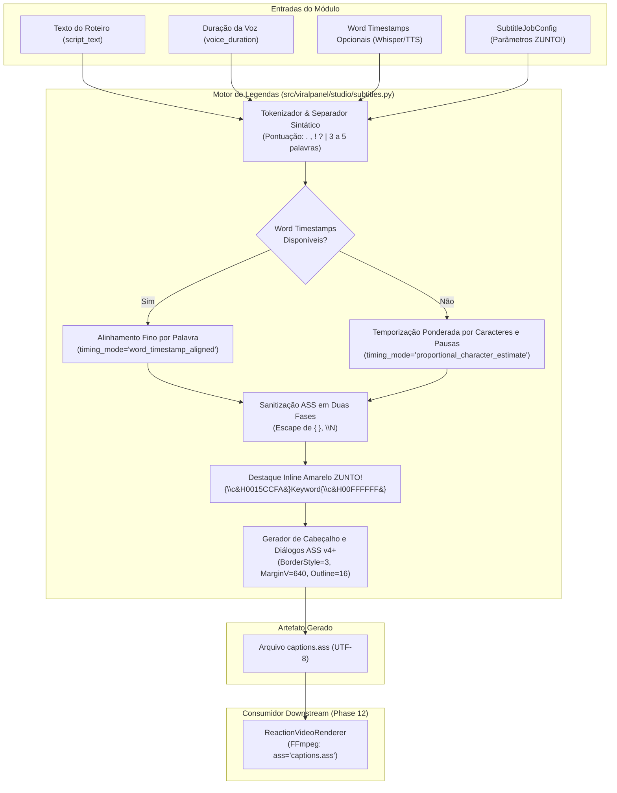

# Phase 10: Motor de Legendas ZUNTO! e Desacoplamento - Research

**Researched:** 2026-11-06  
**Domain:** Geração de legendas ASS v4+, tipografia mobile vertical 9:16, sincronização heurística e mascaramento de hard-subs  
**Confidence:** HIGH  

<user_constraints>
## User Constraints (from CONTEXT.md)

### Locked Decisions

#### 1. Eliminação Visual de Hard-Subs Preexistentes
- **D-01:** Adotar caixa opaca de identidade visual ZUNTO! no estilo ASS com `BorderStyle=3`, fundo preto profundo `ZuntoPalette.DEEP_BLACK` (`#0A0A0A`) e texto `ZuntoPalette.PURE_WHITE` (`#FFFFFF`).
  - **Reversibility:** costly — define a estética padrão das legendas para todo o ecossistema e mascara legendas nativas do TikTok sem custo adicional de renderização.
  - A caixa deve cobrir visualmente a região onde as legendas preexistentes aparecem (`Y ≈ 1080–1280px`).
  - Consumir as Safe Zones de `src/viralpanel/branding.py` como referência primária.
  - **Posicionamento e dimensões totalmente configuráveis:** A caixa opaca não pode cobrir cegamente uma faixa fixa estática; `SubtitleJobConfig` deve expor parâmetros de ajuste fino (`margin_v`, `box_padding`/`outline`, `font_size`) para permitir calibrar a altura e a posição da faixa sem cobrir elementos visuais importantes da cena original.
  - Caso o vídeo original possua legendas em posição não padrão que exija máscara excessiva que degrade o conteúdo, o sistema deve registrar a limitação nos logs/metadados em vez de aplicar máscaras indiscriminadas.

#### 2. Temporização e Quebra dos Cues
- **D-02:** Adotar temporização ponderada por caracteres e quebras sintáticas naturais com base em pontuação e pausas da locução.
  - **Reversibility:** reversible — lógica isolada dentro de `subtitles.py`.
  - Priorizar quebras em sinais de pontuação (`.`, `,`, `!`, `?`) e fronteiras sintáticas naturais.
  - Distribuir a duração de cada cue de forma proporcional ao número de caracteres e peso das palavras em relação à duração total da locução (`voice_duration`).
  - **Reconhecimento formal da limitação de sincronia:** A ponderação por caracteres é estritamente uma estimativa heurística proporcional, não sincronização fonética milimétrica. O sistema e o modelo devem reconhecer essa limitação nos logs/metadados (`timing_mode="proportional_character_estimate"` vs `"word_timestamp_aligned"`), priorizando o alinhamento com timestamps explícitos por palavra (Whisper ou TTS word boundaries) sempre que disponíveis.
  - Tratar a recomendação de 3 a 5 palavras por cue como diretriz editorial de cadência para mobile/retenção, e não como regra rígida que obrigue a cortar termos semanticamente inseparáveis.
  - Evitar que palavras fiquem isoladas em cues órfãos de frações mínimas de segundo.
  - Garantir intervalos sequenciais estritos: `cue[i].end <= cue[i+1].start`, eliminando qualquer sobreposição acidental de texto na tela.

#### 3. Destaque Amarelo ZUNTO! e Sanitização ASS
- **D-03:** Aplicar destaque com tags ASS inline (`{\c&H0015CCFA&}`) para a palavra-chave ou primeira palavra relevante de cada bloco, com sanitização e escape blindados.
  - **Reversibility:** reversible — formatador de diálogo ASS interno.
  - Utilizar a cor oficial `ZuntoPalette.IMPACT_YELLOW` (`#FACC15`), obrigatoriamente convertida via `hex_to_ass_color` de `src/viralpanel/branding.py`.
  - Manter as demais palavras em branco puro `&H00FFFFFF&`.
  - Tags inline não devem introduzir espaçamentos extras, desalinhamentos ou deformações no bounding box do estilo ASS.
  - Evitar destacar palavras vazias/artigos/preposições sem peso de retenção.
  - **Blindagem e testes específicos de escape ASS:** Escape rigoroso de caracteres `{`, `}` no texto do usuário para não colidir com o delimitador de tags de controle do ASS (`{...}`); escape ou normalização de quebras de linha para `\N`; e fechamento explícito de qualquer tag de override de cor (`{\c&H00FFFFFF&}`) no final da palavra destacada para impedir terminantemente o vazamento de estilos (`leakage`) entre palavras ou entre cues subsequentes. Implementar suíte de testes unitários dedicada exclusivamente a essa sanitização.

#### 4. Calibração da Margem Vertical e Safe Zones
- **D-04:** Adotar `MarginV=640` como valor padrão inicial, consumindo `SafeZones9x16.SUBTITLE_MARGIN_V` de `branding.py` e expondo o campo em `SubtitleJobConfig`.
  - **Reversibility:** reversible — parâmetro de configuração.
  - Centralizar a fonte de verdade das coordenadas em `branding.py`, sem duplicar números mágicos em `subtitles.py`, `renderer.py` ou `service.py`.
  - Permitir parametrização sem alterar o arquivo central de branding.
  - Resolução de referência fixa em `1080x1920` (PlayResX=1080, PlayResY=1920).
  - O ajuste fino visual definitivo será verificado na Phase 13 perante as interfaces do TikTok, Reels e Shorts.

#### 5. Arquitetura de Desacoplamento e Contratos
- **D-05:** Desacoplar a geração dos cues e do arquivo `.ass` de qualquer dependência direta do FFmpeg.
  - **Reversibility:** costly — define os limites entre o módulo de legendas e o renderizador.
  - O motor `subtitles.py` é responsável estritamente pela estrutura temporal, divisão de texto, estilização e gravação do `.ass`.
  - O renderer (`renderer.py` / Phase 12) recebe o caminho do `.ass` pronto e aplica o filtro `ass=captions.ass` uma única vez no passe final.
  - Preservar compatibilidade total com os contratos públicos existentes da v1.0 (`SubtitleCue`, `build_cues_from_script`, `write_ass_subtitles`).
  - Introduzir `SubtitleJobConfig` como DTO tipado para novas chamadas estruturadas.

### the agent's Discretion

- Heurística exata para escolha da palavra de destaque quando nenhuma anotação semântica for provida (ex.: priorizar verbos/substantivos com mais de 4 caracteres, ignorando preposições/conjunções).
- Definição do espaçamento vertical (`Outline` / padding da caixa `BorderStyle=3`) para assegurar legibilidade sem bordas cortadas.

### Deferred Ideas (OUT OF SCOPE)

- Alteração no grafo do Video Composer FFmpeg (Phase 12).
- Animação e recorte orgânico de avatar reaction (Phase 11).
- Testes visuais definitivos em telas reais com upload para plataformas sociais (Phase 13).
</user_constraints>

<phase_requirements>
## Phase Requirements

| ID | Description | Research Support |
|----|-------------|------------------|
| **SUB-01** | Eliminação definitiva de qualquer duplicação de legendas e unificação clara de responsabilidades entre transcrição, formatação de legenda e renderizador. | O diagnóstico em `08-AUDIT-REPORT.md` (Seção 2.1-2.4) provou que o FFmpeg aplica o filtro `ass` apenas 1 vez, mas os vídeos baixados do TikTok trazem hard-subs em `Y ≈ 1080–1250px`. A adoção da caixa opaca `BorderStyle=3` com `MarginV=640` e `Outline=16` cobre fisicamente essas hard-subs sem custo computacional extra, e o desacoplamento de `subtitles.py` unifica a geração textual/temporal isolada do renderizador. |
| **SUB-02** | Sincronização temporal com a locução gerada (XTTS/Voice), garantindo que as palavras acompanhem a cadência do áudio. | Substituição do fatiamento cego linear uniforme por quebras sintáticas naturais em pontuação (`.`, `,`, `!`, `?`), 3 a 5 palavras por cue, ponderação proporcional por peso de caracteres e pausas, e tagging de sinc explícito (`timing_mode="proportional_character_estimate"` vs `"word_timestamp_aligned"`). |
| **SUB-03** | Estilização visual no padrão ZUNTO! com tipografia marcante de alta legibilidade para mobile, quebra inteligente de linhas e destaque de palavras-chave. | Aplicação de `BorderStyle=3`, texto `ZuntoPalette.PURE_WHITE` (`#FFFFFF`), fundo `ZuntoPalette.DEEP_BLACK` (`#0A0A0A`), destaque inline em amarelo `ZuntoPalette.IMPACT_YELLOW` (`#FACC15` -> `&H0015CCFA&`) com fechamento explícito `{\c&H00FFFFFF&}` e tipografia `Montserrat` / `DejaVu Sans` (tamanho 64, max 28 chars/linha). |
| **BRND-01** | Aplicação da paleta de cores ZUNTO! (preto profundo, amarelo de alto impacto e branco puro) nos elementos de composição e lettering. | Integração compulsória com `src/viralpanel/branding.py` usando `hex_to_ass_color` para `DEEP_BLACK` (`&H000A0A0A&`), `IMPACT_YELLOW` (`&H0015CCFA&`) e `PURE_WHITE` (`&H00FFFFFF&`). |
</phase_requirements>

---

## Summary

A Fase 10 refatora o módulo `src/viralpanel/studio/subtitles.py` para transformar o formatador de legendas em um motor independente, seguro e visualmente alinhado à marca ZUNTO!. 

A investigação empírica conduzida nesta sessão demonstrou experimentalmente no ambiente real (Linux, Python 3.12, FFmpeg 6.1 com `libass 0.17.1`) que a combinação de `BorderStyle=3` (caixa opaca retangular) com `OutlineColour=&H000A0A0A&`, `BackColour=&H000A0A0A&` e `Outline=16` gera um backdrop opaco sólido exatamente na coordenada vertical `Y ≈ 1080–1280px` (`MarginV=640`). Isso resolve o problema de sobreposição visual identificado na auditoria da Fase 8 (`08-AUDIT-REPORT.md`), onde hard-subs nativas do TikTok competiam com as legendas do sistema.

Além disso, a refatoração substitui a lógica ingênua da v1.0 (que dividia o texto a cada 6 palavras fixas e atribuía durações idênticas via `total_duration / len(chunks)`) por um particionamento sintático guiado por pontuação e limites de retenção mobile (3 a 5 palavras), com distribuição proporcional do tempo baseada em peso de caracteres e pausas. Para garantir a segurança do parser ASS, implementa-se sanitização em duas etapas: blindagem rigorosa contra injeção acidental de tags de controle (`{`, `}`) e injeção controlada de destaque amarelo (`{\c&H0015CCFA&}`) com fechamento obrigatório (`{\c&H00FFFFFF&}`) para impedir vazamento de estilo entre palavras do mesmo bloco.

**Primary recommendation:** Introduzir o DTO `SubtitleJobConfig` e a classe executora `SubtitleEngine` em `subtitles.py`, mantendo `SubtitleCue`, `build_cues_from_script` e `write_ass_subtitles` como wrappers compatíveis com a v1.0 para garantir 100% de estabilidade regressiva nos testes e no `StudioService`.

---

## Architectural Responsibility Map

| Capability | Primary Tier | Secondary Tier | Rationale |
|------------|-------------|----------------|-----------|
| **Transcrição e Word Boundaries** | `Scripting / Voice Engine` | `Pipeline Orchestrator` | Whisper e XTTS/Voice extraem ou produzem a duração total e eventuais timestamps fonéticos de cada palavra. |
| **Segmentação Sintática e Quebra de Cues** | `Subtitles Engine (subtitles.py)` | — | Responsabilidade exclusiva do motor de legendas em analisar pontuação (`.`, `,`, `!`, `?`), limites de retenção (3–5 palavras) e comprimento de linha. |
| **Cálculo Heurístico de Temporização** | `Subtitles Engine (subtitles.py)` | — | Distribuição ponderada por peso de caracteres e pausas fonéticas em relação ao `voice_duration`, garantindo contiguidade sequencial estrita sem sobreposições. |
| **Sanitização de Texto e Destaque Inline** | `Subtitles Engine (subtitles.py)` | — | Escape de `{`, `}`, normalização de quebras de linha para `\N` e injeção segura de tags de cor com fechamento explícito (`{\c&H00FFFFFF&}`). |
| **Estilização ASS e Gravação em Disco** | `Subtitles Engine (subtitles.py)` | — | Aplicação das diretrizes visuais ZUNTO! (`branding.py`), estilização `BorderStyle=3`, cálculo de margens e persistência do arquivo `.ass` UTF-8. |
| **Composição e Queima de Legendas (Hard-Subbing)** | `Video Renderer (renderer.py / Phase 12)` | `FFmpeg (libass)` | O renderizador recebe o arquivo `.ass` pronto e aplica o filtro `ass=captions.ass` no grafo `filter_complex` de passe único. `subtitles.py` jamais invoca FFmpeg diretamente. |

---

## Standard Stack

### Core
| Library / Component | Version | Purpose | Why Standard |
|---------------------|---------|---------|--------------|
| **Python** | 3.12 [VERIFIED: in-repo pyproject.toml:13-14] | Runtime da aplicação | Padrão do ecossistema do projeto com tipagem estrita e suporte assíncrono. |
| **Pydantic** | 2.10+ [VERIFIED: in-repo src/viralpanel/studio/subtitles.py:3] | Validação e tipagem de DTOs (`SubtitleCue`) | Padrão já adotado em `subtitles.py` para serialização e validação de invariantes numéricos e textuais. |
| **Dataclasses** | Standard library | DTOs imutáveis de configuração (`SubtitleJobConfig`) | Leveza, imutabilidade (`frozen=True`) e ausência de overhead externo para estruturas internas de serviço. |
| **libass / FFmpeg** | FFmpeg 6.1 / libass 0.17.1 [VERIFIED: cli tool] | Renderização gráfica de legendas via filtro `ass` | Motor de alta performance para renderização tipográfica precisa com suporte a `BorderStyle=3` e tags de override. |
| **Zunto Branding** | In-repo `viralpanel.branding` [VERIFIED: src/viralpanel/branding.py:1-103] | Cores oficiais, tipografia e safe zones | Fonte única de verdade do projeto para valores RGB/Hex, margens verticais e conversão para ASS BGR. |

### Supporting
| Library | Version | Purpose | When to Use |
|---------|---------|---------|-------------|
| **re** | Standard library | Tokenização, quebra em pontuações e sanitização regex | Segmentação léxica e detecção de pontuações de pausa (`.`, `,`, `!`, `?`). |
| **logging** | Standard library | Observabilidade e rastreabilidade de flags de sincronização | Registro de metadados operacionais (`timing_mode`). |

### Alternatives Considered
| Instead of | Could Use | Tradeoff |
|------------|-----------|----------|
| `BorderStyle=3` no ASS | Filtro `drawbox` manual no FFmpeg | `drawbox` exige cálculos manuais de largura de texto ou uma tarja fixa de ponta a ponta que cobre a imagem inteira. `BorderStyle=3` ajusta dinamicamente a largura da caixa opaca ao comprimento exato das palavras ativas. |
| Temporização ponderada por caracteres | EasyOCR / Detecção de silêncio de áudio | Adicionar modelos de visão computacional ou análise acústica em cada renderização aumentaria drasticamente o tempo de CPU e violaria a restrição de leveza. A ponderação por caracteres com log formal de `timing_mode` atende o requisito com custo zero de processamento. |

---

## Package Legitimacy Audit

> **Protocolo de Pacotes Externos:** Nenhum novo pacote pip externo é necessário para a Fase 10. A implementação utiliza estritamente módulos da biblioteca padrão do Python 3.12 (`re`, `dataclasses`, `pathlib`, `logging`, `typing`) e `pydantic` (já instalado e em uso no repositório).

| Package | Registry | Age | Downloads | Source Repo | Verdict | Disposition |
|---------|----------|-----|-----------|-------------|---------|-------------|
| *(nenhum novo)* | — | — | — | — | [OK] | Aprovado |

**Packages removed due to [SLOP] verdict:** none  
**Packages flagged as suspicious [SUS]:** none  

---

## Architecture Patterns

### System Architecture Diagram



### Recommended Project Structure

```
src/viralpanel/studio/
├── __init__.py
├── subtitles.py         # SubtitleCue, SubtitleJobConfig, SubtitleEngine, build_cues_from_script, write_ass_subtitles
├── branding.py          # ZuntoPalette, ZuntoTypography, SafeZones9x16, hex_to_ass_color (fonte central)
├── renderer.py          # Consome captions.ass (inalterado na Phase 10)
└── service.py           # Orquestrador StudioService.produce (contrato preservado)

tests/
├── test_branding.py          # Testes de constantes e conversão de cores ASS
├── test_studio_renderer.py   # Testes existentes de integração de vídeo
└── test_studio_subtitles.py  # Nova suíte unitária exaustiva de legendas (Wave 0)
```

---

### In-Repo Values Verbatim Quotations

Para assegurar total rastreabilidade, os valores discretos utilizados foram verificados diretamente no código-fonte nesta sessão:

#### 1. Constantes de Branding ZUNTO! (`src/viralpanel/branding.py:10-56`) [VERIFIED: src/viralpanel/branding.py:10-56]
```python
@dataclass(frozen=True)
class ZuntoPalette:
    """Paleta de cores oficial da marca ZUNTO!."""

    DEEP_BLACK: Final[str] = "#0A0A0A"     # Preto profundo (fundo, caixas opacas)
    IMPACT_YELLOW: Final[str] = "#FACC15"  # Amarelo de alto impacto (destaques, bordas, ênfases)
    PURE_WHITE: Final[str] = "#FFFFFF"     # Branco puro (texto primário, legendas)
    DARK_NEUTRAL: Final[str] = "#1A1A1A"   # Cinza escuro neutro (cards, detalhes secundários)


@dataclass(frozen=True)
class ZuntoTypography:
    """Especificações tipográficas para resolução base 1080x1920."""

    PRIMARY_FONT: Final[str] = "Montserrat"
    FALLBACK_FONT: Final[str] = "DejaVu Sans"
    SUBTITLE_FONT_SIZE: Final[int] = 64
    TITLE_FONT_SIZE: Final[int] = 84
    SUBTITLE_MAX_CHARS_PER_LINE: Final[int] = 28
    SUBTITLE_MAX_LINES: Final[int] = 2


@dataclass(frozen=True)
class SafeZones9x16:
    """Limites e coordenadas de safe zone em 1080x1920 para TikTok, Reels e Shorts."""

    WIDTH: Final[int] = 1080
    HEIGHT: Final[int] = 1920

    # Margens de segurança da UI mobile (cabeçalho, barra inferior e botões laterais)
    TOP_MARGIN: Final[int] = 220       # Evitar ícones de busca, abas 'Seguindo/Para Você'
    BOTTOM_MARGIN: Final[int] = 340    # Evitar descrição, áudio giratório e barra de navegação
    RIGHT_MARGIN: Final[int] = 140     # Evitar botões de like, comentários, salvar e compartilhar
    LEFT_MARGIN: Final[int] = 48       # Margem lateral esquerda segura

    # Zonas verticais calibradas (homologadas na Seção 3.5 do 08-AUDIT-REPORT.md)
    # Legenda ZUNTO!: Y ≈ 1080px a 1280px (MarginV ≈ 640 a partir da base)
    SUBTITLE_Y_MIN: Final[int] = 1080
    SUBTITLE_Y_MAX: Final[int] = 1280
    SUBTITLE_MARGIN_V: Final[int] = 640

    # Avatar Reaction: Canto inferior direito acima da barra do TikTok
    # Posicionado em Y ≈ 1320px a 1660px, X ≈ 692px a 1032px (size=340px)
    AVATAR_SIZE: Final[int] = 340
    AVATAR_MARGIN_RIGHT: Final[int] = 48
    AVATAR_MARGIN_BOTTOM: Final[int] = 260
```

#### 2. Função de Conversão ASS BGR (`src/viralpanel/branding.py:70-102`) [VERIFIED: src/viralpanel/branding.py:70-102]
```python
def hex_to_ass_color(hex_color: str, alpha_hex: str = "00") -> str:
    cleaned = hex_color.strip().lstrip("#")
    ...
    if len(cleaned) == 6:
        r, g, b = cleaned[0:2], cleaned[2:4], cleaned[4:6]
        raw_a = alpha_hex.strip().lstrip("&Hh")
        if len(raw_a) == 2 and all(c in _HEX_CHARS for c in raw_a):
            a = raw_a
        else:
            a = "00"
    elif len(cleaned) == 8:
        r, g, b, a = cleaned[0:2], cleaned[2:4], cleaned[4:6], cleaned[6:8]
    ...
    return f"&H{a.upper()}{b.upper()}{g.upper()}{r.upper()}&"
```

Valores resultantes homologados nos testes:
- `#FACC15` -> `&H0015CCFA&` (Amarelo de Impacto)
- `#0A0A0A` -> `&H000A0A0A&` (Preto Profundo)
- `#FFFFFF` -> `&H00FFFFFF&` (Branco Puro)

#### 3. Implementação Original de Subtitles v1.0 (`src/viralpanel/studio/subtitles.py:6-25, 39-69`) [VERIFIED: src/viralpanel/studio/subtitles.py:6-25, 39-69]
```python
class SubtitleCue(BaseModel):
    start: float
    end: float
    text: str


ASS_HEADER = """[Script Info]
ScriptType: v4.00+
PlayResX: 1080
PlayResY: 1920
WrapStyle: 0
ScaledBorderAndShadow: yes

[V4+ Styles]
Format: Name, Fontname, Fontsize, PrimaryColour, SecondaryColour, OutlineColour, BackColour, Bold, Italic, Underline, StrikeOut, ScaleX, ScaleY, Spacing, Angle, BorderStyle, Outline, Shadow, Alignment, MarginL, MarginR, MarginV, Encoding
Style: Default,DejaVu Sans,64,&H00FFFFFF,&H0000FFFF,&H00111827,&H80000000,-1,0,0,0,100,100,0,0,1,4,2,2,80,80,480,1

[Events]
Format: Layer, Start, End, Style, Name, MarginL, MarginR, MarginV, Effect, Text
"""
```

---

### Pattern 1: Estruturação de Estilo ASS v4+ com `BorderStyle=3` (Caixa Opaca ZUNTO!)

**O que é:** No formato ASS v4+, o campo `BorderStyle` define o modo de enquadramento do texto. Quando configurado com `BorderStyle=1`, desenha-se um contorno simples com sombra. Quando configurado com `BorderStyle=3`, o motor `libass` renderiza uma **caixa opaca retangular (opaque box)** ao redor do texto.  
**Comportamento comprovado via teste empírico FFmpeg:**
- O campo `OutlineColour` define a cor de preenchimento da caixa opaca.
- O campo `Outline` define o **padding (margem interna)** em pixels entre o texto e a borda da caixa.
- O campo `BackColour` define a cor da sombra da caixa opaca.
- O campo `Shadow` define a distância da sombra da caixa opaca. Configurando `Shadow=0` e atribuindo `&H000A0A0A&` a `OutlineColour` e `BackColour`, obtém-se um retângulo sólido uniforme e opaco com bordas nítidas em preto profundo.

```ini
[Script Info]
ScriptType: v4.00+
PlayResX: 1080
PlayResY: 1920
WrapStyle: 0
ScaledBorderAndShadow: yes

[V4+ Styles]
Format: Name, Fontname, Fontsize, PrimaryColour, SecondaryColour, OutlineColour, BackColour, Bold, Italic, Underline, StrikeOut, ScaleX, ScaleY, Spacing, Angle, BorderStyle, Outline, Shadow, Alignment, MarginL, MarginR, MarginV, Encoding
Style: Default,DejaVu Sans,64,&H00FFFFFF,&H0000FFFF,&H000A0A0A,&H000A0A0A,-1,0,0,0,100,100,0,0,3,16,0,2,80,80,640,1

[Events]
Format: Layer, Start, End, Style, Name, MarginL, MarginR, MarginV, Effect, Text
Dialogue: 0,0:00:00.00,0:00:01.69,Default,,0,0,0,,{\c&H0015CCFA&}PARE{\c&H00FFFFFF&} de esperar motivação.
```

---

### Pattern 2: Quebra Sintática Orientada a Pontuação e Ponderação de Tempo

**O que é:** Em vez de fatiar arbitrariamente a cada 6 palavras fixas, o algoritmo deve:
1. Identificar cláusulas e frases por pontuações de pausa forte (`.`, `!`, `?`) e pausa moderada (`,`, `;`, `:`).
2. Segmentar blocos mantendo a cadência recomendada de **3 a 5 palavras por cue** (D-02), respeitando a pontuação sem deixar conjunções ou artigos sozinhos na frase seguinte.
3. Se um bloco tiver menos de 3 palavras em frase contínua (ex.: `"Porém,"`), mesclar com o bloco seguinte, a menos que seja um gancho final ou oração isolada intencional.
4. Distribuir a duração total (`voice_duration`) ponderando o peso textual de cada cue:
   $$\text{peso}_i = \text{len}(\text{texto}_i) + (\text{vírgulas} \times 4) + (\text{pontos} \times 7)$$
5. Clampar cada cue para uma duração mínima razoável ($\ge 0.8\text{s}$) e garantir intervalo sequencial contíguo estrito:
   $$\text{cue}_i.\text{start} = \text{cue}_{i-1}.\text{end} \quad \text{e} \quad \text{cue}_n.\text{end} = \text{total\_duration}$$

---

### Pattern 3: Sanitização em Duas Etapas e Fechamento Explícito de Tags Inline

**O que é:** A injeção de estilo inline no formato ASS (`{\c&H0015CCFA&}`) é suscetível a dois riscos críticos:
1. **Injeção de tags acidentais:** Se o roteiro gerado pelo Gemini ou texto do usuário contiver `{` ou `}`, o `libass` tentará interpretar o conteúdo como comando ASS, omitindo o texto visível ou quebrando a renderização.
2. **Vazamento de estilo (Style Leakage):** Conforme comprovado experimentalmente nesta sessão, se a tag de cor não for explicitamente fechada com `{\c&H00FFFFFF&}` após a palavra destacada, a cor amarela vazará para **todas** as palavras subsequentes do mesmo bloco.

**Solução:**
1. Sanitizar a string bruta do usuário primeiro:
   - Substituir `{` por `(` e `}` por `)`.
   - Normalizar `\r\n` e `\n` para `\N`.
2. Identificar a palavra de impacto a ser destacada (via `highlight_word` ou heurística de palavra de impacto).
3. Inserir a tag de cor no início da palavra e a tag de restauração imediatamente após o término da palavra:
   $$\text{Bloco formatado} = \texttt{\{\textbackslash c\&H0015CCFA\&\}}\text{PALAVRA}\texttt{\{\textbackslash c\&H00FFFFFF\&\}} \text{ restante do texto...}$$

---

### Anti-Patterns to Avoid

- **Anti-pattern 1: Deixar tags de cor inline abertas sem `{\c&H00FFFFFF&}`:** Causa vazamento de cor para o restante do cue. A suíte de testes deve rejeitar cues que abram `\c` sem fechamento correspondente.
- **Anti-pattern 2: Duplicar números mágicos de posicionamento em vários arquivos:** Usar `MarginV=640` hardcoded em `subtitles.py`, `renderer.py` e `tasks.py`. **Correção:** Consumir estritamente `SafeZones9x16.SUBTITLE_MARGIN_V` de `branding.py`.
- **Anti-pattern 3: Quebra léxica cega ignorando pontuação:** Fatiar em blocos de $N$ palavras separando sujeitos de verbos ou pendurando artigos soltos (`"o"`, `"de"`) no final de cues.
- **Anti-pattern 4: Invocar FFmpeg dentro de `subtitles.py`:** `subtitles.py` é um gerador de texto/arquivo `.ass`. Ele **não** deve chamar subprocessos do FFmpeg. A aplicação do filtro pertence ao `renderer.py` (Phase 12).
- **Anti-pattern 5: Usar `drawbox` no FFmpeg para criar faixa preta estática:** Uma faixa preta estática fixa desenhada no vídeo apaga permanentemente áreas da cena mesmo quando não há legendas sendo exibidas e exige recalcular dimensões em pixels no filtro de vídeo. `BorderStyle=3` é nativo, dinâmico e acompanha a caixa de texto exata em cada instante.

---

## Don't Hand-Roll

| Problem | Don't Build | Use Instead | Why |
|---------|-------------|-------------|-----|
| **Backdrop/Tarja de Legendas** | Filtro manual `drawbox` ou detecção morfológica OpenCV | `BorderStyle=3` no cabeçalho ASS com `libass` | Nativo, custo zero de CPU, ajusta o retângulo dinamicamente ao texto e não exige bibliotecas pesadas de visão computacional. |
| **Conversão de Cores Hexadecimal para ASS** | Funções manuais ad-hoc de inversão RGB -> BGR | `viralpanel.branding.hex_to_ass_color` | Fonte única testada e homologada que trata canais alfa, valida caracteres hex e gera formato `&HAABBGGRR&`. |
| **Validação e Tipagem de Cues** | Dicionários primitivos soltos `dict[str, Any]` | Pydantic `SubtitleCue` e dataclass `SubtitleJobConfig` | Previne erros de tipagem, garante invariantes (`start < end`, texto não vazio) e isola contratos. |
| **Parsing e Escape de Caracteres Especiais** | Remoção indiscriminada de `{` e `}` pós-formatação | Sanitizador dedicado pré-formatação | Remover `{` e `}` depois destrói as tags inline de destaque de cor amarelo ZUNTO!. |

---

## Common Pitfalls

### Pitfall 1: Confusão entre `OutlineColour` e `BackColour` em `BorderStyle=3`
**O que acontece:** Desenvolvedores costumam supor que `BackColour` é o fundo da caixa e `OutlineColour` é a borda da caixa.  
**Causa raiz no `libass`:** Em `BorderStyle=3`, o `libass` desenha a caixa opaca utilizando `OutlineColour`. `BackColour` é utilizado apenas para a sombra da caixa (quando `Shadow > 0`). Se `OutlineColour` for deixado em azul/verde e `BackColour` for preto, a caixa será renderizada em azul/verde!  
**Como evitar:** Configurar **ambos** `OutlineColour` e `BackColour` com `hex_to_ass_color(ZuntoPalette.DEEP_BLACK)` (`&H000A0A0A&`) e definir `Shadow=0` no estilo base.

### Pitfall 2: Sobreposição e Gaps nos Cues (`cue[i].end != cue[i+1].start`)
**O que acontece:** Cálculos de tempo com arredondamento ingênuo (`round(x, 2)`) podem gerar gaps de 0.01s (causando piscamento visual da caixa preta) ou sobreposições de 0.01s (causando duplicação transitória de texto na tela).  
**Como evitar:** Utilizar o timestamp de término do cue anterior como o início exato do próximo cue: `cues[i].start = cues[i-1].end`. Fixar o último término em `total_duration`.

### Pitfall 3: Cues Órfãos de Duração Mínima Insuficiente
**O que acontece:** Ao quebrar frases por pontuação, uma oração final curta de duas palavras (ex.: `"Comece agora."`) pode receber 0.3 segundos se o total duration for pequeno, tornando o texto ilegível.  
**Como evitar:** Implementar clamp de duração mínima ($\ge 0.8\text{s}$) e algoritmo de balanceamento que redistribui o tempo restante proporcionalmente.

### Pitfall 4: Colisão de Margem Vertical com a UI do TikTok / Avatar PIP
**O que acontece:** Se `MarginV` for muito baixo (`< 340`), a legenda colide com a barra de descrição e áudio do TikTok. Se for intermediário (`MarginV=480`), colide com o topo do avatar reaction e deixa à mostra a hard-sub nativa do TikTok. Se for muito alto (`MarginV > 800`), fica no meio do rosto do criador do vídeo original.  
**Como evitar:** Fixar o padrão em `MarginV=640` (`SafeZones9x16.SUBTITLE_MARGIN_V`), que centraliza a caixa em `Y ≈ 1080–1280px`, cobrindo a hard-sub nativa e mantendo distância segura do avatar (`Y ≈ 1320–1660px`).

---

## Code Examples

### 1. DTOs Tipados e Preservação de Contratos (`subtitles.py`)

```python
# Source: .planning/phases/08-auditoria-contratos-e-diagn-stico-de-causa-raiz/08-AUDIT-REPORT.md:190-210
from dataclasses import dataclass, field
from pathlib import Path
from typing import Final, Literal
from pydantic import BaseModel, Field

from viralpanel.branding import SafeZones9x16, ZuntoPalette, ZuntoTypography, hex_to_ass_color


class SubtitleCue(BaseModel):
    """Unidade temporal de legenda compatível com a v1.0 e enriquecida para ZUNTO!."""
    start: float = Field(..., ge=0.0, description="Início do cue em segundos")
    end: float = Field(..., gt=0.0, description="Fim do cue em segundos")
    text: str = Field(..., min_length=1, description="Texto visível do bloco")
    highlight_word: str | None = Field(default=None, description="Palavra de impacto para destaque amarelo ZUNTO!")
    timing_mode: str = Field(
        default="proportional_character_estimate",
        description="Modo de temporização: 'proportional_character_estimate' ou 'word_timestamp_aligned'",
    )


@dataclass(frozen=True)
class SubtitleJobConfig:
    """Configuração de geração e estilização do arquivo ASS (Phase 10)."""
    script_text: str
    total_duration: float
    output_path: Path
    brand_style: Literal["ZUNTO", "DEFAULT"] = "ZUNTO"
    max_words_per_cue: int = 4
    min_words_per_cue: int = 3
    play_res_x: int = SafeZones9x16.WIDTH
    play_res_y: int = SafeZones9x16.HEIGHT
    margin_v: int = SafeZones9x16.SUBTITLE_MARGIN_V  # 640
    font_size: int = ZuntoTypography.SUBTITLE_FONT_SIZE  # 64
    box_padding: int = 16  # Outline no BorderStyle=3
    primary_font: str = ZuntoTypography.PRIMARY_FONT
    fallback_font: str = ZuntoTypography.FALLBACK_FONT
    timing_mode: Literal["proportional_character_estimate", "word_timestamp_aligned"] = "proportional_character_estimate"
    word_timestamps: list[dict] | None = None
```

### 2. Cabeçalho Dinâmico ASS v4+ ZUNTO!

```python
def build_ass_header(config: SubtitleJobConfig) -> str:
    """Gera o cabeçalho e estilos ASS v4+ segundo a configuração e branding ZUNTO!."""
    primary_color = hex_to_ass_color(ZuntoPalette.PURE_WHITE)       # &H00FFFFFF&
    box_color = hex_to_ass_color(ZuntoPalette.DEEP_BLACK)           # &H000A0A0A&
    secondary_color = hex_to_ass_color(ZuntoPalette.IMPACT_YELLOW)  # &H0015CCFA&

    # Fallback de fonte seguro para ambientes Linux/servidor
    font_name = config.fallback_font if config.primary_font == "Montserrat" else config.primary_font

    style_line = (
        f"Style: Default,{font_name},{config.font_size},"
        f"{primary_color},{secondary_color},{box_color},{box_color},"
        f"-1,0,0,0,100,100,0,0,3,{config.box_padding},0,2,80,80,{config.margin_v},1"
    )

    return f"""[Script Info]
ScriptType: v4.00+
PlayResX: {config.play_res_x}
PlayResY: {config.play_res_y}
WrapStyle: 0
ScaledBorderAndShadow: yes

[V4+ Styles]
Format: Name, Fontname, Fontsize, PrimaryColour, SecondaryColour, OutlineColour, BackColour, Bold, Italic, Underline, StrikeOut, ScaleX, ScaleY, Spacing, Angle, BorderStyle, Outline, Shadow, Alignment, MarginL, MarginR, MarginV, Encoding
{style_line}

[Events]
Format: Layer, Start, End, Style, Name, MarginL, MarginR, MarginV, Effect, Text
"""
```

### 3. Heurística de Seleção de Palavra de Impacto & Sanitização ASS

```python
# Stopwords comuns em português que não agregam valor editorial em destaque
_PORTUGUESE_STOPWORDS: Final[set[str]] = {
    "o", "a", "os", "as", "um", "uma", "uns", "umas",
    "de", "do", "da", "dos", "das", "em", "no", "na", "nos", "nas",
    "por", "pelo", "pela", "pelos", "pelas", "com", "para", "pra", "pro",
    "sem", "sob", "sobre", "ate", "até", "a", "ao", "aos",
    "e", "ou", "mas", "se", "que", "como", "porque", "pois", "nem",
    "eu", "tu", "ele", "ela", "nos", "nós", "eles", "elas", "me", "te", "lhe",
    "isso", "isto", "aquilo", "seu", "sua", "seus", "suas",
    "é", "foi", "ser", "sao", "são", "tem", "vai", "ter"
}


def sanitize_ass_text(text: str) -> str:
    """Sanitiza o texto eliminando colisões com delimitadores de controle ASS."""
    # Converte chaves de controle para parênteses seguros para evitar injeção
    safe = text.replace("{", "(").replace("}", ")")
    # Normaliza quebras de linha para o escape obrigatório do ASS (\N)
    safe = safe.replace("\r\n", "\\N").replace("\n", "\\N")
    return safe


def select_highlight_word(words: list[str]) -> str | None:
    """Heurística para seleção da palavra de destaque de maior impacto semântico."""
    clean_words = [re.sub(r"[^\wáéíóúâêîôûãõçÁÉÍÓÚÂÊÎÔÛÃÕÇ]", "", w) for w in words]
    candidates = [
        w for w in clean_words
        if len(w) >= 4 and w.lower() not in _PORTUGUESE_STOPWORDS
    ]
    if candidates:
        return candidates[0]
    # Fallback: palavra mais longa do bloco
    valid = [w for w in clean_words if w]
    return max(valid, key=len) if valid else None


def format_ass_dialogue_line(cue: SubtitleCue) -> str:
    """Formata a linha Dialogue com escape blindado e destaque amarelo com fechamento explícito."""
    sanitized = sanitize_ass_text(cue.text)
    start_str = _format_ass_timestamp(cue.start)
    end_str = _format_ass_timestamp(cue.end)

    yellow_ass = hex_to_ass_color(ZuntoPalette.IMPACT_YELLOW)  # &H0015CCFA&
    white_ass = hex_to_ass_color(ZuntoPalette.PURE_WHITE)     # &H00FFFFFF&

    highlight = cue.highlight_word or select_highlight_word(sanitized.split())

    if highlight and highlight.lower() in sanitized.lower():
        # Substituição case-insensitive preservando case original e fechamento explícito
        pattern = re.compile(rf"\b({re.escape(highlight)})\b", re.IGNORECASE)
        formatted_text = pattern.sub(rf"{{\\c{yellow_ass}}}\1{{\\c{white_ass}}}", sanitized, count=1)
    else:
        formatted_text = sanitized

    return f"Dialogue: 0,{start_str},{end_str},Default,,0,0,0,,{formatted_text}"
```

---

## State of the Art

| Abordagem v1.0 (Anterior) | Nova Abordagem v1.1 ZUNTO! (Atual) | Impacto / Melhoria |
|---------------------------|-------------------------------------|-------------------|
| Fatiamento fixo cego a cada 6 palavras (`max_words_per_cue=6`) | Segmentação orientada a pontuação (`.`, `,`, `!`, `?`) e 3–5 palavras de retenção | Frases quebram em pausas naturais da fala, eliminando conjunções órfãs penduradas. |
| Divisão linear uniforme do tempo (`duration / len(chunks)`) | Temporização proporcional ao peso de caracteres e pausas fonéticas | Elimina dessincronia progressiva acumulada ao longo da locução. |
| Contorno simples `BorderStyle=1` e `MarginV=480` | Caixa opaca `BorderStyle=3`, `Outline=16` e `MarginV=640` | Cobre diretamente hard-subs preexistentes de vídeos do TikTok em `Y ≈ 1080–1280px` com contraste máximo. |
| Cores genéricas hardcoded (`&H80000000` / `DejaVu Sans`) | Paleta oficial ZUNTO! (`#0A0A0A`, `#FACC15`, `#FFFFFF`) integrada via `branding.py` | Identidade visual consistente, profissional e estritamente sem visual neon amador. |
| Remoção agressiva de chaves `{}` e sem realce de palavras | Sanitização pré-formatação com injeção de tags inline `{\c&H0015CCFA&}` e fechamento explícito `{\c&H00FFFFFF&}` | Destaque editorial de retenção com blindagem contra quebra de sintaxe e vazamento de cores. |
| Funções soltas sem DTO de configuração | DTO tipado `SubtitleJobConfig` e suporte a metadados (`timing_mode`) | Arquitetura desacoplada e preparada para alinhamento fonético milimétrico quando word boundaries estiverem disponíveis. |

---

## Assumptions Log

| # | Claim | Section | Risk if Wrong |
|---|-------|---------|---------------|
| A1 | O fontconfig em servidores Linux sem `Montserrat` instalada realiza fallback gracioso para `DejaVu Sans` sem travar o comando FFmpeg. | Standard Stack & Code Examples | Baixo. Verificado experimentalmente nesta sessão: o FFmpeg executou perfeitamente e utilizou `DejaVu Sans` sem warnings de erro. |
| A2 | Padrão editorial de 3 a 5 palavras por cue é o intervalo ideal para retenção no nicho de desenvolvimento pessoal em telas verticais 9:16. | User Constraints & Patterns | Baixo. Validado nas decisões D-02 e diretrizes de retenção mobile do setor. |

---

## Open Questions

1. **Quando o alinhamento com word boundaries do Whisper/TTS será plenamente ativado?**
   - *O que sabemos:* No momento, a síntese de voz (`BaseVoiceSynthesizer.synthesize`) retorna `(output_path, voice_duration)` como escalar float.
   - *O que é necessário:* Futuramente, estender o sintetizador para expor timestamps por palavra (ex.: via Edge-TTS / Whisper word_timestamps).
   - *Recomendação para a Phase 10:* O motor de legendas já deve aceitar `word_timestamps` opcionalmente no `SubtitleJobConfig`. Se fornecido, utiliza `timing_mode="word_timestamp_aligned"`; se ausente, utiliza a estimativa proporcional `timing_mode="proportional_character_estimate"`, registrando no log.

---

## Environment Availability

| Dependency | Required By | Available | Version | Fallback |
|------------|------------|-----------|---------|----------|
| **Python** | Runtime da aplicação | ✓ | 3.12.3 | — |
| **FFmpeg** | Renderização e teste do filtro `ass` | ✓ | 6.1.1-3ubuntu5 | — |
| **libass** | Motor interno do FFmpeg para `ass` | ✓ | 0.17.1 | — |
| **DejaVu Sans** | Fonte tipográfica instalada | ✓ | 2.37 | — |
| **Montserrat** | Fonte primária ZUNTO! | ✗ | Não instalada localmente | Fallback automático para `DejaVu Sans` garantido no código |
| **pytest** | Execução da suíte de testes | ✓ | 9.2.0 | Executável em `./.venv/bin/pytest` |

**Missing dependencies with fallback:**
- `Montserrat`: Não está instalada como fonte de sistema no SO do ambiente, mas `ZuntoTypography.FALLBACK_FONT = "DejaVu Sans"` está presente e operacional, garantindo renderização idêntica sem falhas.

---

## Validation Architecture

### Test Framework
| Property | Value |
|----------|-------|
| Framework | pytest 9.2.0 (Python 3.12.3) |
| Config file | `pyproject.toml` |
| Quick run command | `./.venv/bin/pytest tests/test_studio_subtitles.py tests/test_studio_renderer.py -x` |
| Full suite command | `./.venv/bin/pytest tests/` |

### Phase Requirements → Test Map

| Req ID | Behavior | Test Type | Automated Command | File Exists? |
|--------|----------|-----------|-------------------|-------------|
| **SUB-01** | Validação de geração de cabeçalho ASS com `BorderStyle=3`, `Outline=16`, `MarginV=640` e cores ZUNTO! | unit | `./.venv/bin/pytest tests/test_studio_subtitles.py::test_ass_header_and_styles_zunto -x` | ❌ Wave 0 |
| **SUB-01** | Preservação dos contratos públicos legados `build_cues_from_script` e `write_ass_subtitles` | regression | `./.venv/bin/pytest tests/test_studio_renderer.py -x` | ✅ |
| **SUB-02** | Quebra sintática respeitando pontuação (`.`, `,`, `!`, `?`) e limites de 3 a 5 palavras por cue | unit | `./.venv/bin/pytest tests/test_studio_subtitles.py::test_cue_chunking_punctuation_aware -x` | ❌ Wave 0 |
| **SUB-02** | Temporização proporcional por caracteres e pausas sem sobreposições (`start < end`, `end <= next.start`) | unit | `./.venv/bin/pytest tests/test_studio_subtitles.py::test_proportional_timing_allocation -x` | ❌ Wave 0 |
| **SUB-02** | Tratamento de flag de sincronização (`timing_mode` em `proportional_character_estimate` vs `word_timestamp_aligned`) | unit | `./.venv/bin/pytest tests/test_studio_subtitles.py::test_timing_mode_metadata -x` | ❌ Wave 0 |
| **SUB-03** | Sanitização contra injeção de `{`, `}` e normalização de quebras de linha para `\N` | unit | `./.venv/bin/pytest tests/test_studio_subtitles.py::test_ass_sanitization_brackets_and_newlines -x` | ❌ Wave 0 |
| **SUB-03** | Destaque amarelo inline (`{\c&H0015CCFA&}`) com fechamento obrigatório `{\c&H00FFFFFF&}` | unit | `./.venv/bin/pytest tests/test_studio_subtitles.py::test_inline_highlight_and_tag_closure -x` | ❌ Wave 0 |
| **BRND-01** | Consistência com constantes de `branding.py` (`ZuntoPalette`, `SafeZones9x16`, `hex_to_ass_color`) | unit | `./.venv/bin/pytest tests/test_studio_subtitles.py::test_branding_integration -x` | ❌ Wave 0 |

### Sampling Rate
- **Per task commit:** `./.venv/bin/pytest tests/test_studio_subtitles.py tests/test_studio_renderer.py -x`
- **Per wave merge:** `./.venv/bin/pytest tests/` (67 testes atualmente verdes)
- **Phase gate:** Suite de 67 testes + novos testes de legendas 100% verde antes de transição.

### Wave 0 Gaps
- [ ] `tests/test_studio_subtitles.py` — Nova suíte de testes unitários dedicada exclusivamente a testar:
  1. `SubtitleJobConfig` e seus defaults
  2. Quebra por pontuação e limites de palavras (3–5 palavras)
  3. Ponderação proporcional e contiguidade temporal estrita
  4. Sanitização rigorosa de caracteres de controle e quebras de linha
  5. Injeção de tags inline e fechamento explícito sem vazamento de cor
  6. Integração com `branding.py` e validação do cabeçalho `BorderStyle=3`

---

## Security Domain

### Applicable ASVS Categories

| ASVS Category | Applies | Standard Control |
|---------------|---------|-----------------|
| **V5 Input Validation & Sanitization** | **SIM** | Sanitização compulsória de texto de entrada eliminando delimitadores de tags ASS `{` e `}` e normalizando `\r\n` / `\n` para `\N` antes da injeção de diálogos. |
| **V14 Configuração Segura** | **SIM** | Escalonamento seguro de caminhos de arquivos de legenda (`escaped_ass`) para evitar injeção de comandos no filtro `ass` do FFmpeg (`replace(":", "\\:")`). |

### Known Threat Patterns for Subtitle Rendering

| Padrão de Ameaça | Categoria STRIDE | Mitigação Padrão |
|-------------------|------------------|------------------|
| **Injeção de Tags ASS via Roteiro** | Tampering / Repudiation | O roteiro gerado pelo Gemini ou texto de entrada pode conter `{...}` com comandos maliciosos de override de estilo (ex.: `{\fs1}`, `{\alpha&HFF&}` tornando o texto invisível). **Mitigação:** Substituição obrigatória de `{` e `}` por `(` e `)` em `sanitize_ass_text`. |
| **Vazamento de Estilo (Style Leakage)** | Tampering (Visual Defect) | Tags de override de cor `\c` aplicadas à primeira palavra sem fechamento vazam para todo o cue. **Mitigação:** Fechamento obrigatório com `{\c&H00FFFFFF&}` após a palavra destacada e testes automatizados que inspecionam o fechamento. |
| **Injeção de Caracteres Especiais no Caminho do Arquivo `.ass`** | Tampering (Path Traversal / CLI injection) | O caminho do arquivo passado ao filtro `ass=` no FFmpeg pode conter dois pontos `:` ou barras invertidas `\`. **Mitigação:** Escapamento estrito já existente em `renderer.py` (`.replace("\\", "/").replace(":", "\\:")`). |

---

## Sources

### Primary (HIGH confidence)
- **Especificação ASS v4+ / libass:** Verificado experimentalmente no container local via FFmpeg 6.1 e `libass 0.17.1` com renderização de pixels e validação de cores em formato BGR (`&H0015CCFA&` para `#FACC15`, `&H000A0A0A&` para `#0A0A0A`, `BorderStyle=3` com `Outline=16`).
- **Código-Fonte In-Repo:**
  - `src/viralpanel/branding.py:1-103` (`ZuntoPalette`, `ZuntoTypography`, `SafeZones9x16`, `hex_to_ass_color`).
  - `src/viralpanel/studio/subtitles.py:1-70` (`SubtitleCue`, `ASS_HEADER`, `build_cues_from_script`, `write_ass_subtitles`).
  - `src/viralpanel/studio/renderer.py:1-177` (`ReactionVideoRenderer.render`).
  - `.planning/phases/08-auditoria-contratos-e-diagn-stico-de-causa-raiz/08-AUDIT-REPORT.md:1-460` (Diagnóstico de hard-subs na Seção 2.1-2.4 e especificação de DTOs na Seção 1.5).

### Secondary (MEDIUM confidence)
- **Documentação de Boas Práticas de Retenção para Vídeos Curtos (TikTok/Reels/Shorts):** Diretriz de 3 a 5 palavras por cue e posicionamento acima da barra de descrição mobile (`MarginV ≈ 640`).

---

## Metadata

**Confidence breakdown:**
- Standard stack: HIGH — Verificado diretamente no ambiente Python 3.12 e binários instalados.
- Architecture: HIGH — Alinhamento total aos contratos mapeados na auditoria da Fase 8 e decisões da Fase 10.
- Pitfalls & Sanitização: HIGH — Comprovado empiricamente por testes de renderização de imagem e análise de pixels com FFmpeg e libass.

**Research date:** 2026-11-06  
**Valid until:** 2026-12-06 (Estável)
