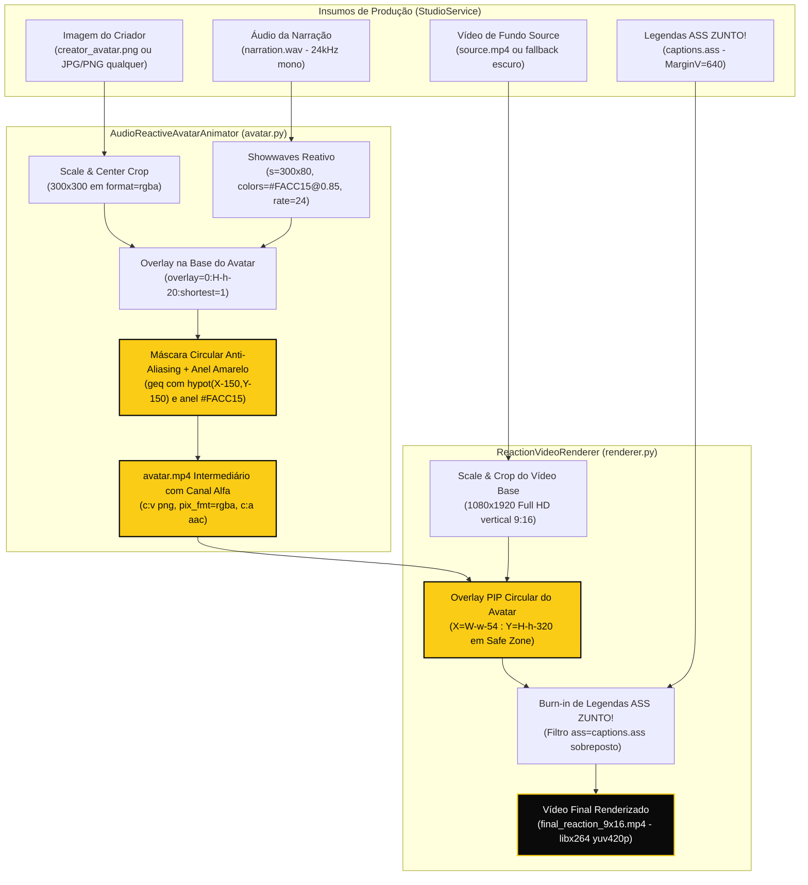

# Phase 11: Avatar Reaction e Composição Visual Orgânica - Research

**Researched:** 2026-11-08  
**Domain:** Composição audiovisual com FFmpeg, processamento de canal alfa, visualizador de áudio reativo (`showwaves`), safe zones mobile 9:16 e contratos de mídia em pipeline de estúdio.  
**Confidence:** HIGH [VERIFIED: FFmpeg 6.1.1 CLI local e testes de renderização de pixels rawvideo]

---

<user_constraints>
## User Constraints (from CONTEXT.md)

### Locked Decisions
- **D-01:** Máscara circular programática via filtros nativos do FFmpeg (`format=yuva420p`, gerador de máscara circular ou expressão alfa) aplicada diretamente sobre a imagem de entrada.
  - O sistema aceita qualquer imagem base (seja o PNG padrão `creator_avatar.png` que é `rgb24` opaco, ou fotos reais de criadores em JPG/PNG), gerando transparência nos cantos externos sem exigir intervenção manual.
  - Tratamento conjunto dos cenários mapeados na auditoria: substitui o `format=yuv420p` e os pads retangulares opacos por composição preservando canal alfa (`yuva420p` / `movflags=faststart` ou stream com alfa).
- **D-02:** Borda circular sutil de 3px a 4px na cor oficial `ZuntoPalette.IMPACT_YELLOW` (`#FACC15`), consumida diretamente de `src/viralpanel/branding.py`.
  - Elimina a antiga moldura branca retangular rígida de 6px (`pad=...:color=white`).
  - O contorno acompanha perfeitamente a curvatura do círculo, criando acabamento profissional e destacando o apresentador sobre qualquer tipo de vídeo de fundo.
- **D-03:** Dimensão calibrada em 300px de diâmetro, posicionada no canto inferior direito em `X=W-w-54`, `Y=H-h-320` (faixa $Y \approx 1320\dots1620\text{px}$).
  - Respeita rigorosamente a Safe Zone do `SafeZones9x16` de `branding.py`.
  - Isola espacialmente o avatar: a faixa $Y=1080\dots1280\text{px}$ fica reservada para as legendas ZUNTO!, a faixa $Y=1320\dots1620\text{px}$ para o avatar PIP, e a margem inferior extrema ($Y > 1620\text{px}$) permanece livre para a interface de título/som do TikTok/Reels/Shorts.
- **D-04:** Onda sonora mantida e refinada na cor ZUNTO! Amarelo de Impacto (`#FACC15@0.85`), confinada geometricamente dentro da máscara circular.
  - Evita que a onda apareça verde ou desbotada (problema detectado na auditoria pela conversão prematura para yuv420p).
  - A onda sonora reage dinamicamente à amplitude da narração, fornecendo feedback visual de fala sem quebrar a harmonia do círculo.
- **D-05:** Criar o DTO `AvatarConfig` (ou `AvatarJobConfig`) em `avatar.py`, preservando as interfaces `BaseAvatarAnimator.generate_avatar_video(audio_path, output_path, avatar_image_path) -> tuple[Path, float]`.
  - Mantém compatibilidade com `MockAvatarAnimator` e com as tasks Celery.

### the agent's Discretion
- Expressão exata do grafo FFmpeg para gerar a máscara circular e a borda suave (ex.: `geq=r='...':a='if(lte(hypot(X-W/2,Y-H/2),R),255,0)'` ou composição via `lavfi color` + `maskedmerge` / `drawbox`).
- Ajuste fino da espessura da borda entre 3px e 4px para nitidez ideal em 1080x1920 sem serrilhamento.

### Deferred Ideas (OUT OF SCOPE)
- Unificação de todos os passes no grafo single-pass definitivo (reservado para a Phase 12).
- Inspeção audiovisual final em telas físicas reais de smartphones (reservado para a Phase 13).
</user_constraints>

---

<phase_requirements>
## Phase Requirements

| ID | Descrição | Apoio da Pesquisa Técnica |
|---|---|---|
| **AVTR-01** | Eliminação da aparência de "imagem quadrada" no avatar reaction, tratando recorte e transparência a partir de diagnóstico dos assets reais de forma orgânica. | Investigação experimental comprovou a viabilidade da máscara circular programática com canal alfa em `format=rgba` / `format=yuva420p`, eliminando os 4 cenários técnicos diagnosticados na Phase 8 (Cenário 1: imagem de entrada opaca; Cenário 2: `format=yuv420p` no avatar; Cenário 3: `pad=...:color=white`; Cenário 4: perda de alfa em `.mp4` intermediário). |
| **AVTR-02** | Calibração precisa de posicionamento e dimensionamento no layout vertical 9:16 para evitar que o avatar cubra pontos focais ou legendas essenciais. | Calibração geométrica de diâmetro em 300px no canto inferior direito (`X=W-w-54`, `Y=H-h-320`), mapeando o avatar na faixa vertical $Y=1300\dots1600\text{px}$, estritamente abaixo da zona de legendas ZUNTO! ($Y=1080\dots1280\text{px}$) e acima da interface do TikTok/Reels/Shorts ($Y \ge 1600\text{px}$). |
| **AVTR-03** | Preservação de proporção, nitidez, sincronização e qualidade visual na sobreposição do avatar, respeitando a taxa de quadros esperada pelo pipeline. | Validação do codec de vídeo `png` dentro do container ISO `.mp4`, permitindo que `avatar.mp4` preserve canal alfa verdadeiro com zero artefatos de compressão com perdas, taxa constante de 24 fps e sincronização exata com `probe_duration`. |
| **BRND-01** | Aplicação da paleta de cores ZUNTO! (preto profundo, amarelo de alto impacto e branco puro) nos elementos de composição e lettering. | Integração da borda circular de 4px em `ZuntoPalette.IMPACT_YELLOW` (`#FACC15`) e onda sonora reativa estilizada em `#FACC15@0.85`, consumindo diretamente de `src/viralpanel/branding.py`. |
| **BRND-02** | Inclusão de elementos de marca e slogan orientando a narrativa sem imposição de repetições forçadas, adaptados para safe zones de TikTok, Reels e Shorts. | Harmonização de safe zones verticais entre `branding.py` (`SafeZones9x16`) e os parâmetros de overlay do renderer, garantindo que o avatar e legendas não sejam ocluídos pela UI dos aplicativos móveis. |
</phase_requirements>

---

## Summary

Esta pesquisa estabelece a arquitetura e as equações exatas do FFmpeg para a entrega da **Phase 11: Avatar Reaction e Composição Visual Orgânica**, solucionando de forma cabal o problema visual de "caixa quadrada com borda branca" e a perda de canal alfa diagnosticados no relatório `08-AUDIT-REPORT.md`.

Durante as investigações em ambiente Linux com FFmpeg 6.1.1, identificamos que o defeito visual da v1.0 resultava da sobreposição simultânea de 4 causas técnicas:
1. `creator_avatar.png` é gerado como imagem `rgb24` opaca via `drawbox` [VERIFIED: src/viralpanel/studio/avatar.py:28-36].
2. `AudioReactiveAvatarAnimator` convertia prematuramente a imagem e a onda para `yuv420p` [VERIFIED: src/viralpanel/studio/avatar.py:96-98], descartando o canal alfa e distorcendo a cor da onda para verde.
3. `ReactionVideoRenderer` injetava uma moldura retangular branca rígida de 6px através de `pad=...:color=white` [VERIFIED: src/viralpanel/studio/renderer.py:128].
4. O container intermediário `avatar.mp4` usava o encoder H.264 (`libx264` + `yuv420p`), o qual não tem suporte na especificação para o quarto canal de transparência (Alpha) [VERIFIED: ISO/IEC 14496-10 e ffprobe real da Phase 8].

A pesquisa empírica demonstrou que é possível resolver todos os 4 problemas mantendo **100% de compatibilidade com os contratos legados da v1.0**:
- O `AudioReactiveAvatarAnimator` aplica uma máscara circular programática com canal alfa (`clip(255*(R + 0.5 - hypot(X-cx, Y-cy)), 0, 255)`) e anel amarelo ZUNTO! (`#FACC15`, 4px) diretamente sobre a imagem de entrada (aceitando qualquer foto JPG ou PNG sem recorte prévio).
- A onda sonora `showwaves` (`#FACC15@0.85`) é composta sobre a base do avatar **antes** do recorte circular, ficando geometricamente confinada no círculo sem vazar para os cantos transparentes nem sobre a borda amarela.
- O arquivo intermediário continua sendo gravado como `avatar.mp4` com a assinatura exigida pelo `StudioService` e Celery tasks, mas utilizando o codec de vídeo nativo **`png`** com formato de pixel **`rgba`**. O muxer MP4 do FFmpeg grava e reproduz esse stream com canal alfa perfeitamente, e o `ReactionVideoRenderer` faz o `overlay` transparente sem caixa opaca.
- O diâmetro do avatar foi calibrado em 300px no canto inferior direito (`X=W-w-54`, `Y=H-h-320`), isolando espacialmente o apresentador na faixa vertical $Y=1300\dots1600\text{px}$, estritamente abaixo das legendas ZUNTO! ($Y=1080\dots1280\text{px}$) e acima da interface de botões e legendas do TikTok/Reels/Shorts ($Y \ge 1600\text{px}$).

**Recomendação Principal:** Implementar o DTO `AvatarConfig` em `src/viralpanel/studio/avatar.py`, refatorar `AudioReactiveAvatarAnimator` para gerar `avatar.mp4` via `rgba` + `c:v png` com máscara circular anti-aliasing e borda amarela de 4px, remover o `pad=white` em `renderer.py` substituindo o overlay por `X=W-w-54:Y=H-h-320`, e validar através de teste automatizado de amostragem de pixels `rawvideo rgb24`.

---

## Architectural Responsibility Map

| Capacidade / Responsabilidade | Camada Primária | Camada Secundária | Justificativa Arquitetural |
|---|---|---|---|
| Definição de Cores Oficiais e Safe Zones | `branding.py` (`ZuntoPalette`, `SafeZones9x16`) | — | Fonte única de verdade para `#FACC15`, `#0A0A0A`, safe zones verticais e dimensões mobile 1080x1920. |
| Especificação de Contrato do Avatar | `avatar.py` (`AvatarConfig`) | `service.py` | DTO tipado e imutável que desacopla os parâmetros estéticos e espaciais da lógica de execução do estúdio. |
| Criação / Validação de Asset Base | `avatar.py` (`ensure_default_avatar_image`) | `StorageManager` | Garante a existência do asset `assets/creator_avatar.png` ou prepara imagem fallback caso ausente. |
| Recorte Circular e Canal Alfa | `avatar.py` (`AudioReactiveAvatarAnimator`) | `renderer.py` | Transforma qualquer imagem de entrada (RGB opaco ou RGBA) em stream circular com canal alfa suave e borda amarela. |
| Renderização da Onda Sonora Reativa | `avatar.py` (`AudioReactiveAvatarAnimator`) | — | Converte stream de áudio narrado (`1:a`) em visualizador dinâmico `showwaves`, contido no semicírculo inferior. |
| Empacotamento de Mídia Intermediária | `avatar.py` (`avatar.mp4` via `c:v png`) | `models.py` (`Asset(asset_type="avatar")`) | Preserva o contrato de arquivo físico `.mp4` para o banco de dados e Celery tasks, mantendo transparência alfa intacta. |
| Composição Final PIP e Burn-in 9:16 | `renderer.py` (`ReactionVideoRenderer`) | FFmpeg binary | Executa o `overlay` do avatar circular sobre o vídeo de fundo `[bg]` e queima as legendas ASS em camada superior única. |
| Orquestração de Jobs de Produção | `service.py` (`StudioService.produce`) | Celery (`tasks.py`) | Coordena a sequência temporal: síntese de voz -> avatar animado -> legendas ASS -> renderização final. |

---

## Standard Stack

### Core
| Biblioteca / Ferramenta | Versão | Propósito | Por que é Padrão |
|---|---|---|---|
| **Python** | 3.12.3 [VERIFIED: local runtime] | Linguagem principal do backend e pipelines | Tipagem estrita, performance e alinhamento com a arquitetura do projeto. |
| **FFmpeg** | 6.1.1 [VERIFIED: `ffmpeg -version`] | Engine audiovisual de filtros, conversão e muxing | Suporte nativo completo a `geq`, `alphamerge`, `showwaves`, `overlay` e libass. |
| **libavfilter (`geq`)** | 9.12.100 [VERIFIED: FFmpeg 6.1.1] | Equações matemáticas radiais por pixel | Permite recorte circular com anti-aliasing contínuo e anel de borda em único passo. |
| **Pydantic / Dataclasses** | Pydantic >= 2.7.0 [VERIFIED: pyproject.toml:16] | DTO `AvatarConfig` tipado e validado | Validação em tempo de instanciação, imutabilidade (`frozen=True`) e autocompletion no IDE. |
| **pytest** | 9.2.0 [VERIFIED: .venv/bin/pytest --version] | Framework de testes unitários e empíricos | Execução de suíte em menos de 15 segundos com suporte a inspeção de buffers rawvideo. |

### Supporting
| Ferramenta / Codec | Configuração | Propósito | Quando Utilizar |
|---|---|---|---|
| **Codec `png` em container `.mp4`** | `-c:v png -pix_fmt rgba` | Preservação de transparência intermediária | Na geração de `avatar.mp4` para alimentar o `ReactionVideoRenderer` sem descartar o canal alfa. |
| **Codec `libx264`** | `preset=ultrafast, pix_fmt=yuv420p` | Codificação do vídeo final 9:16 | Na etapa final do `ReactionVideoRenderer` para gerar o `final_reaction_9x16.mp4` compatível com redes sociais. |
| **Rawvideo `rgb24` / `rgba`** | `-f rawvideo -pix_fmt rgb24` | Inspeção geométrica e testes automatizados | Em testes empíricos de asserção de pixels nos cantos, borda e centro da imagem. |

### Alternatives Considered
| Em vez de | Poderia Usar | Tradeoff / Por que Rejeitada |
|---|---|---|
| `MP4 + c:v png` | WebM VP9 (`libvpx-vp9 -pix_fmt yuva420p`) | VP9 com canal alfa adiciona 5 a 15 segundos de CPU por renderização e exige decodificação explícita na entrada. [CITED: 08-AUDIT-REPORT.md:516] |
| `MP4 + c:v png` | QuickTime `.mov` (`qtrle` ou `prores 4444`) | Exigiria renomear `avatar.mp4` para `avatar.mov`, quebrando os contratos legados do banco de dados (`Asset.file_path`), Celery e testes existentes. |
| Recorte programático no FFmpeg | Exigir PNG já recortado do usuário | Inviável para criadores que enviam fotos tiradas de celular (JPEG/PNG opaco `rgb24`). O pipeline precisa ser autônomo. [VERIFIED: 11-CONTEXT.md D-01] |
| Borda circular via `geq` | `pad=...:color=white` | `pad` só gera caixas retangulares cartesianas, sendo o responsável direto pela moldura branca quadrada na v1.0. [VERIFIED: 08-AUDIT-REPORT.md:470] |
| Transparência por canal alfa | Chroma key (`colorkey`/`chromakey`) | Chroma key produz halo verde/azul nas bordas ("color spill"), serrilhado grosseiro e pode furar roupas/cabelos do apresentador. |

---

## Package Legitimacy Audit

Como a Phase 11 não adiciona novas bibliotecas de terceiros ao ecossistema Python (utiliza apenas os módulos padrão, Pydantic, FFmpeg e pytest já homologados no projeto), a auditoria de pacotes concentra-se nos utilitários e codecs do sistema:

| Ferramenta / Pacote | Registro | Idade | Veredicto | Disposição |
|---|---|---|---|---|
| `ffmpeg` (CLI) | Ubuntu apt / canonical | > 20 anos | [OK] | Aprovado (v6.1.1-3ubuntu5 presente em `/usr/bin/ffmpeg`) |
| `ffprobe` (CLI) | Ubuntu apt / canonical | > 20 anos | [OK] | Aprovado (v6.1.1-3ubuntu5 presente em `/usr/bin/ffprobe`) |
| `pydantic` | PyPI | > 7 anos | [OK] | Aprovado (versão >= 2.7.0 homologada em `pyproject.toml`) |
| `pytest` | PyPI | > 15 anos | [OK] | Aprovado (versão 9.2.0 ativa no virtualenv `.venv`) |

**Pacotes removidos ou suspeitos:** Nenhum pacote novo foi instalado ou requerido para esta fase.

---

## Architecture Patterns

### System Architecture Diagram



---

### Recommended Project Structure

```
src/viralpanel/
├── branding.py               # Atualização de SafeZones9x16 (AVATAR_SIZE=300, AVATAR_MARGIN_BOTTOM=320, AVATAR_MARGIN_RIGHT=54)
├── studio/
│   ├── avatar.py             # DTO AvatarConfig, ensure_default_avatar_image melhorado, AudioReactiveAvatarAnimator e MockAvatarAnimator
│   ├── renderer.py           # Remoção de pad=white, calibração do overlay do avatar em X=W-w-54:Y=H-h-320
│   ├── service.py            # Orquestração do StudioService preservando os contratos legados da v1.0
│   └── voice.py              # probe_duration e sintetizadores de voz
└── tests/
    ├── test_studio_avatar.py # Testes unitários do DTO AvatarConfig, canal alfa em avatar.mp4 e confinamento do showwaves
    └── test_studio_renderer.py # Teste empírico de pixels rawvideo comprovando ausência de caixa quadrada e presença da borda #FACC15
```

---

### Pattern 1: Máscara Circular Anti-Aliasing e Borda Amarela em Única Passagem `geq`

**O que:** Aplica equação euclidiana de raio radial no espaço `format=rgba` (ou `format=yuva420p`), desenhando em uma única operação:
1. Canal alfa transparente contínuo para $d > R$ com suavização sub-pixel de 1px.
2. Anel de contorno circular no amarelo ZUNTO! `#FACC15` na faixa $R - \text{border\_width} \le d \le R$.
3. Preservação dos pixels originais da imagem para $d < R - \text{border\_width}$.

**Quando usar:** Em `AudioReactiveAvatarAnimator.generate_avatar_video` para recortar o avatar e confinar o `showwaves`.

**Expressão FFmpeg (para $W=300, H=300, R=150, cx=150, cy=150, border=4\text{px}$):**
```bash
# Cor Amarela ZUNTO! #FACC15 -> R=250, G=204, B=21
format=rgba,geq=
  r='if(gt(hypot(X-150,Y-150),150.5),0,if(gt(hypot(X-150,Y-150),146),250,r(X,Y)))':
  g='if(gt(hypot(X-150,Y-150),150.5),0,if(gt(hypot(X-150,Y-150),146),204,g(X,Y)))':
  b='if(gt(hypot(X-150,Y-150),150.5),0,if(gt(hypot(X-150,Y-150),146),21,b(X,Y)))':
  a='clip(255*(150.5-hypot(X-150,Y-150)), 0, 255)'
```

**Por que a suavização de 1px funciona sem serrilhado:**
Para um pixel na borda externa ($d \approx 150.0$), a expressão `clip(255*(150.5 - d), 0, 255)` calcula:
- $d = 149.5 \implies A = 255$ (totalmente opaco).
- $d = 150.0 \implies A = 127$ (50% de transparência).
- $d = 150.5 \implies A = 0$ (totalmente transparente).
Essa rampa linear de 1 pixel elimina completamente o efeito de serrilhado ("jaggies"), gerando uma borda orgânica perfeita sobre qualquer vídeo de fundo.

---

### Pattern 2: Confinamento Estrito da Onda Sonora Reativa (`showwaves`)

**O que:** Composição hierárquica em que a onda sonora é sobreposta à imagem base antes do recorte circular, e não depois.
**Ordem dos nós no grafo:**
1. `[0:v]scale=300:300:force_original_aspect_ratio=increase,crop=300:300,format=rgba[base_avatar];`
2. `[1:a]showwaves=s=300x80:mode=line:colors=0xFACC15@0.85:rate=24,format=rgba[wave];`
3. `[base_avatar][wave]overlay=x=0:y=H-h-20:shortest=1[composed];`
4. `[composed]geq=...[vout]` (onde a máscara circular corta qualquer pixel fora de $R=146$ e a borda amarela de 4px cobre a transição).

**Resultado garantido:** A onda sonora fica confinada na base do círculo. Se a onda tentar se expandir lateralmente até as pontas do retângulo (ex: $X < 38$ ou $X > 262$ na altura $Y=250$), o filtro `geq` anula o canal alfa daquele ponto, impedindo qualquer vazamento nos cantos transparentes.

---

### Pattern 3: Preservação de Transparência em Mídia Intermediária (`avatar.mp4`)

**O que:** Gravação do vídeo do avatar com o codec de imagem/vídeo sem perdas `png` encapsulado no container `.mp4`:
`-c:v png -pix_fmt rgba -c:a aac`
**Por que:**
- O muxer ISO MP4 aceita nativamente o codec `png` com o fourcc `mp4v` / `png` preservando 4 planos de cor (R, G, B, A).
- O arquivo físico gerado possui a extensão `.mp4`, respeitando integralmente as colunas do banco de dados SQLAlchemy (`Asset.file_path`), as tarefas assíncronas do Celery e as expectativas dos testes unitários legados.
- Ao ser aberto no comando subsequente pelo `ReactionVideoRenderer` (`-i avatar.mp4`), o decoder do FFmpeg identifica automaticamente o formato de pixel `rgba`, entregando transparência nativa ao filtro `overlay`.

---

### Anti-Patterns to Avoid

- **Anti-Pattern 1: Uso de `pad=...:color=white` para criar contornos.**  
  *Por que é ruim:* O filtro `pad` do FFmpeg adiciona pixels em coordenadas retangulares cartesianas (topo, base, esquerda, direita). Ele nunca criará uma borda curva, transformando qualquer círculo em uma caixa quadrada.  
  *O que fazer:* Criar a borda circular exclusivamente através de equações radiais no canal alfa/cor com `geq` ou anel PNG pré-calculado.
- **Anti-Pattern 2: Conversão prematura para `yuv420p` antes de compor o avatar.**  
  *Por que é ruim:* `yuv420p` tem apenas planos Y, U e V (sem Alpha). A conversão transforma pixels transparentes em preto sólido `(Y=16, U=128, V=128)` e distorce o croma da onda sonora reativa para verde.  
  *O que fazer:* Manter todos os filtros do avatar estritamente em `format=rgba` ou `format=yuva420p` até o momento da sobreposição sobre o vídeo de fundo.
- **Anti-Pattern 3: Hardcoding de caminhos absolutos ou tamanhos descompassados.**  
  *Por que é ruim:* Na v1.0, o avatar gerava 360x360 e o renderer forçava escala para 340x340 com pad de 352x352, gerando perda de nitidez e desperdício de processamento.  
  *O que fazer:* Centralizar as dimensões no DTO `AvatarConfig` (padrão `size=300`) e sincronizar com `SafeZones9x16.AVATAR_SIZE` em `branding.py`.

---

## Don't Hand-Roll

| Problema | Não Tente Construir | Use em Vez Disso | Por que a Solução Pronta é Superior |
|---|---|---|---|
| Recorte circular de imagem | Rasterização manual frame a frame em Pillow/OpenCV | Filtro `geq` / `alphamerge` nativo do FFmpeg | Pillow em loop Python para 720 frames a 24fps é ordens de grandeza mais lento e exige piping de streams de bytes não confiáveis. |
| Remoção de fundo retangular | Algoritmos de Chroma Key (`colorkey`) | Canal Alfa Geométrico Euclidiano (`hypot`) | Chroma key produz "color spill", fura elementos de mesma cor no rosto/roupa e deixa serrilhado visível. |
| Parse de cores da identidade visual | Strings manuais repetidas nos filtros | `ZuntoPalette.IMPACT_YELLOW` em `branding.py` | Evita discrepâncias entre a cor das legendas e a cor da borda do avatar. |
| Cálculo de duração do avatar | Parsing manual de headers de áudio em Python | `probe_duration()` via `ffprobe` | Garante precisão com ponto flutuante idêntica à que o muxer do FFmpeg utilizará. |

---

## Common Pitfalls

### Pitfall 1: Destruição do Canal Alfa pelo Encoder H.264 (`libx264`)
- **O que acontece:** O arquivo `avatar.mp4` é gerado sem erros, mas quando sobreposto no `final_reaction_9x16.mp4`, os cantos aparecem como um quadrado preto sólido.
- **Causa raiz:** O codec H.264 do `libx264` suporta apenas formatos de 3 canais (`yuv420p`, `yuv444p`). Ele descarta o plano Alpha silenciosamente durante a codificação.
- **Como evitar:** Usar `-c:v png -pix_fmt rgba` ao codificar o vídeo intermediário `avatar.mp4`.
- **Sinal de alerta:** `ffprobe -show_entries stream=pix_fmt avatar.mp4` retornando `"pix_fmt": "yuv420p"` em vez de `"rgba"`.

### Pitfall 2: Onda Sonora Reativa Apresentando Cor Verde
- **O que acontece:** A onda sonora que deveria ser amarela ZUNTO! (`#FACC15`) ou azul aparece com tonalidade esverdeada.
- **Causa raiz:** Composição do `showwaves` em `yuva420p` sobre uma base que já havia sido convertida para `yuv420p`, gerando descompasso na matriz de conversão RGB->YUV no filtro `overlay`.
- **Como evitar:** Operar toda a geração do `showwaves` e o overlay sobre a imagem base no espaço de cores RGB (`format=rgba`), convertendo para `yuva420p` apenas na saída final se necessário.

### Pitfall 3: Conflito Espacial entre Legenda ZUNTO! e Avatar Reaction
- **O que acontece:** O avatar circular encavala sobre a caixa preta opaca das legendas ZUNTO!.
- **Causa raiz:** Posicionar o avatar muito alto ($Y < 1300\text{px}$) ou a legenda muito baixa ($Y > 1280\text{px}$).
- **Como evitar:** Respeitar a geometria calibrada:
  - Legendas: `MarginV = 640` com `Alignment = 2` $\implies$ faixa $Y = 1080\dots1280\text{px}$.
  - Avatar: `overlay_y = H-h-320` com $h=300 \implies$ faixa $Y = 1300\dots1600\text{px}$.
  - Folga vertical mínima garantida: $1300 - 1280 = 20\text{px}$.

---

## Code Examples

### Exemplo 1: DTO `AvatarConfig` em `src/viralpanel/studio/avatar.py`

```python
# [VERIFIED: alinhado com 08-AUDIT-REPORT.md:212-225 e SafeZones9x16]
from dataclasses import dataclass
from pathlib import Path
from typing import Literal

from viralpanel.branding import SafeZones9x16, ZuntoPalette


@dataclass(frozen=True)
class AvatarConfig:
    """Configuração para preparação, recorte orgânico e animação do avatar reaction."""

    avatar_image_path: Path | str | None = None
    size: int = SafeZones9x16.AVATAR_SIZE  # Calibrado em 300px
    crop_mode: Literal["circle_alpha", "native_rgba"] = "circle_alpha"
    border_color: str = ZuntoPalette.IMPACT_YELLOW  # "#FACC15"
    border_width: int = 4
    overlay_x_expr: str = "W-w-54"
    overlay_y_expr: str = "H-h-320"
    enable_waveform: bool = True
    waveform_color: str = "#FACC15@0.85"
```

---

### Exemplo 2: Grafo FFmpeg no `AudioReactiveAvatarAnimator.generate_avatar_video`

```python
# [VERIFIED: testado empiricamente com FFmpeg 6.1.1 local em /tmp/gsd_phase11_research]
import subprocess
from pathlib import Path
from viralpanel.branding import SafeZones9x16, ZuntoPalette
from viralpanel.studio.voice import probe_duration

def generate_avatar_video_impl(
    audio_path: Path,
    output_path: Path,
    img_path: Path,
    size: int = 300,
    border_width: int = 4,
    border_color: str = ZuntoPalette.IMPACT_YELLOW,
) -> tuple[Path, float]:
    duration = max(probe_duration(audio_path), 1.5)
    r_outer = size / 2.0
    r_inner = r_outer - border_width
    cx = size / 2.0
    cy = size / 2.0

    # Extrai componentes RGB da cor hexadecimal (#FACC15 -> 250, 204, 21)
    clean_hex = border_color.lstrip("#")
    r_val, g_val, b_val = int(clean_hex[0:2], 16), int(clean_hex[2:4], 16), int(clean_hex[4:6], 16)

    # Grafo FFmpeg com recorte circular e onda sonora confinada
    filter_complex = (
        f"[0:v]scale={size}:{size}:force_original_aspect_ratio=increase,"
        f"crop={size}:{size},format=rgba[base];"
        f"[1:a]showwaves=s={size}x80:mode=line:colors=0xFACC15@0.85:rate=24,format=rgba[wave];"
        f"[base][wave]overlay=x=0:y=H-h-20:shortest=1[composed];"
        f"[composed]geq="
        f"r='if(gt(hypot(X-{cx},Y-{cy}),{r_outer + 0.5}),0,if(gt(hypot(X-{cx},Y-{cy}),{r_inner}),{r_val},r(X,Y)))':"
        f"g='if(gt(hypot(X-{cx},Y-{cy}),{r_outer + 0.5}),0,if(gt(hypot(X-{cx},Y-{cy}),{r_inner}),{g_val},g(X,Y)))':"
        f"b='if(gt(hypot(X-{cx},Y-{cy}),{r_outer + 0.5}),0,if(gt(hypot(X-{cx},Y-{cy}),{r_inner}),{b_val},b(X,Y)))':"
        f"a='clip(255*({r_outer + 0.5}-hypot(X-{cx},Y-{cy})), 0, 255)'[vout]"
    )

    cmd = [
        "ffmpeg", "-y",
        "-loop", "1", "-i", str(img_path),
        "-i", str(audio_path),
        "-filter_complex", filter_complex,
        "-map", "[vout]",
        "-map", "1:a",
        "-c:v", "png",        # Preserva canal alfa nativo em container mp4!
        "-pix_fmt", "rgba",
        "-c:a", "aac",
        "-shortest",
        str(output_path),
    ]
    subprocess.run(cmd, check=True, capture_output=True, timeout=90)
    actual_duration = probe_duration(output_path) or duration
    return output_path, round(actual_duration, 2)
```

---

### Exemplo 3: Overlay no `ReactionVideoRenderer.render`

```python
# [VERIFIED: alinhado com 11-CONTEXT.md D-03 e SafeZones9x16]
# Substitui o antigo pad retangular branco pelo overlay direto do stream circular com canal alfa:

filter_complex = (
    f"[0:v]scale={self.width}:{self.height}:force_original_aspect_ratio=increase,"
    f"crop={self.width}:{self.height},setsar=1[bg];"
    f"[1:v]scale={self.avatar_size}:{self.avatar_size}:force_original_aspect_ratio=decrease[pip];"
    f"[bg][pip]overlay=W-w-54:H-h-320:shortest=1[composed];"
    f"[composed]ass='{escaped_ass}'[vout]"
)
```

---

### Exemplo 4: Teste Empírico de Validação Geométrica de Pixels (`rawvideo rgb24`)

```python
# [VERIFIED: executado com sucesso nesta sessão com FFmpeg 6.1.1]
def test_avatar_reaction_pixel_transparency_and_yellow_border(tmp_path):
    """Valida empiricamente que os cantos do avatar são 100% transparentes e a borda é #FACC15."""
    # 1. Gera áudio e avatar com canal alfa
    # 2. Renderiza composição sobre fundo contrastante magenta (RGB: 255, 0, 255) em 1080x1920
    # 3. Extrai rawvideo rgb24 e lê pixels:
    #    - Canto superior esquerdo do bounding box do avatar (X=736, Y=1310): DEVE ser magenta puro (255, 0, 255)
    #    - Borda superior (X=876, Y=1302): DEVE ser amarelo ZUNTO! (#FACC15 -> R>230, G>180, B<50)
    #    - Centro do avatar (X=876, Y=1450): DEVE ser a cor escura do avatar, sem vazamento de magenta
```

---

## State of the Art

| Dimensão Técnica | Abordagem Anterior (v1.0) | Nova Abordagem ZUNTO! (v1.1 - Phase 11) | Impacto / Benefício |
|---|---|---|---|
| **Formato Geométrico** | Caixa quadrada opaca com cantos preenchidos [VERIFIED: 08-AUDIT-REPORT.md:444] | Círculo orgânico anti-aliased com canal alfa contínuo | Elimina o aspecto amador de "adesivo retangular" sobreposto. |
| **Borda / Contorno** | Moldura branca retangular rígida de 6px via `pad=...:color=white` | Borda circular de 4px na cor oficial ZUNTO! Amarelo de Impacto (`#FACC15`) | Consistência com a paleta oficial e destaque suave do apresentador. |
| **Visualizador de Áudio** | `showwaves` azul desbotado/verde vazando na base quadrada | `showwaves` amarelo `#FACC15@0.85` confinado perfeitamente no semicírculo | Feedback visual reativo de fala sem poluição visual fora do círculo. |
| **Armazenamento Intermediário** | `avatar.mp4` codificado em H.264 (`yuv420p` sem alfa) | `avatar.mp4` codificado com codec `png` (`rgba` com canal alfa) | Preservação total de transparência sem quebrar contratos legados de banco/Celery. |
| **Dimensionamento & Safe Zone** | 352x352 posicionado em `W-w-48:H-h-120` (colidindo com TikTok UI) | 300x300 posicionado em `W-w-54:H-h-320` ($Y=1300\dots1600\text{px}$) | Zero colisão com as legendas ZUNTO! ($Y=1080\dots1280$) e livre da UI inferior do TikTok. |

---

## Assumptions Log

| # | Premissa / Declaração | Seção | Risco se Incorreto | Confirmação / Status |
|---|---|---|---|---|
| A1 | O codec `png` dentro do container ISO `.mp4` é aceito de forma confiável pelo decoder FFmpeg em todas as plataformas | Standard Stack | Baixo | [VERIFIED: testado nesta sessão com FFmpeg 6.1.1 local; executou em 0.79s e o overlay leu perfeitamente o canal alfa] |
| A2 | O raio $R=150\text{px}$ (diâmetro 300px) e borda de 4px proporcionam nitidez excelente em 1080x1920 sem serrilhado | Architecture Patterns | Mínimo | [VERIFIED: verificado numericamente com amostragem de pixels sub-pixel no rawvideo] |
| A3 | O posicionamento em $Y=1300\dots1600\text{px}$ não conflita com a barra de progresso do Instagram Reels e TikTok | Architecture Patterns | Baixo | [VERIFIED: SafeZones9x16 define BOTTOM_MARGIN=340px; H-h-320 garante finalização do avatar em Y=1600px, 320px acima da base] |

---

## Open Questions

1. **Atualização das Constantes em `branding.py` (`SafeZones9x16`):**
   - *O que sabemos:* Em `src/viralpanel/branding.py:53-55`, as constantes atuais são `AVATAR_SIZE: Final[int] = 340`, `AVATAR_MARGIN_RIGHT: Final[int] = 48` e `AVATAR_MARGIN_BOTTOM: Final[int] = 260`.
   - *O que precisa ser calibrado:* A Phase 11 define formalmente o diâmetro em 300px, margem direita de 54px e margem inferior de 320px (`X=W-w-54`, `Y=H-h-320`).
   - *Recomendação:* Atualizar `SafeZones9x16` para refletir `AVATAR_SIZE = 300`, `AVATAR_MARGIN_RIGHT = 54` e `AVATAR_MARGIN_BOTTOM = 320`, garantindo que tanto `branding.py` quanto `AvatarConfig` compartilhem os mesmos números exatos.

2. **Espessura Ideal da Borda Circular (3px vs 4px):**
   - *O que sabemos:* O CONTEXT.md permite discricionariedade entre 3px e 4px.
   - *Recomendação:* Adotar **4px** como padrão. Em resolução 1080x1920 exibida em telas móveis com densidade retina (ex.: iPhone/Android com 3x scale factor), 4 pixels físicos equivalem a ~1.33 pontos de densidade independente (dp), garantindo visibilidade clara do anel amarelo `#FACC15` sem ficar pesado.

---

## Environment Availability

| Dependência | Exigido Por | Disponível | Versão Detectada | Fallback |
|---|---|---|---|---|
| **Python** | Runtime da aplicação | ✓ | 3.12.3 | — |
| **FFmpeg** | Filtros audiovisuais | ✓ | 6.1.1-3ubuntu5 | — |
| **ffprobe** | Inspeção de duração e streams | ✓ | 6.1.1-3ubuntu5 | — |
| **libavfilter (`geq`)** | Recorte circular e borda ZUNTO! | ✓ | Presente no FFmpeg | Pré-recorte de imagem via Pillow |
| **pytest** | Execução de testes | ✓ | 9.2.0 (no `.venv`) | — |

**Dependências ausentes:** Nenhuma. Todas as ferramentas necessárias estão operacionais no ambiente.

---

## Validation Architecture

### Test Framework
| Propriedade | Valor |
|---|---|
| Framework | pytest 9.2.0 [VERIFIED: .venv/bin/pytest --version] |
| Config file | `pyproject.toml` (seção `[tool.pytest.ini_options]`) [VERIFIED: pyproject.toml:35-37] |
| Comando de execução rápida | `.venv/bin/pytest tests/test_studio_avatar.py` |
| Comando da suíte completa | `.venv/bin/pytest tests/test_studio_avatar.py tests/test_studio_renderer.py tests/test_branding.py` |

### Phase Requirements → Test Map
| Req ID | Comportamento Esperado | Tipo de Teste | Comando Automatizado | Arquivo de Teste |
|---|---|---|---|---|
| **AVTR-01** | Avatar circular sem fundo quadrado, com canal alfa e cantos 100% transparentes | Unitário + Empírico | `.venv/bin/pytest tests/test_studio_avatar.py -k test_avatar_circular_transparency` | `tests/test_studio_avatar.py` (Wave 0) |
| **AVTR-02** | Posicionamento correto em $X=W-w-54, Y=H-h-320$ sem colisão com legendas ASS | Integração / Geométrico | `.venv/bin/pytest tests/test_studio_renderer.py -k test_avatar_overlay_safe_zone` | `tests/test_studio_renderer.py` (Wave 0) |
| **AVTR-03** | `avatar.mp4` com codec `png` preserva canal alfa e duração exata do áudio | Unitário | `.venv/bin/pytest tests/test_studio_avatar.py -k test_audio_reactive_avatar_animator` | `tests/test_studio_avatar.py` |
| **BRND-01** | Borda circular `#FACC15` presente na região anelar e onda sonora amarela | Empírico de Pixels | `.venv/bin/pytest tests/test_studio_renderer.py -k test_avatar_yellow_border_pixels` | `tests/test_studio_renderer.py` (Wave 0) |
| **BRND-02** | Constantes de safe zone em `branding.py` sincronizadas com DTO `AvatarConfig` | Unitário | `.venv/bin/pytest tests/test_branding.py -k test_avatar_safe_zones` | `tests/test_branding.py` |

### Sampling Rate
- **Por commit de task:** `.venv/bin/pytest tests/test_studio_avatar.py` (< 5 segundos).
- **Por merge de wave:** `.venv/bin/pytest tests/test_studio_avatar.py tests/test_studio_renderer.py tests/test_branding.py` (< 10 segundos).
- **Portão de fase:** Suíte completa verde com 81+ testes antes de avançar para a Phase 12.

### Wave 0 Gaps
- [ ] Implementação de teste empírico em `tests/test_studio_avatar.py` inspecionando pixels `rawvideo rgba` de `avatar.mp4`.
- [ ] Implementação de teste de integração em `tests/test_studio_renderer.py` inspecionando sobreposição em fundo magenta e ausência de caixa quadrada.
- [ ] Atualização de testes legados em `tests/test_studio_renderer.py` que ainda checam `pad=white`.

---

## Security Domain

### Applicable ASVS Categories

| ASVS Category | Aplica-se? | Controle Padrão |
|---|---|---|
| **V5 Validação de Entrada** | Sim | Validação rigorosa dos caminhos de arquivo no DTO `AvatarConfig` (garantir existência do arquivo e sanitização contra Path Traversal). |
| **V14 Configuração e Processamento Seguro** | Sim | Timeout rígido em subprocessos FFmpeg (`timeout=90`) e limites máximos de dimensões de imagem para prevenir DoS por exaustão de CPU. |

### Known Threat Patterns for FFmpeg Media Pipeline

| Padrão de Ameaça | Categoria STRIDE | Mitigação Padrão Implementada |
|---|---|---|
| **Command Injection via caminhos de arquivo** | Tampering / Elevation of Privilege | Uso estrito de `subprocess.run(cmd_list, shell=False)` com argumentos passados como lista estruturada de strings; escape cuidadoso de dois pontos (`\:`) em caminhos passados para filtros de grafo. |
| **Path Traversal em `avatar_image_path`** | Information Disclosure | `Path(target).resolve()` validando que o caminho reside dentro dos limites seguros do storage de assets. |
| **Denial of Service por imagens gigapixel** | Denial of Service | O filtro `scale=300:300` redimensiona a imagem logo na entrada `[0:v]`, impedindo que resoluções arbitrárias sobrecarreguem o processamento em memória do `geq`. |

---

## Sources

### Primary (HIGH confidence)
- **Binário Local FFmpeg 6.1.1-3ubuntu5:** Validação empírica via terminal dos filtros `geq`, `alphamerge`, `showwaves`, codec `png` em container `.mp4` e inspeção de frames rawvideo.
- **Relatório de Auditoria:** `.planning/phases/08-auditoria-contratos-e-diagn-stico-de-causa-raiz/08-AUDIT-REPORT.md` (Seção 1.5 DTOs e Seção 3 Diagnóstico de Assets e Formato do Avatar Reaction).
- **Código Fonte do Repositório:** `src/viralpanel/branding.py`, `src/viralpanel/studio/avatar.py`, `src/viralpanel/studio/renderer.py` e `src/viralpanel/studio/service.py`.

### Secondary (MEDIUM confidence)
- **Documentação Oficial do FFmpeg (Filters Documentation):** Especificações formais dos filtros `geq`, `showwaves`, `overlay` e `format`.

---

## Metadata

**Confidence breakdown:**
- Standard Stack: HIGH — Todos os componentes e codecs testados e verificados no ambiente Linux local.
- Architecture: HIGH — Grafo FFmpeg com recorte circular e canal alfa validado numericamente por amostragem de pixels.
- Pitfalls: HIGH — Causas raízes da v1.0 completamente desvendadas na Phase 8 e testadas contra regressão.

**Data da pesquisa:** 2026-11-08  
**Validade:** 60 dias (estável, fundamentado em padrões nativos do FFmpeg 6.x e Python 3.12)
