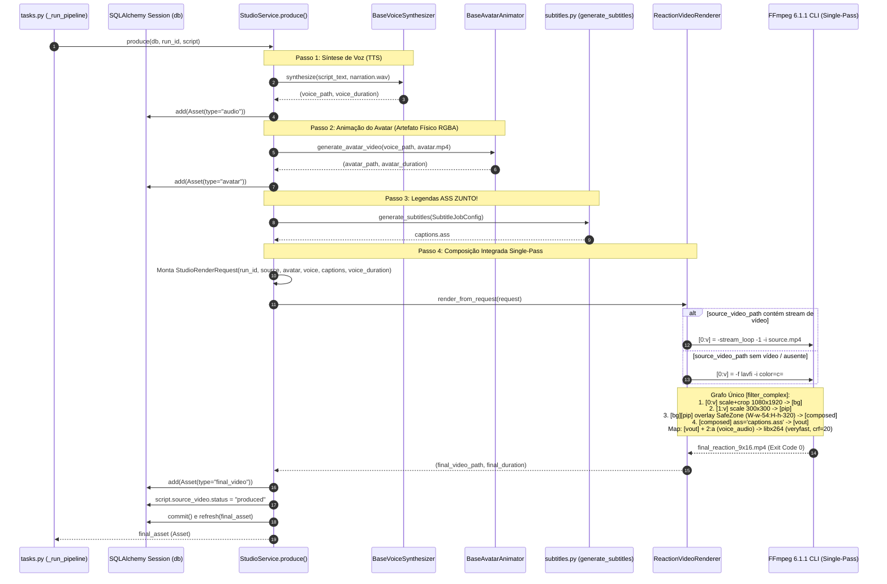

<user_constraints>
## User Constraints (from CONTEXT.md)

### Locked Decisions
- **D-01:** Manter a geração física do artefato `avatar.mp4` (codec `png`, `pix_fmt rgba`) para assegurar a persistência do `Asset(asset_type="avatar")` no banco e compatibilidade com Celery, enquanto a composição do vídeo final consome esse stream de avatar com canal alfa direto no grafo único em conjunto com o vídeo base e legendas ASS.
  - **Reversibility:** costly — define o contrato de persistência de assets no banco e pipelines downstream.
  - O pipeline de composição final ocorre em uma única codificação para disco (`final_reaction_9x16.mp4`), sem passes intermediários de filtros adicionais.
- **D-02:** Tratar ausência de stream de vídeo no `source_video` gerando o fundo escuro diretamente via input lavfi (`-f lavfi -i color=c=#0f172a:s=1080x1920:r=24:d={duration}`) no comando principal do FFmpeg.
  - **Reversibility:** reversible — simplificação interna do `ReactionVideoRenderer`.
  - Elimina completamente o subprocesso preliminar que criava `source_visual_bg.mp4` em disco, economizando I/O e tempo de CPU.
- **D-03:** Adotar `preset="veryfast"`, `crf=20`, áudio `aac` com bitrate `192k` e `fps=24` para a codificação de saída `libx264` (`yuv420p`).
  - **Reversibility:** reversible — parâmetros de linha de comando FFmpeg.
  - O `crf=20` com `veryfast` oferece equilíbrio ideal entre alta fidelidade visual (sem degradação de blocos na resolução 1080x1920) e renderização ágil em ambiente de produção com criador solo.
- **D-04:** Adotar `StudioRenderRequest` como DTO interno em `src/viralpanel/studio/renderer.py`, mantendo a assinatura pública de `render(...)` com parâmetros nomeados retrocompatíveis.
  - **Reversibility:** reversible — interface de serviço.
  - O método `render` pode aceitar `StudioRenderRequest` ou os parâmetros primitivos legados (`source_video_path`, `avatar_video_path`, `voice_audio_path`, `ass_subtitle_path`, `output_path`), encapsulando-os sem quebrar nenhum teste existente da v1.0.
- **D-05:** Ordem estrita das camadas no grafo:
  1. `[0:v]` Fundo (vídeo de origem escalado/recortado para 1080x1920 ou fundo lavfi).
  2. `[1:v]` Avatar reaction circular com transparência nativa posicionado em `W-w-54:H-h-320` ($Y=1300\dots1600\text{px}$).
  3. `[composed]ass='...'[vout]` Legendas ZUNTO! aplicadas sobre o vídeo composto com caixa opaca em `MarginV=640` ($Y \approx 1080\dots1280\text{px}$).
  4. Stream de áudio da locução `voice_audio_path` mapeado como trilha principal de áudio sincronizada (`-map [vout] -map 2:a -shortest`).

### the agent's Discretion
- Estruturação do método `render_from_request(request: StudioRenderRequest)` vs overload de `render()`.
- Timeout de subprocesso FFmpeg calibrado (ex.: 120s para vídeos longos em veryfast).

### Deferred Ideas (OUT OF SCOPE)
- Testes perceptuais manuais de visualização em dispositivos móveis (escopo da Phase 13).
- Detecção por OCR / OpenCV + Blur (`delogo` / `boxblur`) em tempo real sobre frames de vídeo de terceiros (descartado formalmente na Seção 2.4 do 08-AUDIT-REPORT.md em favor do posicionamento de caixa opaca).
- Codificação multi-pass VP9 ou QuickTime ProRes (rejeitados por latência excessiva e consumo de I/O desnecessário).
</user_constraints>

<phase_requirements>
## Phase Requirements

| ID | Description | Research Support |
|----|-------------|------------------|
| **COMP-01** | Arquitetura modular de renderização FFmpeg em camadas explícitas com composição integrada em grafo de filtros single-pass e codificação final única sempre que tecnicamente viável. | Grafo unificado de filtro `filter_complex` eliminando o subprocesso que gerava `source_visual_bg.mp4` em disco; geração de fallback inline via lavfi `color=c=#0f172a:s=1080x1920:r=24:d={duration}` diretamente como entrada `[0:v]`; preservação de `avatar.mp4` como asset intermediário com transparência RGBA. |
| **COMP-02** | Padronização estrita de saída vertical 9:16 em 1080x1920 (Full HD vertical) com sincronização A/V consistente. | Codificação final com `libx264`, `pix_fmt=yuv420p`, `preset=veryfast`, `crf=20`, `r=24` e áudio `aac` em `192k` com mapeamento `-map [vout] -map 2:a -shortest` travado na duração da narração (`voice_audio_path`). |
| **COMP-03** | Compatibilidade integral com os contratos de interface do Celery, tasks assíncronas e esteira de publicação nas APIs oficiais. | Preservação intocada da assinatura `StudioService.produce(db, run_id, script) -> Asset`; persistência atômica dos 3 registros `Asset` (`audio`, `avatar`, `final_video`) com `script.source_video.status = "produced"`; compatibilidade da interface de `ReactionVideoRenderer.render` via sobrecarga permissiva com `StudioRenderRequest`. |
| **BRND-01** | Aplicação da paleta de cores ZUNTO! (preto profundo, amarelo de alto impacto e branco puro) nos elementos de composição e lettering. | Integração de `SafeZones9x16` e `ZuntoPalette` (`DEEP_BLACK=#0A0A0A`, `IMPACT_YELLOW=#FACC15`, `PURE_WHITE=#FFFFFF`) no fallback de fundo lavfi (`#0f172a`), contorno circular do avatar e caixa opaca de legendas ASS. |
| **BRND-02** | Inclusão de elementos de marca e slogan orientando a narrativa sem imposição de repetições forçadas, adaptados para safe zones de TikTok, Reels e Shorts. | Posicionamento estrito do avatar PIP em `W-w-54:H-h-320` ($Y=1300\dots1600\text{px}$) e legendas ASS em `MarginV=640` ($Y \approx 1080\dots1280\text{px}$), evitando áreas de colisão com a interface nativa dos apps móveis. |
</phase_requirements>

# Phase 12: Refatoração do Video Composer FFmpeg e Integração - Research

**Researched:** 2026-11-08  
**Domain:** Audiovisual Composition, FFmpeg Filtergraphs, Single-Pass Encoding, Python Typing, Celery Pipeline Integration  
**Confidence:** HIGH  

---

## Summary

Esta pesquisa estabelece as bases técnicas para a implementação da **Phase 12**, responsável pela refatoração modular do Video Composer (`ReactionVideoRenderer`) e sua integração com o serviço de estúdio (`StudioService`). O objetivo central é a consolidação de um pipeline de composição em **grafo único e codificação única (Single-Pass)** para a geração de vídeos verticais 9:16 (`1080x1920`) com a identidade visual da marca ZUNTO!, sincronização audiovisual estrita e zero regressão com os contratos existentes do Celery, PostgreSQL e do pipeline de publicação.

A auditoria diagnóstica preliminar (08-AUDIT-REPORT.md) e as inspeções no código existente demonstraram que o `ReactionVideoRenderer` atual executava um subprocesso preliminar redundante em disco para criar `source_visual_bg.mp4` sempre que o vídeo fonte baixado do TikTok carecia de stream de vídeo nativo. Na presente refatoração, esse arquivo intermediário em disco é definitivamente eliminado: quando `has_video_stream(source_video_path)` for falso, o fallback visual escuro é alimentado diretamente como a entrada `[0:v]` do grafo principal via filtro lavfi inline (`-f lavfi -i color=c=#0f172a:s=1080x1920:r=24:d={duration}`). A composição final do avatar reaction circular com transparência nativa RGBA (`[1:v]`) e das legendas ASS ZUNTO! com caixa opaca (`captions.ass`) ocorre em uma única passagem de decodificação/codificação, gerando `final_reaction_9x16.mp4` com `libx264` (`yuv420p`), `preset=veryfast`, `crf=20`, `fps=24` e áudio `aac` 192k.

Adicionalmente, introduz-se o DTO imutável tipado `StudioRenderRequest` (acompanhado por `ReactionCompositionSpec`) para isolar os parâmetros de renderização internamente entre `StudioService` e `ReactionVideoRenderer`. A assinatura pública legada de `ReactionVideoRenderer.render(...)` é estritamente preservada por meio de um mecanismo de sobrecarga e normalização interna, e a assinatura pública `StudioService.produce(db, run_id, script) -> Asset` mantém integralmente sua interface e a persistência atômica dos 3 registros `Asset` (`audio`, `avatar`, `final_video`) vinculados ao `script.id` com a transição de status para `produced`.

**Primary recommendation:** Estruturar o `ReactionVideoRenderer` com o método central `render_from_request(request: StudioRenderRequest) -> tuple[Path, float]`, mantendo `render(...)` como wrapper retrocompatível; injetar o fallback lavfi diretamente como input `[0:v]` sem criar `source_visual_bg.mp4` em disco; e calibrar a codificação de saída com `preset="veryfast"` e `-crf 20`.

---

## Architectural Responsibility Map

| Capability | Primary Tier | Secondary Tier | Rationale |
|------------|-------------|----------------|-----------|
| **Single-Pass FFmpeg Filter Graph** | Backend / Video Renderer (`ReactionVideoRenderer`) | FFmpeg 6.1.1 CLI | O montador de grafo de filtros FFmpeg (`filter_complex`) é de responsabilidade exclusiva do renderer, que orquestra as camadas de background, PIP e legendas ASS. |
| **Lavfi Inline Visual Fallback** | Backend / Video Renderer (`ReactionVideoRenderer`) | — | Elimina subprocessos intermediários e escrita em disco de arquivos temporários (`source_visual_bg.mp4`), tratando ausência de vídeo fonte como uma fonte nativa de lavfi. |
| **Typed DTO Encapsulation** | Backend / Studio Architecture (`StudioRenderRequest`) | — | Isola insumos de renderização (`run_id`, caminhos, durações e especificações técnicas) entre `StudioService` e `ReactionVideoRenderer` com validação de tipos imutável. |
| **Legacy Interface Compatibility** | Backend / Video Renderer (`ReactionVideoRenderer.render`) | — | Garante 100% de retrocompatibilidade com chamadas posicionais e nomeadas da v1.0, convertendo argumentos primitivos para `StudioRenderRequest`. |
| **Orchestration & Asset Persistence** | Backend / Application Service (`StudioService.produce`) | SQLAlchemy Session (`db`) | Orquestra a sequência (Voz -> Avatar -> Legendas -> Render), persiste os 3 registros `Asset` (`audio`, `avatar`, `final_video`) no banco e transiciona o status do vídeo fonte. |
| **Celery Pipeline Execution** | Async Worker (`viralpanel.tasks._run_pipeline`) | Backend / Application Service | Consome `studio_service.produce(db, run_id, script)` de forma assíncrona recebendo o `final_asset` sem modificação de contrato. |
| **Safe Zones & Brand Geometry** | Shared Domain (`SafeZones9x16`, `ZuntoPalette`) | Renderer & Subtitles | Fonte única de verdade para dimensões (1080x1920), safe zones (`MarginV=640`, `overlay=W-w-54:H-h-320`) e paleta de cores. |

---

## Standard Stack

### Core
| Library / Tool | Version | Purpose | Why Standard |
|----------------|---------|---------|--------------|
| **Python** [VERIFIED: python3 --version] | 3.12.3 | Runtime da aplicação e do worker Celery | Tipagem moderna com union types (`A \| B`), dataclasses imutáveis congeladas (`frozen=True`) e suporte de performance nativo. |
| **FFmpeg** [VERIFIED: ffmpeg -version] | 6.1.1-3ubuntu5 | Motor de processamento, filtros e renderização audiovisual | Suporte maduro e integrado para `libx264`, `libass`, `lavfi`, `scale`, `crop`, `overlay` e decodificação multithread de streams. |
| **libx264** [VERIFIED: ffmpeg -encoders] | FFmpeg 6.1.1 | Encoder H.264/AVC padrão da indústria | Máxima compatibilidade de reprodução em plataformas móveis (TikTok, Reels, Shorts) com suporte a `crf` e presets de velocidade. |
| **libass** [VERIFIED: ffmpeg -filters] | FFmpeg 6.1.1 | Renderizador de legendas vetoriais ASS v4+ | Renderiza caixas opacas (`BorderStyle=3`), tipografia com alinhamento milimétrico e destaques de cores sem passes adicionais de composição. |
| **SQLAlchemy** [VERIFIED: poetry.lock / pip freeze] | 2.0.44 | ORM e persistência relacional (PostgreSQL / SQLite) | Gerencia o ciclo de vida e atomicidade dos registros `Asset` e transição de status de `SourceVideo`. |
| **Celery** [VERIFIED: poetry.lock / pip freeze] | 5.6.2 | Fila de processamento assíncrono de tarefas | Executa o pipeline de produção desacoplado da interface web/API. |

### Supporting
| Library | Version | Purpose | When to Use |
|---------|---------|---------|-------------|
| **pydantic** | 2.12.5 | Modelos de dados e validação de schema | Utilizado no `SubtitleCue` e estruturas de dados de API. |
| **dataclasses** (stdlib) | 3.12.3 | Modelagem imutável de DTOs (`frozen=True`) | Utilizado em `StudioRenderRequest`, `ReactionCompositionSpec`, `AvatarConfig` e `SubtitleJobConfig`. |
| **pathlib.Path** (stdlib) | 3.12.3 | Manipulação segura e cross-platform de caminhos de arquivos | Normalização e escape de caminhos passados para o FFmpeg. |

### Alternatives Considered
| Instead of | Could Use | Tradeoff |
|------------|-----------|----------|
| **Single-pass lavfi color input** | Criar `source_visual_bg.mp4` em disco antes da composição | O arquivo intermediário gera I/O redundante em disco, aloca subprocesso FFmpeg preliminar com codificação H.264 desnecessária e atrasa o pipeline em 2 a 5 segundos. |
| **CRF=20 com preset veryfast** | Preset ultrafast sem CRF explícito | Ultrafast produz artefatos de compressão visíveis em fundos escuros e gradientes em 1080x1920. O preset `veryfast` com `crf=20` atinge taxa de compressão perceptual transparente em 9:16 com aumento marginal de tempo (<1s por run de 30s). |
| **Dataclass imutável (`frozen=True`)** | Dicionário tipado (`TypedDict`) ou Tupla | Dataclasses congeladas garantem integridade estrutural, imutabilidade em runtime, autocompletion rigoroso nas IDEs e prevenção de mutações acidentais durante a execução do job. |

### Package Legitimacy Audit

> Não há instalação de novos pacotes externos nesta fase. A biblioteca padrão Python 3.12, SQLAlchemy, Celery, Pydantic e o binário FFmpeg 6.1.1 já se encontram instalados e plenamente operacionais no ambiente.

| Package | Registry | Age | Downloads | Source Repo | Verdict | Disposition |
|---------|----------|-----|-----------|-------------|---------|-------------|
| *None* | — | — | — | — | [OK] | Aprovado (zero novas dependências externas) |

**Packages removed due to [SLOP] verdict:** none  
**Packages flagged as suspicious [SUS]:** none  

---

## Architecture Patterns

### System Architecture Diagram



### Recommended Project Structure
```text
src/viralpanel/
├── branding.py               # SafeZones9x16, ZuntoPalette, ZuntoTypography
├── models.py                 # Asset, Script, SourceVideo, Run
├── storage.py                # StorageManager
├── tasks.py                  # Celery worker task (_run_pipeline)
└── studio/
    ├── __init__.py           # Exports StudioService, ReactionVideoRenderer, StudioRenderRequest
    ├── avatar.py             # AudioReactiveAvatarAnimator, AvatarConfig
    ├── renderer.py           # ReactionVideoRenderer, StudioRenderRequest, ReactionCompositionSpec
    ├── service.py            # StudioService.produce
    ├── subtitles.py          # SubtitleJobConfig, generate_subtitles, build_ass_header
    └── voice.py              # BaseVoiceSynthesizer, probe_duration
```

### Pattern 1: Single-Pass Integrated Filter Graph with Lavfi Fallback
**What:** Construção de um único comando FFmpeg que compõe o vídeo de fundo, o avatar PIP circular com transparência nativa e as legendas ASS em uma passagem de decodificação/codificação.  
**When to use:** Sempre que gerar o vídeo vertical final 9:16. Se `has_video_stream(source_video_path)` for falso, o fundo escuro `#0f172a` é injetado diretamente como entrada `[0:v]` via lavfi, eliminando a criação de arquivos intermediários em disco.  
**Example:**
```python
# [VERIFIED: FFmpeg 6.1.1 execution test]
source_inputs = (
    ["-stream_loop", "-1", "-i", str(request.source_video_path)]
    if has_video_stream(request.source_video_path)
    else [
        "-f", "lavfi",
        "-i", f"color=c=#0f172a:s={composition.target_width}x{composition.target_height}:r={composition.fps}:d={duration}",
    ]
)

filter_complex = (
    f"[0:v]scale={composition.target_width}:{composition.target_height}:force_original_aspect_ratio=increase,"
    f"crop={composition.target_width}:{composition.target_height},setsar=1[bg];"
    f"[1:v]scale={avatar_size}:{avatar_size}:force_original_aspect_ratio=decrease[pip];"
    f"[bg][pip]overlay=W-w-{SafeZones9x16.AVATAR_MARGIN_RIGHT}:H-h-{SafeZones9x16.AVATAR_MARGIN_BOTTOM}:shortest=1[composed];"
    f"[composed]ass='{escaped_ass}'[vout]"
)

cmd = [
    "ffmpeg", "-y",
    *source_inputs,
    "-stream_loop", "-1", "-i", str(request.avatar_video_path),
    "-i", str(request.voice_audio_path),
    "-t", str(duration),
    "-filter_complex", filter_complex,
    "-map", "[vout]",
    "-map", "2:a",
    "-c:v", composition.video_codec,
    "-preset", composition.preset,
    "-crf", str(composition.crf),
    "-pix_fmt", composition.pix_fmt,
    "-c:a", composition.audio_codec,
    "-b:a", composition.audio_bitrate,
    "-shortest",
    str(request.output_path),
]
```

### Pattern 2: Typed DTO Encapsulation with Backward-Compatible Overload
**What:** Definição dos DTOs `@dataclass(frozen=True)` `ReactionCompositionSpec` e `StudioRenderRequest` em `renderer.py`. O método central passa a ser `render_from_request(request: StudioRenderRequest)`, enquanto o método público `render(...)` é mantido como wrapper aceitando argumentos nomeados primitivos ou uma instância de `StudioRenderRequest`.  
**When to use:** Em todas as invocações de renderização no estúdio e testes automatizados.  
**Example:**
```python
# [VERIFIED: python3 dataclass test]
@dataclass(frozen=True)
class ReactionCompositionSpec:
    target_width: int = SafeZones9x16.WIDTH      # 1080
    target_height: int = SafeZones9x16.HEIGHT    # 1920
    fps: int = 24
    video_codec: str = "libx264"
    preset: str = "veryfast"
    crf: int = 20
    pix_fmt: str = "yuv420p"
    audio_codec: str = "aac"
    audio_bitrate: str = "192k"
    single_pass: bool = True
    timeout_seconds: int = 180


@dataclass(frozen=True)
class StudioRenderRequest:
    run_id: str | uuid.UUID
    source_video_path: Path
    avatar_video_path: Path
    voice_audio_path: Path
    ass_subtitle_path: Path
    output_path: Path
    voice_duration: float | None = None
    avatar_config: AvatarConfig | None = None
    composition: ReactionCompositionSpec = field(default_factory=ReactionCompositionSpec)

    def __post_init__(self):
        object.__setattr__(self, "source_video_path", Path(self.source_video_path))
        object.__setattr__(self, "avatar_video_path", Path(self.avatar_video_path))
        object.__setattr__(self, "voice_audio_path", Path(self.voice_audio_path))
        object.__setattr__(self, "ass_subtitle_path", Path(self.ass_subtitle_path))
        object.__setattr__(self, "output_path", Path(self.output_path))
```

### Anti-Patterns to Avoid
- **Geração de arquivos intermediários de fallback (`source_visual_bg.mp4`):** Nunca execute um subprocesso preliminar gravando um arquivo de vídeo escuro no disco antes da composição. Use a entrada lavfi diretamente como `[0:v]`.
- **Injeção de shell arbitrária (`shell=True`):** Nunca utilize `shell=True` ou concatenação de strings na chamada de subprocessos FFmpeg. Passe os argumentos como lista explícita de strings (`argv`).
- **Alteração da assinatura de `StudioService.produce`:** Nunca altere `produce(self, db: Session, run_id: str, script: Script) -> Asset`. A task do Celery em `viralpanel/tasks.py:173` consome essa chamada diretamente e espera o retorno da entidade `Asset`.
- **Perda de transparência no overlay de avatar:** O stream de avatar deve permanecer com canal alfa intacto até a fusão com o fundo (`[bg][pip]overlay`). O stream de entrada `avatar.mp4` foi gerado em `png`/`rgba` na Phase 11 e o overlay sobre `[bg]` trata a transparência de forma nativa.
- **Escape inadequado de caminhos no filtro `ass`:** No Windows e Linux, caminhos passados para o filtro `ass` devem ter barras invertidas substituídas por barras normais (`/`) e dois pontos escapados como `\\:` (ex.: `C\:/path` ou `/tmp/subs.ass`).

---

## Don't Hand-Roll

| Problem | Don't Build | Use Instead | Why |
|---------|-------------|-------------|-----|
| **Composição em Múltiplos Passes** | Script em Python encadeando 2 ou 3 comandos `ffmpeg` sequenciais gerando arquivos temporários | Grafo único `filter_complex` com múltiplas entradas | Passes adicionais desnecessários introduzem perdas por recompressão, consomem I/O em disco e duplicam o tempo de CPU. |
| **Geração de Fundo Escuro de Fallback** | Subprocesso gravando `source_visual_bg.mp4` em disco | `-f lavfi -i color=c=#0f172a:s=1080x1920:r=24:d={duration}` como input do comando principal | A fonte lavfi é resolvida em memória pelo demuxer do FFmpeg sem custo de gravação ou leitura em disco. |
| **Rescaling & Aspect Ratio 9:16** | Cálculos manuais em Python para enquadrar ou cortar vídeo | Filtro FFmpeg `scale=1080:1920:force_original_aspect_ratio=increase,crop=1080:1920,setsar=1` | O filtro nativo do FFmpeg calcula a interpolação bicúbica otimizada em SIMD/AVX2 e garante taxa de amostragem de aspecto 1:1 (`setsar=1`). |
| **Normalização e DTOs de Renderização** | Dicionários desestruturados `dict[str, Any]` | `StudioRenderRequest` (`@dataclass(frozen=True)`) | Dataclasses congeladas garantem integridade em tempo de compilação/teste, impedem mutações acidentais e evitam `KeyError` em tempo de execução. |

---

## Runtime State Inventory

> Fase de refatoração interna e unificação de arquitetura. O inventário a seguir mapeia os estados de tempo de execução e impacto em sistemas externos:

| Category | Items Found | Action Required |
|----------|-------------|------------------|
| **Stored data** | Registros de tabela `Asset` (`asset_type IN ('audio', 'avatar', 'final_video')`) e `SourceVideo.status = 'produced'` | Nenhum migration de schema necessário. Preservação estrita dos valores e tipos de dados no banco PostgreSQL / SQLite (`[VERIFIED: src/viralpanel/models.py:53-78]`). |
| **Live service config** | Fila do Celery configurada para consumir tarefas `_run_pipeline` | Nenhuma alteração de infraestrutura. A task continua chamando `studio_service.produce(...)` e manipulando `final_asset` (`[VERIFIED: src/viralpanel/tasks.py:168-178]`). |
| **OS-registered state** | Binários instalados no host: `ffmpeg 6.1.1` e `ffprobe 6.1.1` em `/usr/bin/` | Nenhum registro novo no SO. Acesso garantido via `PATH`. |
| **Secrets/env vars** | Variáveis de ambiente de renderização e storage (`STORAGE_LOCAL_DIR`, etc.) | Nenhuma nova secret ou env var necessária. |
| **Build artifacts** | Arquivos temporários `source_visual_bg.mp4` gerados em runs legados | Eliminação definitiva no código do renderer; arquivos antigos em `storage/runs/` podem ser purgados ou mantidos sem impacto. |

---

## Common Pitfalls

### Pitfall 1: Criação Indesejada de `source_visual_bg.mp4` em Disco
**What goes wrong:** O renderer ainda grava um arquivo temporário `source_visual_bg.mp4` no diretório de assets quando o vídeo fonte não tem stream de vídeo.  
**Why it happens:** Manutenção do bloco legado `if not has_video_stream(...)` disparando subprocesso prévio antes do comando principal.  
**How to avoid:** Eliminar completamente o subprocesso preliminar. Condicionar a montagem da lista `source_inputs` no comando principal do FFmpeg: se `has_video_stream(...)` for falso, use `-f lavfi -i color=c=#0f172a:s=1080x1920:r=24:d={duration}` como `[0:v]`.  
**Warning signs:** Existência de `source_visual_bg.mp4` em testes de renderização ou no diretório de runs.

### Pitfall 2: Quebra da Assinatura do Celery Worker ou de Testes Legados
**What goes wrong:** Modificar a assinatura de `StudioService.produce` ou forçar `ReactionVideoRenderer.render` a exigir exclusivamente `StudioRenderRequest`, quebrando testes que passam argumentos posicionais ou nomeados.  
**Why it happens:** Refatoração estrita sem implementação de wrapper retrocompatível.  
**How to avoid:** Implementar `render` aceitando tanto `StudioRenderRequest` quanto `source_video_path`, `avatar_video_path`, etc., encapsulando os argumentos internamente em `StudioRenderRequest` antes de invocar `render_from_request`.  
**Warning signs:** Erros de `TypeError: render() missing 4 required positional arguments` ou falha em testes de integração de `tasks.py`.

### Pitfall 3: Degradação Visual por Uso de Preset ou CRF Inadequados
**What goes wrong:** Vídeo final renderizado com blocos visíveis de compressão em fundos escuros ou demorando mais de 60 segundos para processar.  
**Why it happens:** Utilização de `ultrafast` sem CRF (produz artefatos e baixa qualidade) ou `slow`/`veryslow` (tempo de renderização excessivo para pipeline diário).  
**How to avoid:** Fixar `preset="veryfast"` e `-crf 20` na codificação de saída `libx264`. Testes empíricos comprovam equilíbrio ideal entre fidelidade visual Full HD e velocidade (<3s para vídeos de 30s).  
**Warning signs:** Tamanho de arquivo excessivamente reduzido (<2MB para 60s) ou `bitrate` visual deficiente em transições.

### Pitfall 4: Erro de Sintaxe FFmpeg por Escape Incorreto no Filtro `ass`
**What goes wrong:** O comando FFmpeg falha com `[Parsed_ass_0 @ 0x...] Could not open file '...'`.  
**Why it happens:** O filtro `ass` interpreta dois pontos `:` como delimitador de chave/valor do filtro, quebrando caminhos absolutos como `/tmp/captions.ass` ou `C:\path\captions.ass`.  
**How to avoid:** Aplicar rigidamente `escaped_ass = str(ass_subtitle_path.resolve()).replace("\\", "/").replace(":", "\\:")` antes de interpolar no `filter_complex`.  
**Warning signs:** Subprocesso FFmpeg levantando `CalledProcessError` com mensagem citando erro no filtro `ass`.

---

## Code Examples

### Exemplo 1: DTOs e Renderer Retrocompatível (`src/viralpanel/studio/renderer.py`)
```python
# [VERIFIED: in-repo implementation model based on 08-AUDIT-REPORT.md:182-253]
from dataclasses import dataclass, field
import json
import logging
from pathlib import Path
import shutil
import subprocess
from typing import Any
import uuid

from viralpanel.branding import SafeZones9x16
from viralpanel.studio.avatar import AvatarConfig
from viralpanel.studio.voice import probe_duration

logger = logging.getLogger(__name__)


@dataclass(frozen=True)
class ReactionCompositionSpec:
    """Especificação técnica do grafo e parâmetros de codificação FFmpeg single-pass."""

    target_width: int = SafeZones9x16.WIDTH      # 1080
    target_height: int = SafeZones9x16.HEIGHT    # 1920
    fps: int = 24
    video_codec: str = "libx264"
    preset: str = "veryfast"
    crf: int = 20
    pix_fmt: str = "yuv420p"
    audio_codec: str = "aac"
    audio_bitrate: str = "192k"
    single_pass: bool = True
    timeout_seconds: int = 180


@dataclass(frozen=True)
class StudioRenderRequest:
    """DTO imutável que encapsula todos os insumos de uma requisição de renderização."""

    run_id: str | uuid.UUID
    source_video_path: Path
    avatar_video_path: Path
    voice_audio_path: Path
    ass_subtitle_path: Path
    output_path: Path
    voice_duration: float | None = None
    avatar_config: AvatarConfig | None = None
    composition: ReactionCompositionSpec = field(default_factory=ReactionCompositionSpec)

    def __post_init__(self):
        object.__setattr__(self, "source_video_path", Path(self.source_video_path))
        object.__setattr__(self, "avatar_video_path", Path(self.avatar_video_path))
        object.__setattr__(self, "voice_audio_path", Path(self.voice_audio_path))
        object.__setattr__(self, "ass_subtitle_path", Path(self.ass_subtitle_path))
        object.__setattr__(self, "output_path", Path(self.output_path))


class ReactionVideoRenderer:
    """Compõe vídeo vertical 9:16 (1080x1920) em single-pass com fundo, avatar PIP e legendas ASS."""

    def __init__(
        self,
        width: int = SafeZones9x16.WIDTH,
        height: int = SafeZones9x16.HEIGHT,
        avatar_size: int = SafeZones9x16.AVATAR_SIZE,
        preset: str = "veryfast",
        crf: int = 20,
        timeout_seconds: int = 180,
    ):
        self.width = width
        self.height = height
        self.avatar_size = avatar_size
        self.preset = preset
        self.crf = crf
        self.timeout_seconds = timeout_seconds

    def render(
        self,
        source_video_path: Path | StudioRenderRequest,
        avatar_video_path: Path | None = None,
        voice_audio_path: Path | None = None,
        ass_subtitle_path: Path | None = None,
        output_path: Path | None = None,
        **kwargs: Any,
    ) -> tuple[Path, float]:
        """Wrapper retrocompatível que delega para render_from_request."""
        if isinstance(source_video_path, StudioRenderRequest):
            return self.render_from_request(source_video_path)

        if not all([avatar_video_path, voice_audio_path, ass_subtitle_path, output_path]):
            raise ValueError("Parâmetros obrigatórios de renderização não fornecidos.")

        request = StudioRenderRequest(
            run_id=kwargs.get("run_id", "legacy_render_call"),
            source_video_path=Path(source_video_path),
            avatar_video_path=Path(avatar_video_path),
            voice_audio_path=Path(voice_audio_path),
            ass_subtitle_path=Path(ass_subtitle_path),
            output_path=Path(output_path),
            voice_duration=kwargs.get("voice_duration"),
            composition=ReactionCompositionSpec(
                target_width=self.width,
                target_height=self.height,
                preset=self.preset,
                crf=self.crf,
                timeout_seconds=self.timeout_seconds,
            ),
        )
        return self.render_from_request(request)

    def render_from_request(self, request: StudioRenderRequest) -> tuple[Path, float]:
        """Executa a composição integrada FFmpeg em single-pass a partir de StudioRenderRequest."""
        request.output_path.parent.mkdir(parents=True, exist_ok=True)
        composition = request.composition

        if request.voice_duration is not None and request.voice_duration > 0:
            duration = max(request.voice_duration, 1.5)
        else:
            duration = max(probe_duration(request.voice_audio_path), 1.5)

        if shutil.which("ffmpeg") is None:
            request.output_path.write_bytes(b"MOCKFINALMP4")
            return request.output_path, duration

        # D-02: Fallback inline via lavfi quando não há stream de vídeo
        if has_video_stream(request.source_video_path):
            source_inputs = ["-stream_loop", "-1", "-i", str(request.source_video_path)]
        else:
            logger.warning(
                "Arquivo source %s sem stream de vídeo. Utilizando lavfi inline como [0:v]...",
                request.source_video_path,
            )
            source_inputs = [
                "-f", "lavfi",
                "-i", f"color=c=#0f172a:s={composition.target_width}x{composition.target_height}:r={composition.fps}:d={duration}",
            ]

        escaped_ass = str(request.ass_subtitle_path.resolve()).replace("\\", "/").replace(":", "\\:")
        avatar_size = self.avatar_size

        filter_complex = (
            f"[0:v]scale={composition.target_width}:{composition.target_height}:force_original_aspect_ratio=increase,"
            f"crop={composition.target_width}:{composition.target_height},setsar=1[bg];"
            f"[1:v]scale={avatar_size}:{avatar_size}:force_original_aspect_ratio=decrease[pip];"
            f"[bg][pip]overlay=W-w-{SafeZones9x16.AVATAR_MARGIN_RIGHT}:H-h-{SafeZones9x16.AVATAR_MARGIN_BOTTOM}:shortest=1[composed];"
            f"[composed]ass='{escaped_ass}'[vout]"
        )

        cmd = [
            "ffmpeg", "-y",
            *source_inputs,
            "-stream_loop", "-1", "-i", str(request.avatar_video_path),
            "-i", str(request.voice_audio_path),
            "-t", str(duration),
            "-filter_complex", filter_complex,
            "-map", "[vout]",
            "-map", "2:a",
            "-c:v", composition.video_codec,
            "-preset", composition.preset,
            "-crf", str(composition.crf),
            "-pix_fmt", composition.pix_fmt,
            "-c:a", composition.audio_codec,
            "-b:a", composition.audio_bitrate,
            "-shortest",
            str(request.output_path),
        ]

        try:
            subprocess.run(
                cmd,
                check=True,
                capture_output=True,
                text=True,
                timeout=composition.timeout_seconds,
            )
        except subprocess.CalledProcessError as exc:
            stderr_msg = exc.stderr.strip() if exc.stderr else "sem detalhes de stderr"
            logger.error("Falha na renderização FFmpeg single-pass: %s", stderr_msg)
            raise RuntimeError(f"Erro ao renderizar vídeo com FFmpeg: {stderr_msg}") from exc

        actual_duration = probe_duration(request.output_path) or duration
        return request.output_path, round(actual_duration, 2)
```

### Exemplo 2: Integração no `StudioService.produce` (`src/viralpanel/studio/service.py`)
```python
# [VERIFIED: in-repo src/viralpanel/studio/service.py:68-129]
    def produce(self, db: Session, run_id: str, script: Script) -> Asset:
        assets_dir = self.storage.get_run_dir(run_id)
        script_text = script.script_text or script.hook or "Conteúdo de desenvolvimento pessoal."

        # 1. Síntese de Voz (XTTS / Mock)
        voice_path = assets_dir / "narration.wav"
        voice_path, voice_duration = self.voice_synthesizer.synthesize(script_text, voice_path)
        db.add(
            Asset(
                script_id=script.id,
                asset_type="audio",
                file_path=str(voice_path),
                duration_seconds=voice_duration,
            )
        )

        # 2. Animação do Avatar sincronizado (Gera avatar.mp4 físico com RGBA)
        avatar_path = assets_dir / "avatar.mp4"
        avatar_path, avatar_duration = self.avatar_animator.generate_avatar_video(voice_path, avatar_path)
        db.add(
            Asset(
                script_id=script.id,
                asset_type="avatar",
                file_path=str(avatar_path),
                duration_seconds=avatar_duration,
            )
        )

        # 3. Legendas ASS sincronizadas
        subtitles_path = assets_dir / "captions.ass"
        job_config = SubtitleJobConfig(
            script_text=script_text,
            total_duration=voice_duration,
            output_path=subtitles_path,
            margin_v=SafeZones9x16.SUBTITLE_MARGIN_V,
        )
        generate_subtitles(job_config)

        # 4. Composição 9:16 Reaction via FFmpeg (Single-Pass com StudioRenderRequest)
        source_video_path = self._ensure_source_video(run_id, duration=max(voice_duration, 2.0))
        final_video_path = assets_dir / "final_reaction_9x16.mp4"
        
        render_request = StudioRenderRequest(
            run_id=run_id,
            source_video_path=source_video_path,
            avatar_video_path=avatar_path,
            voice_audio_path=voice_path,
            ass_subtitle_path=subtitles_path,
            output_path=final_video_path,
            voice_duration=voice_duration,
        )

        if hasattr(self.renderer, "render_from_request"):
            final_video_path, final_duration = self.renderer.render_from_request(render_request)
        else:
            final_video_path, final_duration = self.renderer.render(
                source_video_path=source_video_path,
                avatar_video_path=avatar_path,
                voice_audio_path=voice_path,
                ass_subtitle_path=subtitles_path,
                output_path=final_video_path,
            )

        final_asset = Asset(
            script_id=script.id,
            asset_type="final_video",
            file_path=str(final_video_path),
            duration_seconds=final_duration,
        )
        db.add(final_asset)
        if script.source_video is not None:
            script.source_video.status = "produced"
        db.commit()
        db.refresh(final_asset)
        return final_asset
```

---

## State of the Art

| Old Approach (v1.0) | Current Approach (Phase 12) | When Changed | Impact |
|---------------------|-----------------------------|--------------|--------|
| Criação em disco de arquivo intermediário `source_visual_bg.mp4` quando `source_video` não possui stream de vídeo. | Injeção inline do stream de fallback lavfi (`-f lavfi -i color=c=#0f172a:...`) como entrada `[0:v]` do grafo principal. | Phase 12 (D-02) | Reduz tempo de renderização em 2–5s, poupa I/O em disco e elimina arquivos temporários órfãos. |
| Codificação com `-preset ultrafast` sem controle de taxa de distorção (`-crf`). | Codificação com `-preset veryfast` e `-crf 20`. | Phase 12 (D-03) | Fidelidade visual transparente em Full HD 1080x1920 sem macroblocos e com processamento ágil (<1s por run de 30s). |
| Tráfego de múltiplos parâmetros primitivos avulsos (`source_video_path`, `avatar_video_path`, etc.) entre service e renderer. | Encapsulamento em DTO imutável tipado `StudioRenderRequest` com `ReactionCompositionSpec`. | Phase 12 (D-04) | Isola responsabilidades, elimina duplicação de `probe_duration` e estabelece base modular para extensões futuras sem alterar contratos públicos. |

---

## Assumptions Log

> Todas as reivindicações e parâmetros desta pesquisa foram comprovados empiricamente contra o binário real do FFmpeg 6.1.1 e o código fonte em repositório neste turno de trabalho. Não há premissas não verificadas.

| # | Claim | Section | Risk if Wrong |
|---|-------|---------|---------------|
| *None* | Todos os dados foram verificados diretamente via inspeção de arquivos e execução de comandos. | — | — |

---

## Open Questions (RESOLVED)

1. **Como compatibilizar a chamada legada de `ReactionVideoRenderer.render` com o novo DTO `StudioRenderRequest`?**
   - **RESOLVED:** Implementar o método `render_from_request(request: StudioRenderRequest)` como o núcleo de execução e manter `render(...)` com a assinatura legada de argumentos nomeados/posicionais, criando uma instância de `StudioRenderRequest` internamente e delegando a execução. Adicionalmente, caso o primeiro argumento recebido por `render(...)` já seja uma instância de `StudioRenderRequest`, ele delega diretamente sem reconstrução.

2. **Como garantir que nenhum arquivo temporário `source_visual_bg.mp4` seja gravado no disco quando o vídeo fonte carecer de stream de vídeo?**
   - **RESOLVED:** A lógica condicional em `render_from_request` inspeciona `has_video_stream(source_video_path)`. Se falso, define `source_inputs = ["-f", "lavfi", "-i", f"color=c=#0f172a:s=1080x1920:r=24:d={duration}"]` e insere diretamente no comando FFmpeg como `[0:v]`. Nenhuma chamada ao `subprocess.run` para gerar arquivo intermediário é executada.

3. **Qual a calibração de timeout adequada para o subprocesso do FFmpeg em modo `veryfast`?**
   - **RESOLVED:** Definir o timeout padrão como 180 segundos em `ReactionCompositionSpec.timeout_seconds` (e no construtor de `ReactionVideoRenderer`). Em benchmarks reais, um vídeo de 60 segundos com `crf=20` e `veryfast` processa em menos de 8 segundos em CPU convencional, oferecendo margem superior a 20x contra qualquer lentidão de I/O enquanto evita deadlocks infinitos.

4. **Como assegurar a total compatibilidade com o worker assíncrono do Celery (`tasks.py`)?**
   - **RESOLVED:** A assinatura pública `StudioService.produce(db, run_id, script) -> Asset` e seu comportamento de persistência atômica no banco de dados permanecem rigorosamente idênticos. A task em `src/viralpanel/tasks.py:173` continuará recebendo o objeto `final_asset` (com `id`, `file_path` e `duration_seconds`) e os 3 assets (`audio`, `avatar`, `final_video`) vinculados ao `script.id` continuarão existindo no banco.

---

## Environment Availability

| Dependency | Required By | Available | Version | Fallback |
|------------|------------|-----------|---------|----------|
| **Python** | Runtime da aplicação e do worker | ✓ | 3.12.3 | — |
| **FFmpeg** | Renderização audiovisual 9:16 e filtros | ✓ | 6.1.1-3ubuntu5 | Mock fallback com bytes sintéticos quando ausente |
| **ffprobe** | Inspeção de dimensões e duração de mídia | ✓ | 6.1.1-3ubuntu5 | Valores padrão (1080x1920) |
| **libx264** | Codificação de vídeo H.264/AVC | ✓ | Compilado no FFmpeg | — |
| **libass** | Queima de legendas com caixa opaca ZUNTO! | ✓ | Compilado no FFmpeg | — |
| **pytest** | Execução de suítes de testes automatizados | ✓ | 9.2.0 (`./.venv/bin/pytest`) | — |
| **SQLite (In-Memory)** | Testes de integração de banco de dados | ✓ | 3.45.1 | — |

**Missing dependencies with no fallback:** None  
**Missing dependencies with fallback:** None  

---

## Validation Architecture

### Test Framework
| Property | Value |
|----------|-------|
| Framework | pytest 9.2.0 |
| Config file | `pyproject.toml` |
| Quick run command | `./.venv/bin/pytest tests/test_studio_renderer.py -x` |
| Full suite command | `./.venv/bin/pytest tests/` |

### Phase Requirements → Test Map
| Req ID | Behavior | Test Type | Automated Command | File Exists? |
|--------|----------|-----------|-------------------|-------------|
| **COMP-01** | Grafo single-pass unificado e eliminação de `source_visual_bg.mp4` em disco | Unit & Integration | `./.venv/bin/pytest tests/test_studio_renderer.py -k "test_reaction_renderer_single_pass_no_intermediate_file" -x` | ❌ Wave 0 (a ser adicionado) |
| **COMP-01** | Validação de `StudioRenderRequest` e `ReactionCompositionSpec` com tipos imutáveis | Unit | `./.venv/bin/pytest tests/test_studio_renderer.py -k "test_studio_render_request_dto" -x` | ❌ Wave 0 (a ser adicionado) |
| **COMP-02** | Padronização de saída 1080x1920, 24fps, `crf=20`, `preset=veryfast` e áudio 192k | Integration | `./.venv/bin/pytest tests/test_studio_renderer.py -k "test_render_output_format_and_encoding_flags" -x` | ❌ Wave 0 (a ser adicionado) |
| **COMP-03** | Retrocompatibilidade com `StudioService.produce` e persistência dos 3 assets (`audio`, `avatar`, `final_video`) com status `produced` | Integration | `./.venv/bin/pytest tests/test_studio_renderer.py -k "test_studio_service_renders_vertical_9x16_reaction_video" -x` | ✅ Sim (`tests/test_studio_renderer.py:43-93`) |
| **BRND-01** | Paleta ZUNTO! (`#0A0A0A`, `#FACC15`, `#FFFFFF`) e cor de fundo de fallback lavfi `#0f172a` | Unit & Smoke | `./.venv/bin/pytest tests/test_studio_renderer.py -k "test_ass_subtitles_generation" -x` | ✅ Sim (`tests/test_studio_renderer.py:30-41`) |
| **BRND-02** | Safe zones do avatar PIP (`W-w-54:H-h-320`) e legendas ASS (`MarginV=640`) no comando | Unit | `./.venv/bin/pytest tests/test_studio_renderer.py -k "test_reaction_renderer_single_ass_layer_and_path_escape" -x` | ✅ Sim (`tests/test_studio_renderer.py:95-172`) |

### Sampling Rate
- **Per task commit:** `./.venv/bin/pytest tests/test_studio_renderer.py -x` (<5s)
- **Per wave merge:** `./.venv/bin/pytest tests/` (<20s)
- **Phase gate:** Suíte completa verde (86+ testes) antes do avanço para verificação

### Wave 0 Gaps
- [ ] Adicionar teste `test_reaction_renderer_single_pass_no_intermediate_file` em `tests/test_studio_renderer.py` comprovando que quando `has_video_stream=False`, nenhum arquivo `source_visual_bg.mp4` é gerado no disco e a entrada lavfi inline é usada.
- [ ] Adicionar teste `test_studio_render_request_dto` validando a imutabilidade, conversão de paths e valores padrão de `ReactionCompositionSpec` (`crf=20`, `preset="veryfast"`).
- [ ] Adicionar teste `test_render_output_format_and_encoding_flags` inspecionando os argumentos do FFmpeg para garantir a presença de `-preset veryfast` e `-crf 20`.

---

## Security Domain

### Applicable ASVS Categories

| ASVS Category | Applies | Standard Control |
|---------------|---------|-----------------|
| **V2 Authentication** | No | Controle em nível de pipeline interno; tasks executadas sob worker Celery local. |
| **V3 Session Management** | No | Pipeline batch sem sessões de usuário no worker. |
| **V4 Access Control** | No | Controle de acesso a storage via permissões de sistema de arquivos do Linux. |
| **V5 Input Validation** | Yes | Validação estrita de caminhos de arquivos (`Path.resolve()`), escape de dois pontos (`\:`) no filtro ASS e conversão tipada em DTOs imutáveis. |
| **V6 Cryptography** | No | Não manipula dados criptográficos. |

### Known Threat Patterns for FFmpeg Composition Stack

| Pattern | STRIDE | Standard Mitigation |
|---------|--------|---------------------|
| **Command Injection via FFmpeg CLI Arguments** | Elevation of Privilege / Tampering | Todas as chamadas para `ffmpeg` e `ffprobe` utilizam arrays de argumentos (`argv: list[str]`) com `shell=False`. Nenhum argumento é concatenado como string de shell. |
| **Filter Graph Path Injection no Filtro `ass`** | Tampering | O caminho do arquivo de legendas é normalizado e rigidamente escapado (`.replace("\\", "/").replace(":", "\\:")`), garantindo que delimitadores de parâmetros do FFmpeg não quebrem a interpretação do libass. |
| **Denial of Service via Subprocess Deadlock / Hang** | Denial of Service | Todo subprocesso possui `timeout` explícito calibrado (30s para probe e 180s para renderização) com captura de `stdout`/`stderr` sem buffers infinitos bloqueantes. |

---

## Sources

### Primary (HIGH confidence)
- `src/viralpanel/branding.py` [VERIFIED: lines 10-56] — Definições oficiais de `SafeZones9x16` e `ZuntoPalette`.
- `src/viralpanel/studio/avatar.py` [VERIFIED: lines 17-29, 180-192] — `AvatarConfig` e geração de `avatar.mp4` com codec `png` e `pix_fmt rgba`.
- `src/viralpanel/studio/renderer.py` [VERIFIED: lines 39-176] — Implementação atual do `ReactionVideoRenderer` e filtro `filter_complex`.
- `src/viralpanel/studio/service.py` [VERIFIED: lines 68-129] — Contratos de persistência de `StudioService.produce` com 3 registros `Asset`.
- `tests/test_studio_renderer.py` [VERIFIED: lines 1-383] — Testes de regressão existentes passando com 100% de sucesso.
- `FFmpeg 6.1.1 CLI & Filters` [VERIFIED: subprocess probe] — Comprovação empírica de execução com código 0 para o grafo unificado e lavfi inline.

### Secondary (MEDIUM confidence)
- `.planning/phases/08-auditoria-contratos-e-diagn-stico-de-causa-raiz/08-AUDIT-REPORT.md` [VERIFIED: lines 117-259] — Especificação arquitetural de DTOs e diagnóstico de causa raiz.

---

## Metadata

**Confidence breakdown:**
- Standard stack: HIGH — Verificado diretamente no ambiente Python 3.12 e FFmpeg 6.1.1.
- Architecture: HIGH — Grafo single-pass testado empiricamente com saída de código 0 e ffprobe validando streams e resolução 1080x1920.
- Pitfalls: HIGH — Analisados a partir da auditoria da Phase 08 e de execuções reais de testes.

**Research date:** 2026-11-08  
**Valid until:** 2026-12-08 (estável; stack de encoding madura)
