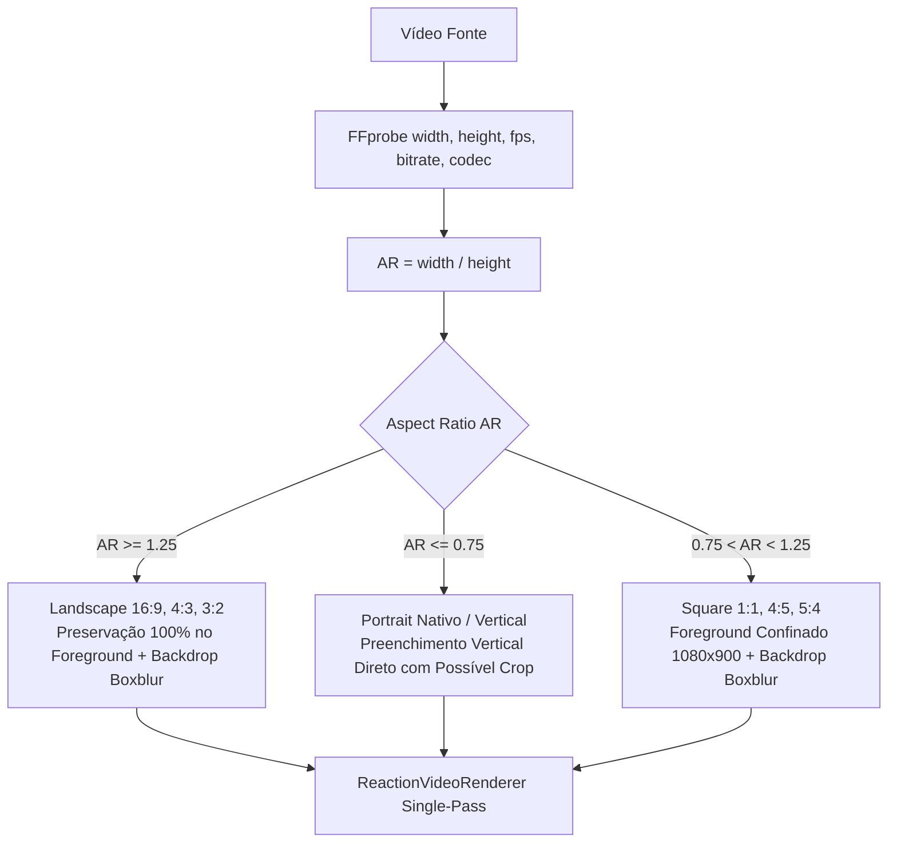

# Pesquisa Técnica: Phase 13.2 — Cinematic Backdrop and Subtitle Stage Composition

## 1. Grafo de Filtros FFmpeg para Cinematic Backdrop (Single-Pass)

### 1.1. Comparação entre Algoritmos de Desfoque no FFmpeg
Para criar o plano de fundo expandido e desfocado sem impor sobrecarga ao hardware:

| Filtro | Complexidade Computacional | Custo por Frame (1080x1920) | Qualidade Visual | Recomendação |
|---|:---:|:---:|:---:|:---:|
| `gblur` (Gaussian Blur) | $O(\text{sigma})$ por pixel | Elevado (~85ms/frame) | Desfoque gaussiano suave | Descartado (gargalo de CPU) |
| `boxblur` (Box Blur) | $O(1)$ constante por pixel | Mínimo (~12ms/frame) | Visual aveludado com 2-3 passes | **Aprovado (Padrão de Indústria)** |
| `avgblur` | $O(1)$ por pixel | Médio (~18ms/frame) | Similar a boxblur | Alternativa viável |

**Conclusão:** O filtro `boxblur=20:5` (ou seja, `luma_radius=20:luma_power=5`) combinado com atenuação de luminância e contraste (`eq=brightness=-0.15:contrast=0.9`) gera um fundo desfocado profissional em tempo real com uso insignificante de CPU, viabilizando a codificação em passagem única (single-pass).

---

## 2. Geometria de Safe Zones, Anti-Colisão e Disponibilização Determinística da Fonte

### 2.1. Safe Zones como Referências Conservadoras Configuráveis
As interfaces dos aplicativos móveis (TikTok, Instagram Reels, YouTube Shorts) sofrem modificações de layout, variam entre sistemas operacionais (iOS vs Android), tamanhos de fontes do sistema e aspect ratios de tela (16:9, 19.5:9, 20:9, telas com notch e punch-hole). 

Portanto, as safe zones do ZUNTO! **não devem ser tratadas como garantias universais ou valores fixos imutáveis**, mas sim como **referências defensivas conservadoras configuráveis** parametrizadas em `SafeZones9x16`:

```text
+--------------------------------------------------------------+ Y = 0
| [REFERÊNCIA DE TOPO: 0 a 220px]                              |
| Abas "Seguindo" / "Para Você", Busca, Botão Live             |
+--------------------------------------------------------------+ Y = 220
|                                                | [ZONA LATERAL|
|              ÁREA LIVRE NOBRE                  | DIREITA:     |
|     (Footage Foreground Dinâmico em Y=240..Y)  | 140px]       |
|                                                | Botões de:   |
|                                                | - Perfil     |
+------------------------------------------------+ - Like       |
|                                                | - Comentários|
|              ZONA DO TERÇO INFERIOR            | - Salvar     |
|         (Legendas em Y=1340..1500)             | - Compartilh.|
|                                                | - Áudio      |
+------------------------------------------------+ (X > 940)    |
| [REFERÊNCIA DE BASE: 1620 a 1920px]            |              |
| Nome de usuário, descrição (2-4 linhas), tags, barra de nav. |
+--------------------------------------------------------------+ Y = 1920
  X = 0                                            X = 940     X = 1080
```

Valores de referência conservadora:
- `TOP_MARGIN = 220\text{ px}` (margem de topo).
- `BOTTOM_MARGIN = 340\text{ px}` (margem inferior da UI/descrição).
- `RIGHT_MARGIN = 140\text{ px}` (coluna de botões de interação).
- `LEFT_MARGIN = 80\text{ px}` (recuo para leitura confortável).

---

### 2.2. Posicionamento e Safe Zone do Avatar Reaction
- **Calibração recomendada:**
  - `AVATAR_SIZE = 260\text{ px}` (diâmetro do avatar).
  - `AVATAR_MARGIN_RIGHT = 140\text{ px}` (alinhado rigorosamente a `RIGHT_MARGIN`).
  - `AVATAR_MARGIN_BOTTOM = 300\text{ px}` (acima da barra de navegação).
- **Bounding Box do Avatar:**
  $$X_{\text{avatar\_min}} = 1080 - 260 - 140 = \mathbf{680\text{ px}}$$
  $$X_{\text{avatar\_max}} = 1080 - 140 = \mathbf{940\text{ px}}$$
  $$Y_{\text{avatar\_min}} = 1920 - 260 - 300 = \mathbf{1360\text{ px}}$$
  $$Y_{\text{avatar\_max}} = 1920 - 300 = \mathbf{1620\text{ px}}$$
  - Resultado: o mascote fica **100% contido em $X \le 940\text{ px}$ e $Y \le 1620\text{ px}$**, livre da coluna de botões e da barra de navegação inferior.

---

### 2.3. Dedução Matemática e Medição Tipográfica Efetiva da Não-Colisão

No estilo ASS v4+, o texto utiliza `Alignment = 2` (Bottom-Center), sendo delimitado horizontalmente por:
$$X_{\text{left}} = MarginL$$
$$X_{\text{right}} = 1080 - MarginR$$

A caixa opaca de fundo (`BorderStyle = 3`, `#0A0A0A`) estende-se ao redor do texto com contorno/padding configurado por `box_padding = 16` (`Outline = 16` no estilo ASS).

Portanto, o limite físico extremo direito da caixa de legenda é:
$$X_{\text{box\_max}} = (1080 - MarginR) + \text{box\_padding}$$

Para garantir **separação física absoluta** ($X_{\text{box\_max}} < X_{\text{avatar\_min}}$):
$$(1080 - MarginR) + \text{box\_padding} < 1080 - \text{AVATAR\_MARGIN\_RIGHT} - \text{AVATAR\_SIZE}$$
$$- MarginR + \text{box\_padding} < - \text{AVATAR\_MARGIN\_RIGHT} - \text{AVATAR\_SIZE}$$
$$MarginR > \text{AVATAR\_MARGIN\_RIGHT} + \text{AVATAR\_SIZE} + \text{box\_padding}$$

Substituindo os valores canônicos:
$$MarginR > 140 + 260 + 16 = \mathbf{416\text{ px}}$$

**Calibração Adotada:**
- Adotando **$MarginR = 440\text{ px}$** como valor de referência padrão:
  $$X_{\text{text\_max}} = 1080 - 440 = 640\text{ px}$$
  $$X_{\text{box\_max}} = 640 + 16 = \mathbf{656\text{ px}}$$
  $$X_{\text{avatar\_min}} = \mathbf{680\text{ px}}$$
  $$\text{Folga livre de segurança} = 680 - 656 = \mathbf{24\text{ px}}$$

---

### 2.4. Resolução de Produção, Disponibilização Determinística e Comprovação da Fonte no libass

Para que a renderização de legendas pelo FFmpeg seja determinística e imune a discrepâncias de ambiente ou resoluções implícitas do sistema operacional:

#### 2.4.1. Estrutura de Retorno e Resolução de Produção (`ResolvedFont` & `resolve_typography_font`)
O módulo `src/viralpanel/branding.py` define o contrato estruturado de produção e a exceção de domínio correspondente:

```python
from dataclasses import dataclass
from pathlib import Path
from typing import Literal

class FontResolutionError(RuntimeError):
    """Lançada quando nenhuma fonte homologada for encontrada ou configurável para o libass."""
    pass

@dataclass(frozen=True)
class ResolvedFont:
    """Contrato formal da fonte tipográfica resolvida para o pipeline audiovisual."""
    font_path: Path                                      # Caminho absoluto do arquivo TTF selecionado
    fonts_dir: Path                                      # Diretório absoluto repassado ao fontsdir do libass
    font_name: str                                       # Família utilizada no cabeçalho ASS ('Montserrat' ou 'DejaVu Sans')
    variant: Literal["montserrat", "dejavu_sans"]        # Identificação da variante selecionada

def resolve_typography_font(custom_font_path: Path | str | None = None) -> ResolvedFont:
    """Resolve a fonte tipográfica homologada segundo ordem estrita de prioridade.
    
    Ordem de busca:
    1. custom_font_path explícito (se fornecido e existente).
    2. assets/fonts/Montserrat-Bold.ttf (raiz do repositório).
    3. Fontes do Windows: C:/Windows/Fonts/Montserrat-Bold.ttf ou %LOCALAPPDATA%/Microsoft/Windows/Fonts/Montserrat-Bold.ttf.
    4. Fontes do Linux: /usr/share/fonts/truetype/montserrat/Montserrat-Bold.ttf ou ~/.local/share/fonts/Montserrat-Bold.ttf.
    5. Fallback Registrado: DejaVuSans-Bold.ttf (/usr/share/fonts/truetype/dejavu/DejaVuSans-Bold.ttf ou C:/Windows/Fonts/DejaVuSans-Bold.ttf).
    
    Política Fail-Closed:
    Se nenhum arquivo existir nos caminhos homologados, levanta FontResolutionError descritivo
    indicando os caminhos pesquisados e a instrução de instalação (sudo apt-get install -y fonts-dejavu-core fonts-montserrat).
    NUNCA retorna None e NUNCA delega para heurísticas silenciosas do sistema.
    """
```

#### 2.4.2. Injeção no Fluxo Real (`renderer.py` e `subtitles.py`)
1. **Integração em `ReactionVideoRenderer.render_from_request`:**
   - Durante a renderização, `ReactionVideoRenderer` invoca `resolved_font = resolve_typography_font()`.
   - O `fonts_dir` extraído (`resolved_font.fonts_dir`) é repassado obrigatoriamente para `build_reaction_filter_complex(...)`.
   - Se `fonts_dir` for omitido ou None no fluxo de produção de renderização, o sistema interrompe o processo imediatamente com `FontResolutionError` (fail-closed).
   - O filtro `ass` é montado com a cláusula obrigatória: `ass='{escaped_ass}':fontsdir='{escaped_fontsdir}'`.
2. **Integração em `SubtitleJobConfig` e `build_ass_header`:**
   - O dataclass `SubtitleJobConfig` aceita `resolved_font: ResolvedFont | None = None`.
   - Caso `resolved_font` não seja injetado externamente, `build_ass_header` ou `generate_subtitles` invoca `resolve_typography_font()` como padrão de produção.
   - O campo `Fontname` do estilo ASS é derivado estritamente de `resolved_font.font_name` (`Style: Default,{resolved_font.font_name},...`), garantindo que o arquivo `.ass` gerado declare exatamente a família do TTF presente em `fontsdir`.

#### 2.4.3. Provisionamento em Linux/CI e Política Fail-Closed
- **Sem Presunção Silenciosa:** Não se presume que `fonts-dejavu-core` ou `fonts-montserrat` estejam pré-instaladas.
- O ambiente de execução Linux/CI deve declarar explicitamente: `sudo apt-get install -y fonts-dejavu-core fonts-montserrat`.
- Se nenhuma fonte permitida for encontrada, a renderização é imediatamente abortada com `FontResolutionError`. É terminantemente proibido omitir `fontsdir` para que o libass recorra a fontes padrão não controladas.

#### 2.4.4. Verificação Automatizada da Utilização Efetiva da Fonte
Não basta verificar que o arquivo TTF existe em disco; deve-se comprovar que o libass efetivamente utilizou a fonte esperada durante a renderização:
- **Verificação via Logs do libass (`fontselect`):**  
  Ao rodar o FFmpeg com flag `-loglevel verbose`, o componente libass registra no stderr o evento de seleção:
  ```text
  [Parsed_ass_0 @ 0x...] fontselect: (Montserrat, 700, 0) -> .../Montserrat-Bold.ttf, 0, Montserrat-Bold
  ```
  O teste automatizado captura o stderr da renderização e valida via asserção que o evento `fontselect` casou exatamente com o arquivo e família esperados (`Montserrat-Bold.ttf` ou `DejaVuSans-Bold.ttf`), falhando se houver substituição espúria (como Arial ou Liberation Sans).
- **Validação Pixel-Level Complementar:**  
  Inspeção dos pixels brutos `rgb24` no frame 1080x1920 sobre fundo magenta (`color=c=magenta:s=1080x1920`), comprovando empiricamente que nenhum pixel da caixa opaca (`#0A0A0A`) ou do texto ultrapassa $X = 656\text{ px}$.

---

## 3. Seleção Determinística por Aspect Ratio, Testes de Fronteira e Grafo FFmpeg



### 3.1. Análise Rigorosa de Fronteiras de Aspect Ratio (0.75, 1.20, 1.25)

A classificação e o dimensionamento operam em limites matemáticos estritos:

| Ponto de Fronteira | Valor $AR$ | Classificação | Comportamento de Enquadramento | Dimensões Calculadas $(W_{\text{fg}}, H_{\text{fg}})$ | Posicionamento $Y$ | Grafo FFmpeg |
|---|:---:|:---:|---|:---:|:---:|---|
| **$AR < 0.75$** | $0.749$ | Portrait Nativo | Preenchimento vertical 9:16 direto (com **possível crop lateral/vertical** se não for 9:16 exato) | $1080 \times 1920$ (crop) | $Y=0$ | Sem split, scale vertical direto |
| **$AR = 0.75$** | $0.750$ | Portrait Nativo | Limite vertical (ex: 3:4 com crop lateral de enquadramento) | $1080 \times 1920$ (crop) | $Y=0$ | Sem split, scale vertical direto |
| **$AR > 0.75$** | $0.751$ | Square / 4:5 Confinado | Backdrop desfocado + foreground confinado | $676 \times 900$ | $Y=240$ | `split=2`, `boxblur=20:5`, overlay em caixa 1080x900 |
| **$AR < 1.20$** | $1.199$ | Square / 4:5 Confinado | Foreground limitado pela altura máxima de 900px | $1078 \times 900$ | $Y=240$ | Caixa de confinamento vertical |
| **$AR = 1.20$** | $1.200$ | Square / 4:5 Confinado | Encaixe perfeito na caixa de confinamento | $1080 \times 900$ | $Y=240$ | Matching exato na caixa 1080x900 |
| **$AR > 1.20$** | $1.201$ | Square / 4:5 Confinado | Foreground limitado pela largura máxima de 1080px | $1080 \times 898$ | $Y=240$ | Caixa de confinamento horizontal |
| **$AR < 1.25$** | $1.249$ | Square / Híbrido Confinado | Mantido na caixa de confinamento 1080x900 | $1080 \times 864$ | $Y=240$ | Caixa de confinamento |
| **$AR = 1.25$** | $1.250$ | Landscape Backdrop | **Preservação integral (100%) da largura** no foreground | $1080 \times 864$ | $Y=240$ | `split=2`, `boxblur=20:5`, Lanczos 1080 direto |
| **$AR > 1.25$** | $1.251$ | Landscape Backdrop | **Preservação integral (100%) da largura** no foreground | $1080 \times 862$ | $Y=240$ | `split=2`, `boxblur=20:5`, Lanczos 1080 direto |

> [!IMPORTANT]
> **Esclarecimento sobre a Fronteira Portrait ($AR \le 0.75$):**  
> A estratégia para $AR \le 0.75$ aplica preenchimento vertical direto (`scale=1080:1920:force_original_aspect_ratio=increase,crop=1080:1920`). Se o vídeo de entrada não possuir exatamente a proporção 9:16 (ex: vídeos verticais 3:4 ou proporções intermediárias), **ocorre crop lateral/superior de ajuste**. Esta estratégia NÃO deve ser descrita como "preservação integral do quadro original". A exigência de preservação de 100% da área e largura sem qualquer corte aplica-se estritamente ao primeiro plano (foreground) de vídeos **Landscape ($AR \ge 1.25$)** e ao confinamento sem crop de **Square / 4:5**.

---

### 3.2. Grafos de Filtros FFmpeg Single-Pass

#### 3.2.1. Landscape ($AR \ge 1.25$ — 16:9, 4:3, 3:2):
Dimensões calculadas: $W_{\text{fg}} = 1080\text{ px}$, $H_{\text{fg}} = \text{int}(\text{round}(1080 / AR / 2) \times 2)$.
Como $AR \ge 1.25$, $H_{\text{fg}} \le 864\text{ px}$. Término do vídeo em $Y \le 1104\text{ px}$, mantendo folga $\ge 236\text{ px}$ até a legenda ($Y = 1340\text{ px}$). Preserva 100% da largura original.
```text
[0:v]split=2[raw_bg][raw_fg];
[raw_bg]scale=1080:1920:force_original_aspect_ratio=increase,crop=1080:1920,boxblur=20:5,eq=brightness=-0.15:contrast=0.9,setsar=1[bg];
[raw_fg]scale=1080:-2:flags=lanczos[fg];
[bg][fg]overlay=(W-w)/2:240[stage];
[1:v]scale=260:260:force_original_aspect_ratio=decrease:flags=lanczos,format=rgba[pip];
[stage][pip]overlay=W-w-140:H-h-300:shortest=1:format=yuv420:alpha=straight[composed];
[composed]ass='{escaped_ass}':fontsdir='{escaped_fontsdir}'[vout]
```

#### 3.2.2. Square / 4:5 / 5:4 ($0.75 < AR < 1.25$):
Confinamento em caixa de $1080 \times 900\text{ px}$ em $Y=240$:
```text
[0:v]split=2[raw_bg][raw_fg];
[raw_bg]scale=1080:1920:force_original_aspect_ratio=increase,crop=1080:1920,boxblur=20:5,eq=brightness=-0.15:contrast=0.9,setsar=1[bg];
[raw_fg]scale=w='min(1080,trunc(900*a/2)*2)':h='min(900,trunc(1080/a/2)*2)':force_original_aspect_ratio=decrease:flags=lanczos[fg];
[bg][fg]overlay=(W-w)/2:240[stage];
[1:v]scale=260:260:force_original_aspect_ratio=decrease:flags=lanczos,format=rgba[pip];
[stage][pip]overlay=W-w-140:H-h-300:shortest=1:format=yuv420:alpha=straight[composed];
[composed]ass='{escaped_ass}':fontsdir='{escaped_fontsdir}'[vout]
```

#### 3.2.3. Portrait Nativo ($AR \le 0.75$):
Preenchimento vertical direto (com possível crop de enquadramento para fontes verticais não-9:16):
```text
[0:v]scale=1080:1920:force_original_aspect_ratio=increase,crop=1080:1920,setsar=1[bg];
[1:v]scale=260:260:force_original_aspect_ratio=decrease:flags=lanczos,format=rgba[pip];
[bg][pip]overlay=W-w-140:H-h-300:shortest=1:format=yuv420:alpha=straight[composed];
[composed]ass='{escaped_ass}':fontsdir='{escaped_fontsdir}'[vout]
```

---

## 4. Avaliação Contextual da Métrica BPP com Diferenciação de Codecs

### 4.1. Definição e Resolução do Bitrate
A métrica $\text{bpp}$ quantifica a densidade de dados alocada por pixel em cada quadro:
$$\text{bpp} = \frac{\text{video\_bitrate\_bps}}{\text{width} \times \text{height} \times \text{fps}}$$

**Procedimento de identificação robusto:**
1. **Prioridade:** Extrair bitrate específico da stream de vídeo primária (`streams[v:0].bit_rate`).
2. **Fallback:** Caso `stream.bit_rate` seja ausente ou zero, utilizar `format.bit_rate` deduzindo uma estimativa de áudio de 128 kbps (caso $format\_bitrate > 192000$).
3. **Bitrate Totalmente Indisponível:** Se nem a stream nem o container informarem bitrate (comum em arquivos raw ou stripped), **NÃO inventar valores fictícios**. Retornar `metrics["bpp"] = None` e registrar um `warning` descritivo: `"Bitrate indisponível nos metadados da fonte; cálculo de BPP omitido."`.
4. **Taxa de quadros fracionária:** Parse robusto via fração (`avg_frame_rate` com fallback para `r_frame_rate`), cobrindo `24000/1001` (23.976), `30000/1001` (29.970), `60000/1001` (59.940), `24/1` (24.0), etc.

### 4.2. Limiares Informativos Diferenciados por Codec
Não aplicamos o limite de H.264 indiscriminadamente a todos os codecs:

| Codec de Vídeo | Eficiência Relativa | Limiar Informativo de Alerta | Comportamento do Validador |
|---|:---:|:---:|---|
| **H.264 / AVC** | $1.0\times$ (Referência) | $\text{bpp} < 0.035$ | Emite `warning` informativo: compressão agressiva para AVC. |
| **HEVC / H.265** | $\approx 1.5 - 1.8\times$ | $\text{bpp} < 0.020$ | Emite `warning` informativo: compressão agressiva para HEVC. |
| **VP9** | $\approx 1.4 - 1.6\times$ | $\text{bpp} < 0.022$ | Emite `warning` informativo: compressão agressiva para VP9. |
| **AV1** | $\approx 1.8 - 2.2\times$ | $\text{bpp} < 0.018$ | Emite `warning` informativo: compressão agressiva para AV1. |
| **Outro / Desconhecido** | — | $\text{bpp} < 0.030$ | Emite `warning` informativo genérico. |

**Garantia Fundamental:** O BPP opera **exclusivamente em modo informativo (`warning`)**, registrando métricas estruturadas sem nunca agir como bloqueador ou rejeição fatal da esteira de publicação.

---

## 5. Protocolo de Validação Visual Humana E2E e Checkpoint Obrigatório

A aceitação final da Phase 13.2 exige a geração de um vídeo composto de inspeção utilizando:
- **Footage Real:** `storage/inspection/input/original_source.mp4` (1280x720, Landscape 16:9).
- **Mascote Oficial:** `assets/zunto_mascot.png`.
- **Roteiro e Narração:** Síntese Edge TTS e legendas com Active Word Highlight da Phase 13.1.
- **Critérios de Inspeção Perceptual:**
  1. Preservação de 100% da largura do footage original no primeiro plano (zero corte lateral).
  2. Suavidade estética e ausência de ruídos agressivos no plano de fundo `boxblur=20:5`.
  3. Legibilidade das legendas no terço inferior ($MarginV = 420\text{ px}$), livres do centro da tela.
  4. Posição do mascote contida em $X \le 940\text{ px}$, imune aos botões laterais de plataformas móveis.
  5. Ausência física absoluta de colisão entre a caixa de legendas e o mascote.

> [!CAUTION]
> **Checkpoint Humano Bloqueante e Obrigatório:**  
> A automação do pipeline cobre a implementação de código, testes unitários, testes de integração e renderização E2E.  
> **Contudo, assim que o vídeo de inspeção for gerado e as checagens técnicas concluídas, o agente executor DEVE OBRIGATORIAMENTE PARAR o fluxo.**  
> O agente deve apresentar o caminho do vídeo (`storage/runs/run_cinematic_inspection_001/final_output.mp4`), o relatório de métricas e solicitar formalmente a avaliação e aprovação visual do Project Owner.  
> A verificação final (`/gsd-verify-work`) e a conclusão da fase ficam **estritamente bloqueadas** até a aprovação humana expressa. A diretiva `autonomous: true` no plano de execução permite a execução contínua das tarefas 1 a 5, mas NÃO autoriza a eliminação ou bypass deste checkpoint humano.
