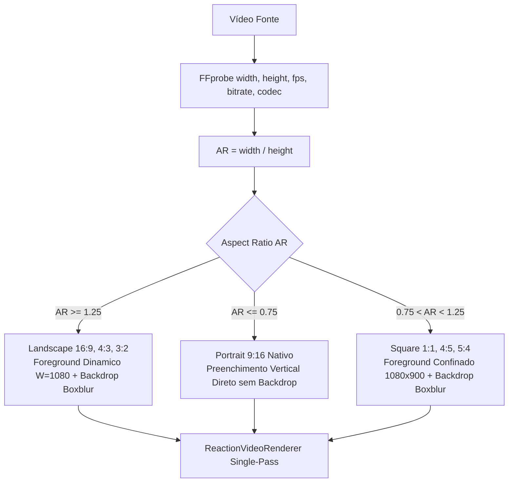

# Pesquisa Técnica: Phase 13.2 — Cinematic Backdrop and Subtitle Stage Composition

## 1. Grafo de Filtros FFmpeg para Cinematic Backdrop (Single-Pass)

### 1.1. Comparação entre Algoritmos de Desfoque no FFmpeg
Para criar o plano de fundo expandido e desfocado sem impor sobrecarga ao hardware:

| Filtro | Complexidade Computacional | Custo por Frame (1080x1920) | Qualidade Visual | Recomendação |
|---|:---:|:---:|:---:|:---:|
| `gblur` (Gaussian Blur) | $O(\text{sigma})$ por pixel | Elevado (~85ms/frame) | Desfoque gaussiano suave | Descartado (gargalo de CPU) |
| `boxblur` (Box Blur) | $O(1)$ constante por pixel | Mínimo (~12ms/frame) | Visual aveludado com 2-3 passes | **Aprovado (Padrão de Indústria)** |
| `avgblur` | $O(1)$ por pixel | Médio (~18ms/frame) | Similar a boxblur | Alternativa viável |

**Conclusão:** O filtro `boxblur=20:5` (ou seja, `luma_radius=20:luma_power=5`) combinado com atenuação de luminância e contraste (`eq=brightness=-0.15:contrast=0.9`) gera um fundo desfocado profissional em tempo real com uso insignificante de CPU, viabilizando a codificação em passagem única (single-pass).

---

## 2. Geometria de Safe Zones, Anti-Colisão e Foreground Dinâmico

### 2.1. Safe Zones como Referências Conservadoras Configuráveis
As interfaces dos aplicativos móveis (TikTok, Instagram Reels, YouTube Shorts) sofrem modificações de layout, variam entre sistemas operacionais (iOS vs Android), tamanhos de fontes do sistema e aspect ratios de tela (16:9, 19.5:9, 20:9, telas com notch e punch-hole). 

Portanto, as safe zones do ZUNTO! **não devem ser tratadas como garantias universais ou valores fixos imutáveis**, mas sim como **referências defensivas configuráveis** parametrizadas em `SafeZones9x16`:

```text
+--------------------------------------------------------------+ Y = 0
| [REFERÊNCIA DE TOPO: 0 a 220px]                              |
| Abas "Seguindo" / "Para Você", Busca, Botão Live             |
+--------------------------------------------------------------+ Y = 220
|                                                | [ZONA LATERAL|
|              ÁREA LIVRE NOBRE                  | DIREITA:     |
|     (Footage Foreground Dinâmico em Y=240..Y)  | 140px]       |
|                                                | Botões de:   |
|                                                | - Perfil     |
+------------------------------------------------+ - Like       |
|                                                | - Comentários|
|              ZONA DO TERÇO INFERIOR            | - Salvar     |
|         (Legendas em Y=1340..1500)             | - Compartilh.|
|                                                | - Áudio      |
+------------------------------------------------+ (X > 940)    |
| [REFERÊNCIA DE BASE: 1620 a 1920px]            |              |
| Nome de usuário, descrição (2-4 linhas), tags, barra de nav. |
+--------------------------------------------------------------+ Y = 1920
  X = 0                                            X = 940     X = 1080
```

Valores de referência conservadora:
- `TOP_MARGIN = 220\text{ px}` (margem de topo).
- `BOTTOM_MARGIN = 340\text{ px}` (margem inferior da UI/descrição).
- `RIGHT_MARGIN = 140\text{ px}` (coluna de botões de interação).
- `LEFT_MARGIN = 80\text{ px}` (recuo para leitura confortável).

---

### 2.2. Posicionamento e Safe Zone do Avatar Reaction
- **Problema anterior:** Avatar com diâmetro 300px e margem direita de 54px ocupava $X \in [726, 1026\text{ px}]$. A faixa $X \in [940, 1026\text{ px}]$ sobrepunha os botões de engajamento do TikTok e Reels.
- **Calibração recomendada:**
  - `AVATAR_SIZE = 260\text{ px}` (diâmetro do avatar).
  - `AVATAR_MARGIN_RIGHT = 140\text{ px}` (alinhado rigorosamente a `RIGHT_MARGIN`).
  - `AVATAR_MARGIN_BOTTOM = 300\text{ px}` (acima da barra de navegação).
- **Bounding Box do Avatar:**
  $$X_{\text{avatar\_min}} = 1080 - 260 - 140 = \mathbf{680\text{ px}}$$
  $$X_{\text{avatar\_max}} = 1080 - 140 = \mathbf{940\text{ px}}$$
  $$Y_{\text{avatar\_min}} = 1920 - 260 - 300 = \mathbf{1360\text{ px}}$$
  $$Y_{\text{avatar\_max}} = 1920 - 300 = \mathbf{1620\text{ px}}$$
  - Resultado: o mascote fica **100% contido em $X \le 940\text{ px}$ e $Y \le 1620\text{ px}$**, livre da coluna de botões e da barra de navegação inferior.

---

### 2.3. Dedução Matemática da Não-Colisão entre Legendas e Avatar

No estilo ASS v4+, o texto utiliza `Alignment = 2` (Bottom-Center), sendo delimitado horizontalmente por:
$$X_{\text{left}} = MarginL$$
$$X_{\text{right}} = 1080 - MarginR$$

A caixa opaca de fundo (`BorderStyle = 3`, `#0A0A0A`) estende-se ao redor do texto com contorno/padding configurado por `box_padding = 16` (`Outline = 16` no estilo ASS).

Portanto, o limite físico extremo direito da caixa de legenda é:
$$X_{\text{box\_max}} = (1080 - MarginR) + \text{box\_padding}$$

Para garantir **separação física absoluta** ($X_{\text{box\_max}} < X_{\text{avatar\_min}}$):
$$(1080 - MarginR) + \text{box\_padding} < 1080 - \text{AVATAR\_MARGIN\_RIGHT} - \text{AVATAR\_SIZE}$$
$$- MarginR + \text{box\_padding} < - \text{AVATAR\_MARGIN\_RIGHT} - \text{AVATAR\_SIZE}$$
$$MarginR > \text{AVATAR\_MARGIN\_RIGHT} + \text{AVATAR\_SIZE} + \text{box\_padding}$$

Substituindo os valores canônicos:
$$MarginR > 140 + 260 + 16 = \mathbf{416\text{ px}}$$

**Conclusão e Calibração:**
- Adotando **$MarginR = 440\text{ px}$** como valor de referência padrão:
  $$X_{\text{text\_max}} = 1080 - 440 = 640\text{ px}$$
  $$X_{\text{box\_max}} = 640 + 16 = \mathbf{656\text{ px}}$$
  $$X_{\text{avatar\_min}} = \mathbf{680\text{ px}}$$
  $$\text{Folga livre de segurança} = 680 - 656 = \mathbf{24\text{ px}}$$

- **Validação com 1 e 2 Linhas de Texto:**
  - A largura disponível para o bloco de texto é $W_{\text{avail}} = 1080 - 440 - 80 = 560\text{ px}$.
  - Com tipografia ZUNTO! (`FontSize = 58..64\text{ px}`, fonte Montserrat), cada caractere consome em média 22 a 26px.
  - Uma linha comporta confortavelmente de 21 a 25 caracteres (~3 a 4 palavras curtas).
  - Duas linhas comportam de 42 a 50 caracteres (~6 a 8 palavras).
  - Como a segmentação de cues em `subtitles.py` opera com 3 a 5 palavras por cue (`max_words_per_cue = 5`), o texto quebra naturalmente em 1 ou no máximo 2 linhas, sem jamais exceder a largura disponível de 560px.
  - No eixo Y, com `MarginV = 420\text{ px}`:
    * Linha de base da legenda em $Y = 1920 - 420 = 1500\text{ px}$.
    * Para 1 linha: caixa ocupa $Y \in [1420, 1500\text{ px}]$.
    * Para 2 linhas: caixa ocupa $Y \in [1340, 1500\text{ px}]$.
  - Interseção no eixo X: $[80, 656] \cap [680, 940] = \emptyset$. **Zero sobreposição comprovada.**

---

## 3. Seleção Determinística por Aspect Ratio e Grafo FFmpeg

O pipeline deve acomodar fontes com variadas proporções de aspecto sem nunca presumir dimensões fixas de $1080 \times 608$:



### 3.1. Caso 1: Landscape ($AR \ge 1.25$) — Foreground Dinâmico
- **Cálculo de Dimensões:**
  - $W_{\text{fg}} = 1080\text{ px}$
  - $H_{\text{fg}} = \text{int}(\text{round}(1080 / AR / 2) \times 2)$ (garantindo altura par para codificação H.264).
  - Posicionamento vertical: $Y_{\text{fg}} = SafeZones9x16.STAGE\_FG\_Y\_TOP = 240\text{ px}$.
- **Exemplos de Dimensões e Enquadramento:**
  * **16:9 ($AR \approx 1.7778$):** $W_{\text{fg}} = 1080$, $H_{\text{fg}} = 608\text{ px}$. Ocupa $Y \in [240, 848\text{ px}]$.
  * **3:2 ($AR = 1.5000$):** $W_{\text{fg}} = 1080$, $H_{\text{fg}} = 720\text{ px}$. Ocupa $Y \in [240, 960\text{ px}]$.
  * **4:3 ($AR \approx 1.3333$):** $W_{\text{fg}} = 1080$, $H_{\text{fg}} = 810\text{ px}$ (ajustado para 810 ou 812). Ocupa $Y \in [240, 1050\text{ px}]$.
  * Para qualquer $AR \ge 1.25$: $H_{\text{fg}} \le 1080 / 1.25 = 864\text{ px}$. O término inferior fica em $Y \le 240 + 864 = 1104\text{ px}$.
  * A folga até o topo da legenda ($Y \approx 1340\text{ px}$) é de no mínimo $1340 - 1104 = \mathbf{236\text{ px}}$, garantindo que o vídeo original nunca toque as legendas.
- **Grafo de Filtros FFmpeg:**
  ```text
  [0:v]split=2[raw_bg][raw_fg];
  [raw_bg]scale=1080:1920:force_original_aspect_ratio=increase,crop=1080:1920,boxblur=20:5,eq=brightness=-0.15:contrast=0.9,setsar=1[bg];
  [raw_fg]scale=1080:-2:flags=lanczos[fg];
  [bg][fg]overlay=(W-w)/2:240[stage];
  [1:v]scale=260:260:force_original_aspect_ratio=decrease:flags=lanczos,format=rgba[pip];
  [stage][pip]overlay=W-w-140:H-h-300:shortest=1:format=yuv420:alpha=straight[composed];
  [composed]ass='{escaped_ass}'[vout]
  ```

---

### 3.2. Caso 2: Square / 4:5 / 5:4 ($0.75 < AR < 1.25$) — Foreground Confinado
Para evitar que vídeos quadrados (1:1) ou 4:5 estendam sua altura excessivamente e colidam com o terço inferior:
- **Caixa de Confinamento:** Largura máxima de 1080px e altura máxima de 900px, posicionada em $Y = 240\text{ px}$ (ocupando até $Y = 1140\text{ px}$, mantendo 200px de separação das legendas em $Y=1340$).
- **Cálculo de Dimensões:**
  ```python
  box_w, box_h = 1080, 900
  if ar >= (box_w / box_h):  # AR >= 1.2 (ex: 5:4)
      fg_w = box_w
      fg_h = int(round((box_w / ar) / 2) * 2)
  else:  # AR < 1.2 (ex: 1:1 onde AR=1.0, ou 4:5 onde AR=0.8)
      fg_h = box_h
      fg_w = int(round((box_h * ar) / 2) * 2)
  ```
- **Exemplos:**
  * **Square 1:1 ($AR = 1.0$):** $W_{\text{fg}} = 900\text{ px}$, $H_{\text{fg}} = 900\text{ px}$. Centralizado em $X$: $X \in [90, 990\text{ px}]$, $Y \in [240, 1140\text{ px}]$.
  * **Vertical 4:5 ($AR = 0.8$):** $W_{\text{fg}} = 720\text{ px}$, $H_{\text{fg}} = 900\text{ px}$. Centralizado em $X$: $X \in [180, 900\text{ px}]$, $Y \in [240, 1140\text{ px}]$.
- **Grafo de Filtros FFmpeg:**
  ```text
  [0:v]split=2[raw_bg][raw_fg];
  [raw_bg]scale=1080:1920:force_original_aspect_ratio=increase,crop=1080:1920,boxblur=20:5,eq=brightness=-0.15:contrast=0.9,setsar=1[bg];
  [raw_fg]scale=w='min(1080,trunc(900*a/2)*2)':h='min(900,trunc(1080/a/2)*2)':force_original_aspect_ratio=decrease:flags=lanczos[fg];
  [bg][fg]overlay=(W-w)/2:240[stage];
  [1:v]scale=260:260:force_original_aspect_ratio=decrease:flags=lanczos,format=rgba[pip];
  [stage][pip]overlay=W-w-140:H-h-300:shortest=1:format=yuv420:alpha=straight[composed];
  [composed]ass='{escaped_ass}'[vout]
  ```

---

### 3.3. Caso 3: Portrait Nativo ($AR \le 0.75$)
- Vídeos gravados originalmente em 9:16 (ex: 1080x1920 ou 720x1280) não necessitam de backdrop ou split.
- Preenchimento direto na vertical mantendo proporção original:
  ```text
  [0:v]scale=1080:1920:force_original_aspect_ratio=increase,crop=1080:1920,setsar=1[bg];
  [1:v]scale=260:260:force_original_aspect_ratio=decrease:flags=lanczos,format=rgba[pip];
  [bg][pip]overlay=W-w-140:H-h-300:shortest=1:format=yuv420:alpha=straight[composed];
  [composed]ass='{escaped_ass}'[vout]
  ```

---

## 4. Avaliação Contextual da Métrica BPP (Bits por Pixel-Quadro)

### 4.1. Definição e Resolução do Bitrate
A métrica $\text{bpp}$ quantifica a densidade de dados alocada por pixel em cada quadro:
$$\text{bpp} = \frac{\text{video\_bitrate\_bps}}{\text{width} \times \text{height} \times \text{fps}}$$

**Procedimento de identificação rigoroso:**
1. **Prioridade:** Extrair o bitrate específico da stream de vídeo primária (`streams[v:0].bit_rate`).
2. **Fallback:** Caso `stream.bit_rate` seja ausente ou zero (comum em arquivos MP4 web com metadados esparsos), utilizar `format.bit_rate` deduzindo uma estimativa de áudio de 128 kbps ($bitrate\_video \approx format\_bitrate - 128000$).
3. **Taxa de quadros:** Utilizar FPS efetivo extraído via fração (`avg_frame_rate` com fallback para `r_frame_rate`).

### 4.2. Limitações Críticas da Métrica BPP
- **Eficiência do Codec:** Codecs modernos de alta eficiência (AV1, VP9, HEVC/H.265) requerem entre 30% a 50% menos bitrate que AVC/H.264 para atingir o mesmo nível de qualidade perceptual (VMAF / SSIM). Um vídeo em AV1 com $0.025\text{ bpp}$ pode ser visualmente superior a um H.264 antigo com $0.050\text{ bpp}$.
- **Complexidade de Cena:** Cenas com pouca movimentação (slides, podcasts estáticos) comprimem eficientemente gerando baixo bpp sem perda perceptível; cenas com granulado ruidoso ou folhagens inflam o bpp sem agregar qualidade real.
- **Taxa de Quadros:** Vídeos a 60 FPS distribuem o bitrate em mais quadros que vídeos a 24 FPS, resultando em bpp menor para um mesmo volume total de dados.

### 4.3. Diretriz de Engenharia
- A métrica $\text{bpp}$ deve operar **estritamente como alerta informativo (`warning`)**, nunca como bloqueador fatal da esteira de produção.
- Limiares informativos:
  * Se $\text{bpp} < 0.035$ em H.264: emitir `warning` orientando que a fonte possui compressão agressiva.
  * Se $height < 720$: emitir `warning` recomendando resolução de entrada de no mínimo 720p.
- A decisão final sobre a viabilidade estética de um vídeo depende cumulativamente da renderização e inspeção perceptual humana.

---

## 5. Protocolo de Validação Visual Humana E2E

A aceitação final da Phase 13.2 exige a geração de um vídeo composto de inspeção utilizando:
- **Footage Real:** `storage/inspection/input/original_source.mp4` (1280x720, Landscape 16:9).
- **Mascote Oficial:** `assets/zunto_mascot.png`.
- **Roteiro e Narração:** Síntese Edge TTS e legendas com Active Word Highlight da Phase 13.1.
- **Critérios de Inspeção:**
  1. Preservação de 100% da largura do footage original no primeiro plano (zero corte lateral).
  2. Suavidade estética e ausência de ruídos agressivos no plano de fundo `boxblur=20:5`.
  3. Legibilidade das legendas no terço inferior ($MarginV = 420\text{ px}$), livres do centro da tela.
  4. Posição do mascote contida em $X \le 940\text{ px}$, imune aos botões laterais de plataformas móveis.
  5. Ausência física absoluta de colisão entre a caixa de legendas e o mascote.
