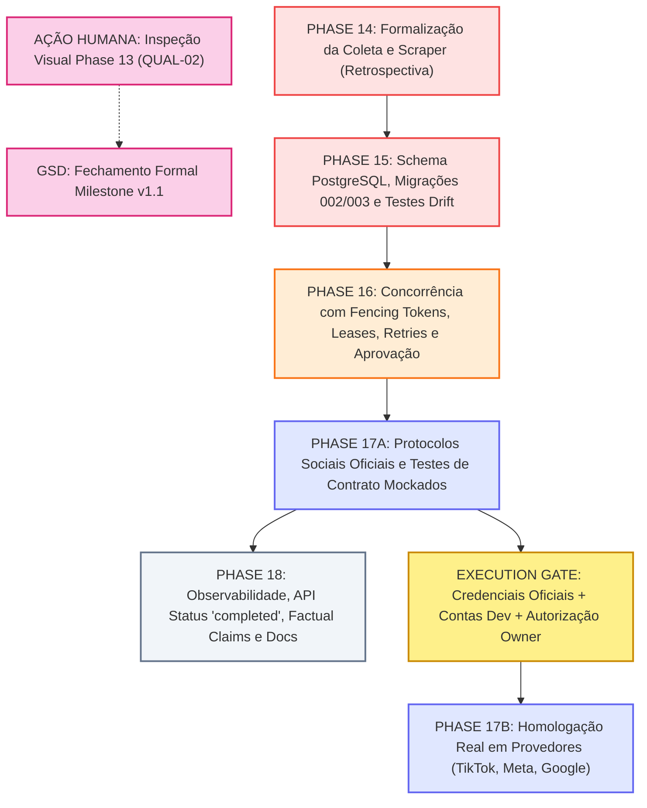

# ANALYZER 04 — IMPLEMENTATION-READY REMEDIATION BLUEPRINT (REVISED)
## Milestone v1.2 — Production Hardening & Social Ecosystem

**Projeto:** ZUNTO! (anteriormente ViralPanel)  
**Papel:** Senior Software Architect, Staff Backend Engineer, Database Architect & Technical Lead  
**Data:** 13 de Novembro de 2026  
**Status:** Blueprint Definitivo de Planejamento e Remediação Aprovado (Pós-Reconciliação ANALYZER 05)  
**Modo Operacional:** STRICT READ-ONLY AUDIT (Nenhum arquivo de código, teste ou migração modificado)  

---

## A. Executive Summary

O ZUNTO! possui um núcleo de processamento audiovisual avançado e sofisticado (composição em grafo único FFmpeg, animação de avatar PIP circular com canal alfa suave, síntese de voz neural e roteirização orientada a retenção com Gemini 2.5 Flash), suportado por 117 testes unitários e de integração verdes.

No entanto, as cinco auditorias técnicas (**ANALYZER 01 a 05**) revelaram vulnerabilidades estruturais que impedem sua operação autônoma e segura em ambiente de produção:

1. **Schema Drift Bloqueante no PostgreSQL:** O modelo `Script` ([src/viralpanel/models.py#L43](file:///c:/Users/Windows%20Lite%20BR/Documents/GitHub/viralpanel/src/viralpanel/models.py#L43)) declara a coluna `metadata_json`, mas o histórico de migrações do Alembic contém apenas a revisão inicial `001`, que não a cria. Toda a suíte de testes existente mascara essa falha porque utiliza SQLite em memória com `create_all()`, contornando o Alembic.
2. **Incompletude Estrutural dos Publicadores Oficiais:** As integrações de redes sociais (TikTok, Instagram, YouTube) realizam apenas handshakes superficiais ou chamadas inválidas sem upload binário dos arquivos de vídeo. Na ausência de credenciais, o sistema recorre silenciosamente ao `MockPublisher`, forjando URLs falsas e persistindo publicações simuladas no banco de dados como se fossem reais.
3. **Divergência de Contrato em `PipelineRun.status`:** O orquestrador Celery grava execuções bem-sucedidas com status `"success"`, enquanto a API REST administrativa consulta `"completed"`. Isso faz com que o dashboard administrativo e os endpoints de métricas reportem permanentemente zero execuções concluídas.
4. **Vulnerabilidade a Race Conditions na Seleção de Candidatos:** A consulta `select_best_candidate()` em `DiscoveryService` não utiliza bloqueio transacional pessimista (`FOR UPDATE SKIP LOCKED`) nem tokens de reserva/fencing, permitindo que workers Celery concorrentes ou acionamentos manuais via API processem simultaneamente o mesmo vídeo viral.
5. **Fratura na Governança e Rastreabilidade do GSD:** A Phase 13 encontra-se formalmente pendente da inspeção visual humana exigida pelo requisito `QUAL-02`. Paralelamente, 12 commits de código (correções de scraper, yt-dlp e deduplicação) foram incorporados diretamente na branch `developer` sob o rótulo informal de "Phase 14", sem qualquer formalização no planejamento do GSD.

### Diretriz Estratégica de Execução (Reconciliada)

A execução deste Blueprint organiza o trabalho em duas frentes independentes:
- **Frente Humana / Fechamento de v1.1:** O Project Owner / Tech Lead realiza a inspeção visual dos vídeos da Phase 13 de forma independente e assina o fechamento de `QUAL-02` e Milestone v1.1. **Esta ação NÃO bloqueia a execução técnica das Phases 14, 15, 16, 17A ou 18.**
- **Frente Técnica / Milestone v1.2 (`Production Hardening & Social Ecosystem`):** Estrutura canônica de 5 fases (Phases 14 a 18), com separação estrita entre desenvolvimento de testes de contrato mockados (Phase 17A) e homologação real em provedores externos (Phase 17B, protegida por Execution Gate explícito).

---

## B. Repository and Evidence Baseline

A inspeção do repositório confirma o seguinte estado operacional antes do início das fases:

- **Branch Atual:** `developer` (sincronizada com `origin/developer`).
- **Commit HEAD:** `10229d6e04d9319c7e062c96a52b8f48cabb754c` (`test(phase14): add regression tests for downloader, discovery, deduplication and mock guards`).
- **Estado do Working Tree:** 100% limpo quanto a arquivos versionados (apenas o artefato de blueprint presente).
- **Ambiente de Testes:** 117 testes executados com 100% de sucesso em 31.54s (`pytest 9.2.0`, Python 3.14.7).
- **Disponibilidade do Banco de Dados:** Instância local do PostgreSQL offline durante auditoria (portas 5432/5433 fechadas; daemon Docker desligado no host).
- **Versão do GSD Instalada:** `1.14.0` (runtime `antigravity` em `C:\Users\Windows Lite BR\.gemini\antigravity\gsd-core`).

---

## C. Validated Findings Register

| ID | Finding | Validação | Severidade | Causa Raiz | Componentes Afetados | Ação de Remediação |
|---|---|---|---|---|---|---|
| **F-01** | Schema Drift no PostgreSQL (`scripts.metadata_json`) | **CONFIRMED** | **P0** | Phase 09 adicionou coluna no ORM sem criar migração Alembic. | `models.py`, `alembic/versions/` | Criar migração Alembic `002` adicionando `metadata_json` à tabela `scripts` e teste de schema drift exclusivo contra PostgreSQL. |
| **F-02** | Publicadores Sociais Incompletos e Mock Fallback Silencioso | **CONFIRMED** | **P1** | Handshakes incompletos e fallback automático para `MockPublisher` na ausência de chaves. | `publishing/tiktok.py`, `instagram.py`, `youtube.py`, `auth.py` | Implementar upload em chunks (TikTok), resumable (Meta), refresh OAuth (YouTube) e fail-closed obrigatório em produção. |
| **F-03** | Inconsistência de Status em `PipelineRun` (`success` vs `completed`) | **CONFIRMED** | **P1** | Celery grava `"success"`; API consulta `where(status == "completed")`. | `tasks.py`, `api/routes.py`, `frontend/` | Padronizar status canônico para `"completed"` e atualizar rota de estatísticas mantendo query de transição. |
| **F-04** | Race Condition na Seleção de Candidatos por Workers Concorrentes | **CONFIRMED** | **P1** | Consulta `select_best_candidate` não usa travamento pessimista relacional nem tokens de reserva. | `discovery/service.py`, `tasks.py` | Implementar reserva atômica com `SELECT FOR UPDATE SKIP LOCKED`, lease configurável e token de fencing (`reservation_token`). |
| **F-05** | Perda de Estado de Vídeos Candidatos em Celery Retries | **CONFIRMED** | **P1** | Retries do Celery buscam apenas `status == "pending"`, ignorando vídeos já em `"scripted"`. | `tasks.py` | Implementar lógica de recuperação de candidato ativo vinculado ao `run_id` antes de selecionar novos vídeos. |
| **F-06** | Pendência de Inspeção Visual Humana na Phase 13 | **CONFIRMED** | **P1** | Requisito `QUAL-02` exige validação perceptual humana que não foi assinada. | `13-valida-o.../INSPECTION-REPORT.md` | Tech Lead inspeciona vídeos em `storage/inspection/` de forma desacoplada; não bloqueia execução das fases técnicas. |
| **F-07** | Ruptura de Governança GSD no Trabalho da "Phase 14" | **CONFIRMED** | **P2** | 12 commits de recuperação e hardening aplicados no Git sem fase formal no GSD. | Git History, `.planning/phases/` | Formalizar as entregas da Phase 14 em fase retrospectiva documentada no Milestone v1.2 do GSD. |
| **F-08** | Inconsistência entre Storage TTL e Tabela `assets` | **CONFIRMED** | **P2** | `StorageManager` apaga pastas no disco sem atualizar registros no banco (`file_path` é NOT NULL). | `storage.py`, `models.py` | Adicionar coluna `status` em `Asset` (migração `003`), marcando `"purged"` sem quebrar restrição NOT NULL. |
| **F-09** | Omissão de `metadata_json` no `ScriptSchema` da API | **CONFIRMED** | **P2** | Schema Pydantic da API REST não expõe metadados gerados na Phase 09. | `api/schemas.py`, `api/routes.py` | Expor `factual_claims`, `closing_thought` e `cta` em `ScriptSchema` (API-ONLY, sem alterações de UI React). |
| **F-10** | Ausência de Testes Automatizados de Migrações em CI | **CONFIRMED** | **P2** | Testes usam exclusivamente SQLite com `create_all()`, contornando o Alembic. | `tests/` | Criar teste automatizado exclusivo contra PostgreSQL que executa migrações Alembic e roda `compare_metadata()`. |
| **F-11** | Falta de Rollback Explícito em `DiscoveryService` e `PublishingService` | **CONFIRMED** | **P2** | Operações de `commit()` não encapsuladas em blocos com `rollback()` em caso de erro. | `discovery/service.py`, `publishing/service.py` | Adicionar tratamento com `try...except: db.rollback(); raise` para garantir isolamento e sessões íntegras. |
| **F-12** | Drift Documental de Nicho Editorial e Frontend | **CONFIRMED** | **P3** | `PROJECT.md` define motivação e Chakra UI; código real usa ciência/mistério e Shadcn UI. | `PROJECT.md`, `ROADMAP.md` | Sincronizar documentação de escopo, nicho e stack com o estado real do projeto. |
| **F-13** | Dead Code Residual em `SupervisionService` | **CONFIRMED** | **P3** | Linhas 99-100 de `service.py` repetem retorno de forma inalcançável. | `telegram/service.py` | Excluir linhas mortas. |

---

## D. Architectural Decisions (Reconciled)

### D-01: Estratégia de Migração Alembic e Validação contra PostgreSQL Real
- **Problema:** A tabela `scripts` no PostgreSQL precisa da coluna `metadata_json` (JSON, nullable=True).
- **Decisão:** **Criar migração incremental `alembic/versions/002_add_metadata_json_to_scripts.py`** e migração `003_add_status_to_assets.py`. A revisão `001` permanece estritamente imutável.
- **Ambiente de Teste:** O teste de migração e detecção de schema drift (`compare_metadata()`) deve rodar **exclusivamente contra instância PostgreSQL** (via Docker ou flag de integração). Não rodar testes de migração Alembic contra SQLite.

### D-02: Vocabulário Canônico de Status de `PipelineRun`
- **Problema:** Mismatch entre `"success"` (gravado pelo Celery) e `"completed"` (consultado pela API REST).
- **Decisão:** Padronizar para **`"completed"`**.
  - O Celery em `tasks.py` passará a atribuir `run.status = "completed"`.
  - Como salvaguarda de transição retrocompatível, os endpoints de consulta usarão `PipelineRun.status.in_(["completed", "success"])`.

### D-03: Concorrência com Fencing Tokens, Leases Robustos e Recuperação de Stale Workers
- **Problema:** Race conditions na seleção de candidatos e risco de dois workers processarem o mesmo vídeo ou workers zumbis sobrescreverem trabalho.
- **Decisão Aprovada (Arquitetura de Concorrência Robusta):**
  1. **Duração de Lease Configurável:** Substituir qualquer valor estático por `DISCOVERY_LEASE_DURATION_SECONDS` (padrão: 600 segundos / 10 minutos), calibrado com base no tempo total do pipeline audiovisual (download 30-60s, transcrição 60-120s, roteiro 10-15s, total ~3-5 min).
  2. **Token de Reserva / Fencing Token Único:** Ao reservar um candidato atômico via `SELECT ... FOR UPDATE SKIP LOCKED`, gerar um `reservation_token = uuid4()`, registrando `lease_expires_at = now() + lease_duration` e `reservation_token` no banco.
  3. **Heartbeat / Renovação de Lease:** Tarefas longas renovam periodicamente o lease (`lease_expires_at = now() + lease_duration`) enquanto o worker estiver ativo.
  4. **Atualizações Condicionais (Fencing Otimista):** Toda atualização de estado do candidato exige:
     ```sql
     UPDATE source_videos 
     SET status = :new_status, ... 
     WHERE id = :candidate_id AND reservation_token = :worker_token
     ```
     Se zero linhas forem afetadas, o worker detecta que seu lease expirou e foi reclamado por outro worker, abortando imediatamente a operação (proteção contra zumbis).
  5. **Recuperação de Leases Expirados:** Recuperação automática de candidatos onde `status IN ('analyzing', 'processing') AND lease_expires_at < now()`, redefinindo para `pending` com incremento de `retry_count`.
  6. **Testes de Concorrência PostgreSQL:** Testes automatizados cobrindo workers concorrentes disputando candidatos, recuperação de lease expirado e rejeição de escrita de worker zumbi.

### D-04: Recuperação de Candidatos em Retries Celery
- **Problema:** Se o pipeline falha após roteirizar o vídeo, o retry do Celery busca um novo vídeo pendente, abandonando o anterior em estado `"scripted"`.
- **Decisão:** Antes de buscar novos candidatos em `"pending"`, a tarefa `trigger_daily_pipeline` verifica se o `run.run_metadata` já registrou um `selected_video_id`. Se existir e o vídeo estiver em estágio intermediário (`"analyzing"` ou `"scripted"`), a execução retoma o processamento desse candidato específico.

### D-05: Ciclo de Vida de Assets e Tratamento de `file_path` Não-Nulo
- **Problema:** `StorageManager.cleanup_old_runs()` apaga arquivos do disco por TTL (7 dias), mas a coluna `Asset.file_path` é declarada como `nullable=False`.
- **Decisão:** Adição da coluna `status: Mapped[str] = mapped_column(String(32), default="active", index=True)` na tabela `assets` (Migração `003`). A rotina de expiração atualiza `asset.status = "purged"`, mantendo o caminho histórico e a integridade referencial.

### D-06: Política Estrita de Mock Mode e Fail-Closed
- **Problema:** Publicadores usam `MockPublisher` silenciosamente quando não há credenciais configuradas.
- **Decisão:** Quando `PIPELINE_MOCK_MODE=false`, a ausência de chaves de API válidas deve lançar exceção impeditiva (`ConfigurationError` / `RuntimeError`) no momento do disparo. O `MockPublisher` só pode ser instanciado se `PIPELINE_MOCK_MODE=true` estiver explicitamente definido.

### D-07: Publicação Social Dividida em Duas Frentes (Phase 17A e Phase 17B)
- **Decisão Oficial: BOTH (Mock Contract Testing + Real Provider Homologation)**.
- **Divisão Arquitetural:**
  - **Phase 17A (Desenvolvimento de Protocolos e Testes de Contrato Mockados):** Implementação completa da lógica de upload em chunks (TikTok Content Posting API v2), resumable upload (Meta Graph API v21.0), OAuth 2.0 token refresh e streaming multipart (YouTube Data API v3), e travas fail-closed. Validada por testes HTTP mockados de alta fidelidade sem exigir credenciais reais.
  - **Phase 17B (Homologação Real com Provedores — Sob Execution Gate):** Executada somente após o Core Engine estar homologado, credenciais reais serem criadas pelo Project Owner e autorização explícita ser concedida. A ausência de credenciais **não bloqueia** o fechamento do Core Engine nem a Phase 18.

### D-08: Aprovação e Agendamento Independentes por Plataforma
- **Preservação dos Modos:** Modo de publicação 100% automático e modo de aprovação manual via Telegram/API permanecem disponíveis como opções de primeira classe.
- **Aprovação Granular e Independente:**
  - Aprovação de uma plataforma (`approve:tiktok:{run_id}`) **NÃO** autoriza Instagram ou YouTube.
  - Rejeição ou alteração de legenda/horário de uma rede não afeta as demais.
  - O estado de publicação é rastreado de forma independente por plataforma no banco de dados.
- **Agendamento Independente:**
  - Suporte a timestamps específicos de publicação por plataforma (`scheduled_at_tiktok`, `scheduled_at_instagram`, etc.).

### D-09: Alegações Factuais e Metadados (API-ONLY)
- **Escopo Restrito:** `factual_claims`, `closing_thought` e `cta` serão expostos exclusivamente via `ScriptSchema` e endpoints REST da API FastAPI.
- **Interface:** **Nenhum** componente visual ou alteração de UI em React será desenvolvido no Milestone v1.2.

---

## E. Dependency Map (Decoupled & Gated)



### Regras de Desacoplamento
1. **Desacoplamento de Phase 13:** A inspeção visual humana de `scenario_normal_final.mp4` e `scenario_fallback_final.mp4` corre em paralelo. O início e a execução das Phases 14, 15, 16, 17A e 18 ocorrem normalmente sem esperar a assinatura de v1.1.
2. **Desacoplamento de Homologação Real (Phase 17B):** O Milestone v1.2 foca no Core Engine e nos protocolos de publicação testados por contrato (Phase 17A). A Phase 17B só é ativada quando o Execution Gate for formalmente liberado pelo Project Owner.

---

## F. GSD Milestone Structure (Milestone v1.2)

O Milestone v1.2 é estruturado nas seguintes 5 fases técnicas:

```
Milestone v1.2: Production Hardening & Social Ecosystem
├── Phase 14: Formalização da Coleta e Scraper (Retrospectiva)
├── Phase 15: Integridade do Schema, Migrações Alembic e Validação PostgreSQL
├── Phase 16: Concorrência com Fencing Tokens, Leases, Retries e Aprovação Multi-Plataforma
├── Phase 17: Publicação Oficial (17A: Testes de Contrato Mockados | 17B: Homologação Real Gated)
└── Phase 18: Observabilidade, Status Canônico, API REST Factual Claims e Sincronização
```

---

## G. Detailed Implementation Plans

### Phase 14: Formalização da Coleta e Scraper (Retrospectiva)
- **14-01-PLAN.md — Formalização GSD do Módulo Discovery e Scraper**
  - **Objetivo:** Auditar, catalogar e vincular formalmente as alterações existentes de deduplicação de URLs e comandos yt-dlp cross-platform ao histórico do GSD, sem fabricar histórico fictício.
  - **Arquivos:** `.planning/phases/14-formalizacao-coleta/` (`14-01-PLAN.md`, `14-01-SUMMARY.md`, `14-VERIFICATION.md`).
  - **Testes:** Execução das suítes `tests/test_phase14_recovery.py` e `tests/test_discovery_scoring.py`.
  - **Critério de Aceitação:** GSD 100% sincronizado com as entregas já presentes no Git.

### Phase 15: Integridade do Schema, Migrações Alembic e Validação PostgreSQL
- **15-01-PLAN.md — Migrações Alembic 002 e 003 e Validação de Schema Drift**
  - **Objetivo:** Criar migração `002_add_metadata_json_to_scripts.py` e migração `003_add_status_to_assets.py`. Implementar teste automatizado exclusivo contra PostgreSQL que valida `alembic upgrade head`, downgrade e `compare_metadata()`.
  - **Arquivos:** `alembic/versions/002_add_metadata_json_to_scripts.py`, `alembic/versions/003_add_status_to_assets.py`, `src/viralpanel/models.py`, `tests/test_migrations.py`.
  - **Testes:** Teste de migração completo rodando contra PostgreSQL (Docker ou teste de integração).
  - **Critério de Aceitação:** Base PostgreSQL limpa sobe até `head` e `compare_metadata()` não reporta divergências.

### Phase 16: Concorrência com Fencing Tokens, Leases, Retries e Aprovação Multi-Plataforma
- **16-01-PLAN.md — Reserva Atômica, Leases Configuráveis, Fencing Tokens e Retries**
  - **Objetivo:** 
    - Implementar `select_best_candidate` com `SELECT FOR UPDATE SKIP LOCKED`.
    - Adicionar `reservation_token: UUID` e `lease_expires_at` configurado via `DISCOVERY_LEASE_DURATION_SECONDS` (padrão 600s).
    - Implementar heartbeat de renovação de lease para tarefas longas.
    - Implementar atualizações condicionais com fencing otimista (`WHERE id = :id AND reservation_token = :token`), abortando workers zumbis caso o lease tenha expirado e sido reclamado.
    - Recuperação de candidatos em retries do Celery vinculados ao `run_id`.
    - Rollbacks explícitos em blocos de exceção.
  - **Arquivos:** `src/viralpanel/discovery/service.py`, `src/viralpanel/tasks.py`, `src/viralpanel/publishing/service.py`.
  - **Testes:** Testes de concorrência com PostgreSQL cobrindo workers simultâneos, recuperação de leases expirados e rejeição de escrita de stale workers.
  - **Critério de Aceitação:** Zero concorrência duplicada, zero candidatos órfãos em retries e zero sobrescrita por workers zumbis.
- **16-02-PLAN.md — Aprovação Independente por Plataforma, Agendamento e Lifecycle de Assets**
  - **Objetivo:**
    - Implementar aprovação independente por plataforma (`approve:{platform}:{run_id}`) e rejeição isolada via Telegram/API.
    - Suporte a timestamps independentes de agendamento por plataforma.
    - Atualizar rotina de expiração de assets para definir `Asset.status = "purged"`, respeitando o `file_path` não-nulo.
  - **Arquivos:** `src/viralpanel/telegram/approval.py`, `src/viralpanel/telegram/service.py`, `src/viralpanel/storage.py`, `src/viralpanel/models.py`.
  - **Testes:** Teste de aprovação parcial (apenas TikTok aprovado; Instagram pendente) e teste de purga de storage marcando status.
  - **Critério de Aceitação:** Aprovação de uma rede social nunca autoriza outra automaticamente; assets purgados mantêm integridade referencial.

### Phase 17: Publicação Oficial (17A: Mock Contract Protocol / 17B: Homologação Real Gated)
- **17-01-PLAN.md (Phase 17A) — Protocolos de Upload Binário Oficial e Testes de Contrato Mockados**
  - **Objetivo:**
    - TikTok: Fluxo de Content Posting API v2 com upload de chunks binários via stream `PUT` e verificação de status.
    - Instagram: Container upload via Resumable Upload API do Meta Graph v21.0 ou URL pública temporária.
    - YouTube: Fluxo de refresh token OAuth 2.0 dinâmico e upload multipart em stream contínuo (sem buffer in-memory da totalidade do arquivo).
    - Travas fail-closed: Se `PIPELINE_MOCK_MODE=false`, a falta de credenciais lança erro impeditivo e nunca usa `MockPublisher`.
  - **Arquivos:** `src/viralpanel/publishing/tiktok.py`, `instagram.py`, `youtube.py`, `auth.py`, `base.py`.
  - **Testes:** Suíte rigorosa de testes de contrato HTTP mockados com `respx`/`responses` validando payloads, headers e chunks.
  - **Critério de Aceitação:** Protocolos 100% implementados e testados por contrato; mocks silenciosos estritamente barrados.
- **Phase 17B (Gated) — Homologação Real em Provedores com Contas de Desenvolvedor**
  - **Objetivo:** Realizar handshakes reais, uploads e publicações reais de teste com contas oficiais de homologação.
  - **Execution Gate:** Exige: (1) Core Engine validado e estável, (2) Contas de desenvolvedor ativas criadas pelo Project Owner, (3) Credenciais configuradas no `.env`, (4) Autorização explícita do Project Owner.
  - **Critério de Aceitação:** Publicações de teste confirmadas no feed de sandbox/teste dos provedores.

### Phase 18: Observabilidade, Status Canônico, API REST Factual Claims e Sincronização
- **18-01-PLAN.md — Status Canônico 'completed', API REST Factual Claims e Limpeza Residual**
  - **Objetivo:**
    - Padronizar status em `tasks.py` para `run.status = "completed"`.
    - Ajustar rotas da API com suporte transitório a `status.in_(["completed", "success"])`.
    - Expor `factual_claims`, `closing_thought` e `cta` no `ScriptSchema` da API REST (estritamente sem alterações de UI React).
    - Remover dead code nas linhas 99-100 de `src/viralpanel/telegram/service.py`.
  - **Arquivos:** `src/viralpanel/tasks.py`, `src/viralpanel/api/schemas.py`, `src/viralpanel/api/routes.py`, `src/viralpanel/telegram/service.py`.
  - **Testes:** Teste dos endpoints `/api/stats`, `/api/scripts` e `/api/runs`.
  - **Critério de Aceitação:** `/api/stats` contabiliza execuções concluídas; scripts retornam alegações factuais.
- **18-02-PLAN.md — Sincronização Documental e Smoke Test E2E do Core Engine**
  - **Objetivo:**
    - Atualizar `PROJECT.md`, `ROADMAP.md` e `.env.example` (nicho ZUNTO!, persona editorial, stack React + Tailwind + Shadcn UI).
    - Executar smoke test E2E integrado do Core Engine (Discovery -> Script -> Voice -> Avatar -> Composer -> Approval -> Publishing Mock Guard).
  - **Arquivos:** `.planning/PROJECT.md`, `.planning/ROADMAP.md`, `.env.example`.
  - **Testes:** Suíte completa de 117+ testes executada com sucesso.
  - **Critério de Aceitação:** Documentação 100% fidedigna; Core Engine operando ponta a ponta com estabilidade.

---

## H. Testing Strategy & Concurrency Validation

```
                          ┌───────────────────────────┐
                          │   Inspeção Visual Humana  │  (Critério QUAL-02 na Phase 13 - Desacoplada)
                          └─────────────┬─────────────┘
                                        │
                          ┌─────────────┴─────────────┐
                          │  Testes de Contrato HTTP  │  Validação de bytes, chunks e headers de
                          │    (Phase 17A Sociais)    │  upload nas APIs sociais (respx / responses)
                          └─────────────┬─────────────┘
                                        │
                          ┌─────────────┴─────────────┐
                          │   Testes de Concorrência  │  PostgreSQL real: workers simultâneos,
                          │   e Fencing (Phase 16)    │  rejeição de stale workers e leases expirados
                          └─────────────┬─────────────┘
                                        │
                          ┌─────────────┴─────────────┐
                          │    Testes de Migração     │  Alembic 001->002->003 e compare_metadata()
                          │  PostgreSQL (Phase 15)    │  exclusivos contra banco real
                          └─────────────┬─────────────┘
                                        │
                          ┌─────────────┴─────────────┐
                          │  Testes Unitários Rápidos │  117 testes unitários isolados
                          │      (pytest SQLite)      │  para lógica matemática, áudio e vídeo
                          └───────────────────────────┘
```

---

## I. Acceptance Criteria Matrix

| Finding ID | Fase de Fechamento | Plano de Ação | Teste Requerido | Critério de Aceitação Específico |
|---|---|---|---|---|
| **F-01** | Phase 15 | `15-01-PLAN.md` | `test_alembic_upgrade_head_creates_metadata_json` | Banco PostgreSQL limpo sobe até `head` e aceita inserção de `Script(metadata_json={...})`. |
| **F-02** | Phase 17A | `17-01-PLAN.md` | `test_social_publishers_chunked_upload_and_auth` | Publicadores enviam chunks de vídeo em stream e barram mocks se `PIPELINE_MOCK_MODE=false`. |
| **F-03** | Phase 18 | `18-01-PLAN.md` | `test_pipeline_run_status_completed_and_api_stats` | `PipelineRun.status` gravado como `"completed"`; `/api/stats` contabiliza `successful_runs > 0`. |
| **F-04** | Phase 16 | `16-01-PLAN.md` | `test_concurrent_candidate_selection_with_fencing` | Dois workers concorrentes selecionam vídeos distintos; worker com token expirado é rejeitado. |
| **F-05** | Phase 16 | `16-01-PLAN.md` | `test_celery_retry_recovers_scripted_candidate` | Em caso de retry, a task recupera o candidato já roteirizado em vez de descartá-lo. |
| **F-06** | Phase 13 | Ação Humana | `INSPECTION-REPORT.md` | Assinatura visual humana dos 4 pilares visuais nos vídeos de `storage/inspection/` (não bloqueia v1.2). |
| **F-07** | Phase 14 | `14-01-PLAN.md` | `test_phase14_recovery.py` | Suíte de testes da Phase 14 incorporada formalmente a plano GSD retrospectivo aprovado. |
| **F-08** | Phase 16 | `16-02-PLAN.md` | `test_storage_cleanup_updates_asset_status` | Deleção física de arquivos atualiza `Asset.status = "purged"`, mantendo integridade referencial. |
| **F-09** | Phase 18 | `18-01-PLAN.md` | `test_api_scripts_exposes_metadata_json` | Endpoint `/api/scripts` serializa e retorna alegações factuais (API-ONLY). |
| **F-10** | Phase 15 | `15-01-PLAN.md` | `test_schema_drift_compare_metadata` | Teste em CI falha caso o modelo ORM divirja das migrações do Alembic (PostgreSQL real). |
| **F-11** | Phase 16 | `16-01-PLAN.md` | `test_service_transaction_rollback_on_failure` | Falha em operação de banco dispara `rollback()` explícito, preservando a sessão. |
| **F-12** | Phase 18 | `18-02-PLAN.md` | `test_e2e_core_engine_smoke` | Pipeline integrado executa com documentação sincronizada com o escopo real. |
| **F-13** | Phase 18 | `18-01-PLAN.md` | `test_supervision_service_clean` | Código residual morto removido e verificado por análise estática. |

---

## J. Risk Register & Mitigations

| Risco Técnico / Operacional | Probabilidade | Impacto | Estratégia de Mitigação | Método de Detecção |
|---|---|---|---|---|
| **Quebra de Bases PostgreSQL Existentes em Migração** | Baixa | Alto | Adicionar `metadata_json` e `status` como colunas anuláveis ou com defaults não-bloqueantes. | Teste de migração prévio em base staging PostgreSQL. |
| **Disparo Indevido de Posts em Redes Sociais Reais** | Média | Crítico | Manter tokens de teste e exigir confirmação explícita de `PIPELINE_MOCK_MODE=false`. Phase 17B sob Execution Gate. | Mock guards estritos em suítes de teste. |
| **Race Conditions entre Workers Concorrentes** | Alta | Médio | Bloqueio pessimista `SELECT FOR UPDATE SKIP LOCKED`, lease com heartbeat e token de fencing (`reservation_token`). | Testes de concorrência com threads simultâneas em PostgreSQL. |
| **Worker Zumbi Sobrescrevendo Candidato Reclamado** | Média | Alto | Atualização condicional por `reservation_token` (`WHERE id = :id AND reservation_token = :token`). | Teste de escrita com token expirado. |
| **Exclusão de Arquivos Pendentes de Aprovação Humana** | Média | Alto | Rotina de limpeza ignora vídeos cujo `SourceVideo.status` seja `"awaiting_approval"`. | Teste de expiração condicional de storage. |
| **Aprovação Acidental Cruzada entre Redes Sociais** | Média | Alto | Callbacks e comandos estritamente independentes por plataforma (`approve:{platform}:{run_id}`). | Teste de matriz de aprovação granular. |
| **Esgotamento de Memória RAM em Upload de Vídeos** | Alta | Médio | Eliminar `video_file.read_bytes()` no YouTube; implementar stream de leitura em chunks de 8MB. | Monitoramento de perfil de memória. |

---

## K. Final Execution Order and Next Immediate Step

### Sequência Oficial de Execução

1. **Ação Paralela Humana (Project Owner):** O Tech Lead inspeciona visualmente os arquivos [storage/inspection/scenario_normal_final.mp4](file:///c:/Users/Windows%20Lite%20BR/Documents/GitHub/viralpanel/storage/inspection/scenario_normal_final.mp4) e [scenario_fallback_final.mp4](file:///c:/Users/Windows%20Lite%20BR/Documents/GitHub/viralpanel/storage/inspection/scenario_fallback_final.mp4) para emitir sua deliberação de `QUAL-02` e fechamento formal do Milestone v1.1. **Não bloqueia o início técnico do Milestone v1.2.**
2. **Ação Técnica 01 — Phase 14:** Executar a formalização retrospectiva da Coleta e Scraper (`14-01-PLAN.md`).
3. **Ação Técnica 02 — Phase 15:** Executar Migrações Alembic `002` e `003` e testes de schema drift contra PostgreSQL (`15-01-PLAN.md`).
4. **Ação Técnica 03 — Phase 16:** Executar Concorrência com Fencing Tokens, Leases, Retries (`16-01-PLAN.md`) e Aprovação Independente / Storage Lifecycle (`16-02-PLAN.md`).
5. **Ação Técnica 04 — Phase 17A:** Executar Protocolos Sociais Oficiais e Testes de Contrato Mockados (`17-01-PLAN.md`).
6. **Ação Técnica 05 — Phase 18:** Executar Status Canônico, API REST Factual Claims, Sincronização Documental e Smoke Test E2E do Core Engine (`18-01-PLAN.md`, `18-02-PLAN.md`).
7. **Ação Técnica 06 (Gated) — Phase 17B:** Após liberação do Execution Gate pelo Project Owner (com credenciais legítimas), executar a homologação real com as plataformas sociais.

### Próxima Ação Imediata

Conforme diretriz estrita, **nenhum código de aplicação, teste ou migração foi modificado**.

O planejamento está formalmente reconciliado e pronto para ser executado via GSD assim que autorizado pelo Project Owner.
